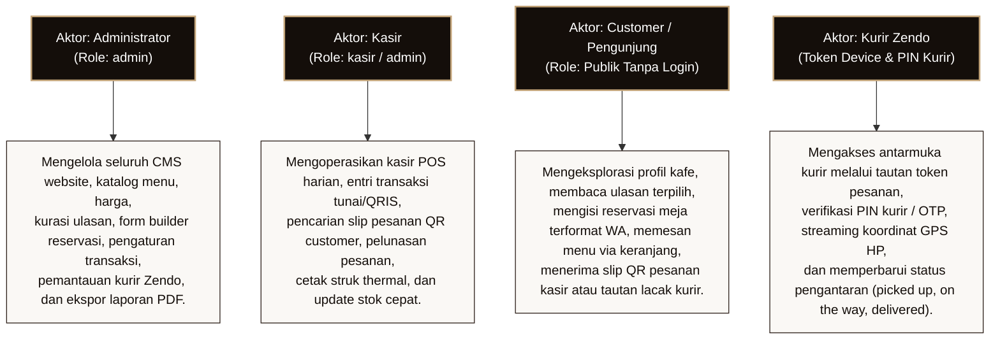

# DOKUMENTASI SISTEM INFORMASI WEBSITE NUCOMU CAFE
**Mata Pelajaran:** Rekayasa Perangkat Lunak (SMK RPL)  
**Proyek:** Sistem Informasi & Transaksi Pemesanan Nucomu Cafe & Roastery  
**Lokasi Fisik:** Jl. Mayor Sujadi, Manggisan, Plosokandang, Kec. Kedungwaru, Kabupaten Tulungagung, Jawa Timur 66221  
**Status Repositori:** Publik (tanpa rahasia, kunci kredensial dituliskan nama variabel lingkungannya)  
**Cabang Kerja Acuan:** `fitur-menu-navbar` (Basis commit `8b8edba` / `9c83edc`)

---

## 1. Pendahuluan dan Ringkasan Eksekutif

Nucomu Cafe adalah sistem informasi berbasis web yang mengintegrasikan profil interaktif kafe (*company profile*), katalog menu digital dengan pilihan varian dan tingkat kemanisan, sistem kurasi ulasan pelanggan, modul pemesanan multi-jalur (*multi-channel ordering*), sistem reservasi tempat berbasis pembangun formulir (*form builder*), manajemen kasir terpadu (*Point of Sale* / POS), hingga pelacakan pengantaran pesanan secara langsung (*live GPS courier tracking*) oleh armada internal Kurir Zendo.

Dokumen ini disusun sebagai panduan rancangan dan analisis sistem bagi siswa SMK Rekayasa Perangkat Lunak (RPL). Seluruh isi dokumen ditelusuri secara ketat dari berkas kode sumber (*source code*), konfigurasi, relasi basis data, migrasi, rute (*routes*), dan pengontrol (*controllers*) yang benar-benar ada di dalam repositori proyek, tanpa spekulasi maupun rekayasa fungsi.

---

## 2. Status Sinkronisasi Cabang (*Branch Tracking*)

Dokumen ini disusun berdasarkan status cabang aktif saat ini: **`fitur-menu-navbar`**.

> [!NOTE]
> **Status Integrasi Kode `origin/main`:**  
> Berdasarkan hasil pemeriksaan penelusuran riwayat Git (`git log origin/main..fitur-menu-navbar`), cabang `fitur-menu-navbar` dibuat langsung dari cabang utama `main` pada commit `8b8edba` (setelah penggabungan fitur hero redesign, grabfood, dan dynamic settings). Oleh karena itu:
> 1. Modul **Dashboard Grafik Keuangan 7 Hari, 4 Minggu, dan 12 Bulan** (`App\Http\Controllers\Admin\DashboardController`).
> 2. Modul **Ekspor Rekapitulasi Transaksi PDF 1.4 Native** (`App\Support\TransactionReportPdfGenerator`).
> 3. Modul **Workspace Kasir POS** (`/kasir` via `App\Http\Controllers\KasirController`).
> 4. Modul **Sinkronisasi Ulasan Google Maps & Website** (`NucomuController::getCombinedReviews`).
> 
> Seluruh fitur di atas **SUDAH TERINTEGRASI PENUH** pada cabang ini dan didokumentasikan di dalam dokumen utama. Dokumen ini juga menandai rute atau bagian kode yang bersifat eksperimental atau belum tersambung secara operasional (*dead code / incomplete route*).

---

## 3. Identifikasi Aktor Sistem

Berdasarkan struktur autentikasi, middleware (`AdminMiddleware`, `KasirMiddleware`), pengontrol sesi, serta model `User`, sistem Nucomu Cafe memiliki 4 (empat) aktor manusia dengan batasan akses yang terpisah tegas:



### Rincian Peran dan Otorisasi Aktor:

1. **Administrator (Admin)**
   - **Mekanisme Masuk:** Login melalui rute `/admin/login`.
   - **Kredensial:** Alamat email dan password yang terdaftar di tabel `users` dengan atribut `role = 'admin'`.
   - **Pengamanan Sesi:** Dilindungi oleh `AdminMiddleware`, sesi server Laravel, serta *persistent cookie* bertanda tangan HMAC SHA-256 (`nucomu_admin_auth_v1`, masa aktif 30 hari).
   - **Cakupan Akses:** Dashboard metrik harian, grafik penjualan, pengelolaan banner promo, cerita Tentang Kafe (*Our Story*), fasilitas kafe, katalog menu dan kategori, galeri foto, kurasi ulasan/testimoni (*pin / unpin / toggle active / delete*), manajemen reservasi meja dan perancang formulir (*form builder*), manajemen transaksi pesanan (ubah status, batalkan, cetak ulang struk, ekspor PDF/CSV rekapitulasi penjualan), scanner kamera slip QR pesanan kasir, armada kurir Zendo & tarif jarak, profil admin (ganti nama, email, avatar, password), pengaturan kontak/medsos/jam operasional, dan pusat notifikasi.

2. **Kasir (Cashier)**
   - **Mekanisme Masuk:** Login melalui rute `/kasir/login`.
   - **Kredensial:** Akun khusus kasir (`kasir@nucomu.com`) atau akun admin yang memiliki hak operasional kasir (`role = 'kasir'` atau `role = 'admin'`).
   - **Pengamanan Sesi:** Dilindungi oleh `KasirMiddleware`, sesi `kasir_authenticated = true`, serta *persistent signed cookie* (`nucomu_kasir_auth_v2`, masa aktif 1 tahun / 525.600 menit).
   - **Cakupan Akses:** Workspace POS kasir (`/kasir`), melihat daftar menu dan kategori secara visual, memperbarui jumlah stok fisik per menu, melayani pesanan langsung di meja (*dine-in*) atau bungkus (*take-away*), memindai dan mencari pesanan pelanggan berdasarkan kode pesanan `NCM-xxx` dari slip QR, mengubah status pembayaran menjadi lunas, mengubah status pesanan (`processing`, `ready`, `completed`), dan mencetak struk kasir format thermal 58mm/80mm (`/kasir/pesanan/{order}/struk`).

3. **Customer / Pengunjung Web**
   - **Mekanisme Masuk:** Tanpa login / publik (*guest*). Setiap pengguna internet dapat langsung mengakses.
   - **Cakupan Akses:** Menjelajahi halaman beranda responsif, melihat banner promo aktif, membaca filosofi kafe dan fasilitas, menelusuri katalog menu dengan filter kategori dan pencarian, memilih varian/opsi sajian, memasukkan item ke keranjang belanja lokal (*cart drawer*), melakukan checkout dengan 3 mode transaksi (Makan di Cafe dengan QR slip kasir, Antar via Chat WhatsApp Zendo, atau Antar dengan Pelacakan Langsung Zendo), mengirimkan ulasan baru beserta foto, mengisi formulir reservasi meja, dan membuka pelacakan pesanan publik.

4. **Kurir Zendo (Zendo Courier)**
   - **Mekanisme Masuk:** Mengakses tautan unik berbasis token dari URL pesanan pengantaran (`/zendo/kurir/{token}` atau `/zendo/lacak/{token}?k={courier_token}`).
   - **Kredensial & Otorisasi:** Bukan merupakan baris di tabel `users`, melainkan divalidasi melalui nomor telepon kurir yang terdaftar di konfigurasi/pengaturan Zendo, verifikasi PIN rahasia kurir (default `1234` atau sesuai `Setting::get('zendo_courier_pin')`), dan pengikatan perangkat (*device binding*) menggunakan cookie `zendo_courier_device` (`ZendoTrackingController::DEVICE_COOKIE`).
   - **Cakupan Akses:** Membuka lembar kerja pengantaran kurir, melihat rute dari kafe ke alamat pelanggan, melakukan *streaming* koordinat GPS perangkat kurir ke server secara berkala (*heartbeat GPS*), melewati pemeriksaan sistem anti-*fake* GPS (*speed threshold, service radius, accuracy limit*), serta memperbarui tahapan status pengantaran dari *assigned*, *picked_up*, *on_the_way*, *almost_done*, hingga *delivered*.

---

## 4. Entitas Eksternal (*External Entities*)

Sistem Nucomu Cafe berkomunikasi dengan 5 (lima) entitas eksternal di luar batas sistem aplikasi:

1. **WhatsApp Web / WhatsApp Application (`wa.me` & Gateway API)**
   - **Tipe Interaksi:** Komunikasi keluar (*outbound messaging*).
   - **Fungsi:** 
     * Menerima kiriman draf pesanan berformat rapi dari pelanggan ke nomor resmi WhatsApp Zendo saat mode Antar Chat Zendo aktif.
     * Menerima draf rincian formulir reservasi meja dari pelanggan ke nomor WhatsApp reservasi kafe.
     * Melakukan pengiriman otomatis (*auto-dispatch*) via Fonnte API (`https://api.fonnte.com/send`) menggunakan token lingkungan `NUCOMU_ZENDO_WA_API_TOKEN` untuk meneruskan tautan pelacakan GPS ke WhatsApp kurir dan customer.

2. **Google Maps & Places API**
   - **Tipe Interaksi:** Tautan antarmuka dan konsumsi REST API.
   - **Fungsi:** 
     * Menyematkan peta rute dan titik lokasi kafe pada halaman kontak dan footer.
     * Mengambil ulasan autentik secara berkala melalui Google Places Details API (`https://maps.googleapis.com/maps/api/place/details/json`) menggunakan `GOOGLE_PLACES_API_KEY` dan `GOOGLE_PLACE_ID` yang di-cache selama 6 jam untuk disandingkan dengan ulasan internal website.

3. **Penyedia Layanan QRIS (Statis/Dinamis Gambar)**
   - **Tipe Interaksi:** Penyajian dokumen visual pembayaran.
   - **Fungsi:** Menampilkan citra kode QRIS resmi Nucomu Cafe (`qris_image` yang diunggah admin di tabel `settings`) saat customer memilih pembayaran QRIS pada pesanan makan di kafe.

4. **GrabFood Marketplace**
   - **Tipe Interaksi:** Tautan rujukan eksternal (*outbound referral link*).
   - **Fungsi:** Mengarahkan pelanggan yang ingin memesan melalui aplikasi pihak ketiga GrabFood melalui tombol resmi di navigasi, footer, dan kartu info kontak.

5. **Kamera Perangkat / Barcode Scanner Fisik**
   - **Tipe Interaksi:** Masukan visual perangkat keras (*hardware input*).
   - **Fungsi:** Memindai kode QR pada slip pesanan pelanggan (`/qr/pesanan/{code}`) yang ditampilkan pada layar ponsel pelanggan untuk membuka halaman detail transaksi di komputer kasir secara instan.

---

## 5. Ringkasan Basis Data & Penyimpanan (*Data Stores*)

Sistem Nucomu Cafe menggunakan basis data relasional MySQL/MariaDB dengan 17 tabel data utama yang didaftarkan sebagai Data Store (D1 s/d D17):

| No. Store | Nama Tabel Sebenarnya | Kategori Entitas | Deskripsi & Kegunaan Utama |
| :---: | :--- | :--- | :--- |
| **D1** | `users` | Autentikasi | Menyimpan data akun pengguna dengan peran `admin`, `kasir`, dan `user`, password ter-hash bcrypt, email unik, dan foto avatar. |
| **D2** | `categories` | Master Menu | Menyimpan kelompok menu makanan/minuman, slug URL unik, deskripsi, urutan tampilan, dan status aktif. |
| **D3** | `menus` | Master Menu | Menyimpan data menu makanan, minuman, dan dessert, harga satuan, stok fisik, foto sajian, status ketersediaan, status featured/best seller, serta soft deletes. |
| **D4** | `menu_options` | Relasi Menu | Menyimpan opsi varian sajian (misal: Dingin/Panas), tingkat kemanisan (*sugar level*), dan pilihan tambahan (*extra add-on*) per menu dalam bentuk JSON. |
| **D5** | `tables` | Operasional | Menyimpan daftar meja kafe, nomor meja unik, kapasitas kursi, posisi/lokasi (indoor, outdoor, lantai dua, teras), dan status keterisian meja. |
| **D6** | `orders` | Transaksi | Menyimpan data induk transaksi pesanan kafe (kode unik `NCM-xxx`, nama pemesan, tipe order dine-in/takeaway, status transaksi, status bayar, subtotal, ongkir, total, form data koordinat JSON). |
| **D7** | `order_items` | Transaksi | Menyimpan rincian item baris pesanan yang dipesan per transaksi, menu_id, jumlah kuantitas (*qty*), harga satuan pada saat transaksi, subtotal baris, dan opsi varian JSON. |
| **D8** | `reservations` | Reservasi | Menyimpan pengajuan reservasi meja pelanggan, nama pemesan, nomor HP, tanggal kedatangan, jam, jumlah tamu, catatan, status (pending/confirmed/completed/cancelled), dan seluruh jawaban formulir dinamis JSON. |
| **D9** | `reservation_fields` | Form Builder | Menyimpan struktur kolom dinamis formulir reservasi yang diatur admin (kunci kolom `field_key`, label, tipe data: text/tel/date/time/number/textarea/photo/checkbox, placeholder, opsi JSON, dan status wajib). |
| **D10** | `settings` | Konfigurasi | Tabel kunci-nilai (*key-value*) serbaguna untuk seluruh pengaturan dinamis kafe: narasi About, kontak, WhatsApp, koordinat GPS kafe, mode transaksi 3 jalur, tarif Zendo, PIN kurir, dan riwayat notifikasi terbaca. |
| **D11** | `operating_hours` | Konfigurasi | Menyimpan jadwal operasional kafe untuk 7 hari dalam sepekan (0=Minggu s/d 6=Sabtu), jam buka, jam tutup, dan status libur/tutup harian. |
| **D12** | `facilities` | Konten Web | Menyimpan kartu fasilitas penunjang kafe (Indoor ber-AC, Outdoor, Musala, Toilet), badge, ikon material, deskripsi naratif, fitur pelengkap JSON, dan koleksi foto carousel slider JSON. |
| **D13** | `gallery_items` | Konten Web | Menyimpan koleksi visual galeri kafe, judul foto, kategori (suasana, makanan, minuman, kegiatan/event), path berkas foto di server, keterangan (*caption*), urutan, dan status tampil. |
| **D14** | `testimonials` | Ulasan | Menyimpan ulasan dan testimoni pelanggan dari website, nama pengulas, rating bintang (1-5), isi komentar ulasan, foto ulasan opsional, sumber (`website`), status aktif, dan tanda sematan (*is_pinned*). |
| **D15** | `events` | Konten Web | Menyimpan informasi agenda, promo tematik, atau kegiatan khusus kafe, judul kegiatan, slug, deskripsi lengkap, banner kegiatan, tanggal mulai, dan tanggal selesai. |
| **D16** | `zendo_deliveries` | Logistik & GPS | Menyimpan rekaman pengantaran kurir Zendo per pesanan, token pelacakan pelanggan (`tracking_token`), token rahasia kurir (`courier_token`), nomor kurir, titik koordinat tujuan, koordinat kurir real-time, akurasi, kecepatan, riwayat jejak rute JSON, penghitung anomali fake-GPS, dan stempel waktu status. |
| **D17** | `banners` | Konten Web | Menyimpan data banner promo hero slider beranda, judul, subtitle, deskripsi, jenis media (image/video), layout_mode (poster/overlay/split), tautan tombol, status aktif, urutan, jadwal tayang mulai, dan jadwal selesai otomatis (*auto-expiry*). |

---

## 6. Arsitektur Teknologi dan Ekosistem

Aplikasi Nucomu Cafe dibangun di atas tumpukan teknologi modern:
- **Bahasa Pemrograman Backend:** PHP 8.5
- **Framework Aplikasi:** Laravel Framework (Arsitektur MVC - *Model View Controller*)
- **Penyimpanan Berkas Media Lokal:** Direktori publik `public/uploads/` (`banners`, `facilities`, `gallery`, `about`, `reviews`, `reservations`, `avatars`, `qris`).
- **Antarmuka Pengguna (Frontend):** Laravel Blade Template Engine, Tailwind CSS, Alpine.js, Vanilla JavaScript modern.
- **Peta Interaktif & Geospasial:** Leaflet.js dengan ubin peta OpenStreetMap (OSM) dan kalkulasi jarak rumus lengkung bumi (*Haversine Formula*).
- **Mesin Dokumen PDF:** Kompiler biner murni format PDF 1.4 buatan sendiri (`App\Support\TransactionReportPdfGenerator`), menghasilkan dokumen PDF rekapitulasi multi-halaman dengan tabel, ringkasan kartu metrik, dan pewarnaan tanpa membutuhkan pustaka eksternal seperti Dompdf atau TCPDF.
- **Pesan Instan:** Integrasi protokol WhatsApp URL (`https://wa.me/`) dan HTTP REST Client Fonnte API.

---

## 7. Struktur Dokumen dan Petunjuk Membaca Diagram

Rangkaian dokumentasi sistem ini dipecah ke dalam 6 (enam) berkas markdown terstruktur di folder `docs/dfd/`:
1. **`00-ringkasan-sistem.md`** (Berkas ini): Profil sistem, aktor, entitas eksternal, teknologi, dan daftar tabel.
2. **`01-diagram-berjenjang.md`**: Dekomposisi fungsional fitur berjenjang (*Functional Hierarchy Diagram*) dari tingkat sistem induk hingga fitur terkecil per aktor (Admin, Kasir, Customer, Kurir).
3. **`02-dfd.md`**: Diagram Alir Data (*Data Flow Diagram*) menggunakan notasi Gane-Sarson yang konsisten, meliputi Diagram Konteks, DFD Level 0, dan DFD Level 1 untuk seluruh modul utama.
4. **`03-algoritma.md`**: Algoritma alur penggunaan terinci untuk seluruh proses penting (dilengkapi langkah pengguna, pseudocode IF-ELSE, flowchart standar, dan tabel operasi baca/tulis basis data).
5. **`04-kamus-data.md`**: Kamus data teknis untuk setiap tabel basis data (nama kolom, tipe data, indeks, kunci utama, kunci asing, dan aturan integritas).
6. **`05-penelusuran.md`**: Matriks penelusuran (*traceability matrix*) yang menghubungkan kode hierarki fitur, rute URL, pengontrol, view Blade, tabel database, serta daftar temuan fitur setengah jadi.

### Cara Menampilkan dan Mengunduh Diagram Mermaid:
Seluruh diagram dalam dokumen ini ditulis menggunakan format diagram berbasis kode **Mermaid** di dalam blok ```mermaid.
- **Di GitHub / GitLab:** Dokumen `.md` akan otomatis merender grafik Mermaid menjadi diagram visual interaktif yang rapi.
- **Di Visual Studio Code:** Pasang ekstensi *Markdown Preview Mermaid Support* atau *Markdown Preview Enhanced* untuk melihat pratinjau diagram langsung di editor.
- **Mengunduh sebagai Gambar (PNG/SVG/PDF):** Salin kode di dalam blok ```mermaid lalu tempelkan ke editor daring resmi di **[mermaid.live](https://mermaid.live)** untuk langsung mengunduh diagram dalam format PNG beresolusi tinggi atau berkas vektor SVG.
