# DIAGRAM BERJENJANG SISTEM INFORMASI NUCOMU CAFE
**Tingkat Analisis:** Dekomposisi Fungsional Sistem (*Functional Decomposition Diagram / Hierarchy Chart*)  
**Notasi:** Bagan Dekomposisi Berjenjang Terstruktur (*Top-Down Functional Breakdown*)  
**Acuan Kode:** Seluruh Pengontrol (*Controllers*), Middleware, Rute Web, Tampilan Blade, dan Model

---

## 1. Konsep dan Aturan Penomoran Hierarki

Diagram berjenjang memetakan struktur fungsional sistem dari tingkat induk (*root system*), kemudian diturunkan ke masing-masing aktor operasional, modul utama, sub-modul, hingga aksi/fitur terkecil yang dapat dijalankan pada antarmuka pengguna.

### Format Penomoran Node:
- **Tingkat 0 (0.0):** Sistem Informasi Website Nucomu Cafe (Induk).
- **Tingkat 1 (X.0):** Modul Peran Aktor (1.0 Admin, 2.0 Kasir, 3.0 Customer, 4.0 Kurir Zendo).
- **Tingkat 2 (X.Y):** Modul Fungsional Spesifik (misal: 1.2 Hero & Banner, 1.4 Menu & Kategori, 3.5 Pemesanan & Checkout).
- **Tingkat 3 (X.Y.Z):** Fitur Operasional / Sub-modul (misal: 1.2.1 Tambah Banner, 1.4.4 Hapus Menu dengan Proteksi).
- **Tingkat 4 (X.Y.Z.W):** Rincian Aksi Terkecil (misal: 1.2.1.1 Validasi Rasio Landscape 1600px, 1.4.4.1 Tolak Jika Ada Riwayat Transaksi).

Setiap diagram dibatasi maksimal sekitar 25–30 kotak agar tetap proporsional dan mudah dibaca pada layar maupun hasil cetak. Diagram induk ringkasan disajikan di awal, diikuti diagram pecahan terperinci untuk masing-masing modul.

---

## 2. Diagram Induk Dekomposisi Sistem

Diagram induk berikut menggambarkan percabangan dari Sistem Informasi Nucomu Cafe ke 4 (empat) aktor utama dan kelompok modul operasional di bawahnya.

#### Gambar 1.1 Diagram Induk Dekomposisi Fungsional Sistem Nucomu Cafe

```mermaid
flowchart TB
    classDef root fill:#140E0A,stroke:#C2A378,stroke-width:3px,color:#FFFFFF;
    classDef actor fill:#2A1D17,stroke:#C2A378,stroke-width:2px,color:#FFFFFF;
    classDef mod fill:#E7DED1,stroke:#2A1D17,stroke-width:1px,color:#140E0A;

    SYS["0.0 SISTEM INFORMASI WEBSITE NUCOMU CAFE"]:::root

    ACT_ADM["1.0 Modul Administrator<br>(Manajemen Pusat)"]:::actor
    ACT_KSR["2.0 Modul Kasir<br>(Point of Sale / POS)"]:::actor
    ACT_CUST["3.0 Modul Customer<br>(Web Pelanggan)"]:::actor
    ACT_KRR["4.0 Modul Kurir Zendo<br>(Logistik & GPS)"]:::actor

    SYS --> ACT_ADM
    SYS --> ACT_KSR
    SYS --> ACT_CUST
    SYS --> ACT_KRR

    %% Admin Submodules
    M_ADM_1["1.1 Dashboard & Grafik"]:::mod
    M_ADM_2["1.2 Hero & Banner Promo"]:::mod
    M_ADM_3["1.3 Konten Profil & Media"]:::mod
    M_ADM_4["1.4 Menu & Kategori"]:::mod
    M_ADM_5["1.5 Kurasi Ulasan/Pin"]:::mod
    M_ADM_6["1.6 Reservasi & Form Builder"]:::mod
    M_ADM_7["1.7 Transaksi & Scanner Slip"]:::mod
    M_ADM_8["1.8 Armada Kurir Zendo"]:::mod
    M_ADM_9["1.9 Profil, Notif & Setting"]:::mod

    ACT_ADM --> M_ADM_1
    ACT_ADM --> M_ADM_2
    ACT_ADM --> M_ADM_3
    ACT_ADM --> M_ADM_4
    ACT_ADM --> M_ADM_5
    ACT_ADM --> M_ADM_6
    ACT_ADM --> M_ADM_7
    ACT_ADM --> M_ADM_8
    ACT_ADM --> M_ADM_9

    %% Kasir Submodules
    M_KSR_1["2.1 Login & Sesi Kasir"]:::mod
    M_KSR_2["2.2 Katalog POS & Order Langsung"]:::mod
    M_KSR_3["2.3 Lookup & Validasi Slip QR"]:::mod
    M_KSR_4["2.4 Pelunasan, Struk & Stok"]:::mod

    ACT_KSR --> M_KSR_1
    ACT_KSR --> M_KSR_2
    ACT_KSR --> M_KSR_3
    ACT_KSR --> M_KSR_4

    %% Customer Submodules
    M_CST_1["3.1 Beranda, Profil & Fasilitas"]:::mod
    M_CST_2["3.2 Katalog Menu & Pilihan Varian"]:::mod
    M_CST_3["3.3 Form Ulasan & Unggah Foto"]:::mod
    M_CST_4["3.4 Reservasi Meja Dinamis"]:::mod
    M_CST_5["3.5 Keranjang & Checkout 3 Mode"]:::mod
    M_CST_6["3.6 Slip Pesanan & Lacak Live"]:::mod

    ACT_CUST --> M_CST_1
    ACT_CUST --> M_CST_2
    ACT_CUST --> M_CST_3
    ACT_CUST --> M_CST_4
    ACT_CUST --> M_CST_5
    ACT_CUST --> M_CST_6

    %% Kurir Submodules
    M_KRR_1["4.1 Verifikasi PIN & Device Binding"]:::mod
    M_KRR_2["4.2 Streaming Koordinat GPS"]:::mod
    M_KRR_3["4.3 Deteksi Anti-Fake GPS"]:::mod
    M_KRR_4["4.4 Perubahan Status Pengantaran"]:::mod

    ACT_KRR --> M_KRR_1
    ACT_KRR --> M_KRR_2
    ACT_KRR --> M_KRR_3
    ACT_KRR --> M_KRR_4
```

---

## 3. Diagram Berjenjang Rinci Administrator

Karena modul administrator memiliki fungsi yang sangat luas, diagram berjenjang untuk Admin dipecah menjadi 3 sub-diagram tematik:

### 3.1 Diagram Berjenjang Admin Bagian 1: Dashboard, Banner, dan Konten Profil

Mencakup modul Analisis Dashboard (1.1), Hero Section & Banner Promo (1.2), dan Konten Profil Kafe (1.3).

#### Gambar 1.2 Diagram Berjenjang Admin - Bagian 1 (Dashboard, Banner, Konten Profil)

```mermaid
flowchart TB
    classDef actor fill:#2A1D17,stroke:#C2A378,stroke-width:2px,color:#FFFFFF;
    classDef mod fill:#C2A378,stroke:#2A1D17,stroke-width:1px,color:#FFFFFF;
    classDef submod fill:#E7DED1,stroke:#2A1D17,stroke-width:1px,color:#140E0A;
    classDef leaf fill:#FAF8F5,stroke:#8C7E74,stroke-width:1px,color:#140E0A;

    ADM["1.0 Modul Administrator"]:::actor

    M11["1.1 Dashboard & Analitik"]:::mod
    M12["1.2 Hero & Banner Promo"]:::mod
    M13["1.3 Konten Profil Kafe"]:::mod

    ADM --> M11
    ADM --> M12
    ADM --> M13

    %% 1.1 Dashboard
    F111["1.1.1 Pantau 4 Metrik Utama<br>(Omzet, Pesanan, Pending, Menu)"]:::submod
    F112["1.1.2 Grafik Penjualan Interaktif<br>(Harian 7 Hari, 4 Minggu, 12 Bulan)"]:::submod
    F113["1.1.3 Menu Terlaris<br>(Top 5 Berdasarkan Kuantitas & Omzet)"]:::submod
    F114["1.1.4 Saklar Visibilitas Grafik<br>(Toggle Show/Hide Chart)"]:::submod

    M11 --> F111
    M11 --> F112
    M11 --> F113
    M11 --> F114

    %% 1.2 Hero & Banner
    F121["1.2.1 Tambah Banner Baru"]:::submod
    F122["1.2.2 Jadwal & Hitung Mundur<br>(Start Time, End Time & Auto Expired)"]:::submod
    F123["1.2.3 Perpanjang Masa Tayang<br>(Extend Duration Pilihan Jam/Hari)"]:::submod
    F124["1.2.4 Operasional Banner<br>(Edit, Hapus Berkas, Toggle Aktif)"]:::submod
    F125["1.2.5 Deteksi Notifikasi 30 Menit<br>(Check Expiring Banner API)"]:::submod

    M12 --> F121
    M12 --> F122
    M12 --> F123
    M12 --> F124
    M12 --> F125

    L121["1.2.1.1 Validasi Media<br>(Foto Landscape Min 1600px / Video MP4)"]:::leaf
    L122["1.2.1.2 Mode Layout<br>(Poster, Overlay, Split Layout)"]:::leaf
    F121 --> L121
    F121 --> L122

    %% 1.3 Konten Profil
    F131["1.3.1 Our Story / Tentang Kafe<br>(Headline, Narasi, Kutipan, Video/Foto)"]:::submod
    F132["1.3.2 Fasilitas Kafe<br>(Multi-Foto, Fitur, Ikon, Toggle, Reorder)"]:::submod
    F133["1.3.3 Galeri Foto<br>(Upload Foto, Kategori, Caption, Toggle)"]:::submod
    F134["1.3.4 Event & Agenda<br>(Judul, Tanggal, Poster, Deskripsi)"]:::submod

    M13 --> F131
    M13 --> F132
    M13 --> F133
    M13 --> F134
```

---

### 3.2 Diagram Berjenjang Admin Bagian 2: Menu, Kategori, Ulasan, dan Reservasi

Mencakup modul Katalog Menu & Kategori (1.4), Kurasi Ulasan/Testimoni (1.5), serta Reservasi Meja & Form Builder (1.6).

#### Gambar 1.3 Diagram Berjenjang Admin - Bagian 2 (Menu, Kategori, Ulasan, Reservasi)

```mermaid
flowchart TB
    classDef actor fill:#2A1D17,stroke:#C2A378,stroke-width:2px,color:#FFFFFF;
    classDef mod fill:#C2A378,stroke:#2A1D17,stroke-width:1px,color:#FFFFFF;
    classDef submod fill:#E7DED1,stroke:#2A1D17,stroke-width:1px,color:#140E0A;
    classDef leaf fill:#FAF8F5,stroke:#8C7E74,stroke-width:1px,color:#140E0A;

    ADM["1.0 Modul Administrator"]:::actor

    M14["1.4 Menu & Kategori"]:::mod
    M15["1.5 Kurasi Ulasan"]:::mod
    M16["1.6 Reservasi & Form Builder"]:::mod

    ADM --> M14
    ADM --> M15
    ADM --> M16

    %% 1.4 Menu & Kategori
    F141["1.4.1 Kelola Kategori Menu"]:::submod
    F142["1.4.2 Tambah & Edit Menu<br>(Foto Kotak 1:1, Harga, Stok Awal 25)"]:::submod
    F143["1.4.3 Kendali Stok & Tampilan<br>(Toggle Ketersediaan, Featured, Best Seller)"]:::submod
    F144["1.4.4 Hapus Menu Berproteksi"]:::submod

    M14 --> F141
    M14 --> F142
    M14 --> F143
    M14 --> F144

    L141["1.4.1.1 Tolak Hapus Kategori<br>Jika Masih Berisi Menu"]:::leaf
    L142["1.4.4.1 Tolak Hapus Permanen<br>Jika Menu Pernah Dipesan (Soft Delete)"]:::leaf
    L143["1.4.4.2 Pulihkan Menu (Restore)"]:::leaf
    F141 --> L141
    F144 --> L142
    F144 --> L143

    %% 1.5 Kurasi Ulasan
    F151["1.5.1 Filter & Pencarian Ulasan<br>(Semua, Pinned, Unpinned, Rating 1-5)"]:::submod
    F152["1.5.2 Sematkan Ulasan (Pin)<br>(Otomatis Tampil di Beranda)"]:::submod
    F153["1.5.3 Lepas Sematan (Unpin)"]:::submod
    F154["1.5.4 Sembunyikan Ulasan (Toggle Active)"]:::submod
    F155["1.5.5 Hapus Ulasan Spam & Foto"]:::submod
    F156["1.5.6 Hapus Massal Data Contoh"]:::submod

    M15 --> F151
    M15 --> F152
    M15 --> F153
    M15 --> F154
    M15 --> F155
    M15 --> F156

    %% 1.6 Reservasi & Form Builder
    F161["1.6.1 Pantau Daftar Reservasi<br>(Filter Pending, Confirmed, Completed, Cancel)"]:::submod
    F162["1.6.2 Ubah Status & Hapus Reservasi"]:::submod
    F163["1.6.3 Atur Nomor WhatsApp Tujuan"]:::submod
    F164["1.6.4 Form Builder Kustom"]:::submod

    M16 --> F161
    M16 --> F162
    M16 --> F163
    M16 --> F164

    L161["1.6.4.1 Tambah Kolom Baru<br>(Teks, Tel, Tanggal, Jam, Angka, Area, Foto, Checkbox)"]:::leaf
    L162["1.6.4.2 Atur Wajib/Opsional, Urutan, Toggle Aktif"]:::leaf
    F164 --> L161
    F164 --> L162
```

---

### 3.3 Diagram Berjenjang Admin Bagian 3: Transaksi, Scanner, Kurir Zendo, dan Pengaturan

Mencakup modul Transaksi & Rekapitulasi (1.7), Pengelolaan Kurir Zendo (1.8), serta Profil & Pengaturan Sistem (1.9).

#### Gambar 1.4 Diagram Berjenjang Admin - Bagian 3 (Transaksi, Kurir, Pengaturan)

```mermaid
flowchart TB
    classDef actor fill:#2A1D17,stroke:#C2A378,stroke-width:2px,color:#FFFFFF;
    classDef mod fill:#C2A378,stroke:#2A1D17,stroke-width:1px,color:#FFFFFF;
    classDef submod fill:#E7DED1,stroke:#2A1D17,stroke-width:1px,color:#140E0A;
    classDef leaf fill:#FAF8F5,stroke:#8C7E74,stroke-width:1px,color:#140E0A;

    ADM["1.0 Modul Administrator"]:::actor

    M17["1.7 Transaksi & Scanner"]:::mod
    M18["1.8 Logistik & Kurir Zendo"]:::mod
    M19["1.9 Profil & Pengaturan"]:::mod

    ADM --> M17
    ADM --> M18
    ADM --> M19

    %% 1.7 Transaksi
    F171["1.7.1 Konfigurasi 3 Mode Transaksi"]:::submod
    F172["1.7.2 Sub-Pengaturan Pembayaran<br>(Opsi Tunai & QRIS, Upload Gambar QRIS)"]:::submod
    F173["1.7.3 Template Chat WA Zendo Dinamis<br>(Edit Format Pesan & Tombol Reset)"]:::submod
    F174["1.7.4 Operasional Pesanan<br>(Filter, Cari Kode NCM, Ubah Status, Cetak Struk)"]:::submod
    F175["1.7.5 Ekspor Laporan Rekap Transaksi<br>(PDF Native 1.4, Print View, CSV/Excel)"]:::submod
    F176["1.7.6 Pemindai Kamera Slip QR Kasir"]:::submod

    M17 --> F171
    M17 --> F172
    M17 --> F173
    M17 --> F174
    M17 --> F175
    M17 --> F176

    L171["1.7.1.1 Aturan Saling Mengunci<br>(Tracking ON -> Chat Otomatis OFF)"]:::leaf
    L172["1.7.1.2 Mode Semua OFF<br>(Keranjang Dinonaktifkan di Web)"]:::leaf
    F171 --> L171
    F171 --> L172

    %% 1.8 Kurir Zendo
    F181["1.8.1 Kelola Daftar & Nomor Kurir<br>(Tambah, Hapus, Edit Nomor WA Kurir)"]:::submod
    F182["1.8.2 Konfigurasi Tarif Ongkir<br>(Tier 0-3km, 3-4km, ..., Tambahan/km)"]:::submod
    F183["1.8.3 Pemantauan Perangkat Terhubung<br>(Pantau Device Token & Status GPS)"]:::submod
    F184["1.8.4 Cabut Akses / Reset Device Kurir"]:::submod

    M18 --> F181
    M18 --> F182
    M18 --> F183
    M18 --> F184

    %% 1.9 Profil & Pengaturan
    F191["1.9.1 Profil Administrator<br>(Nama, Email, Upload/Hapus Avatar, Ganti Password)"]:::submod
    F192["1.9.2 Pusat Notifikasi & Pesan<br>(Agregasi Banner, Order, Reservasi, Review, Tandai Baca)"]:::submod
    F193["1.9.3 Pusat Bantuan & Manual Penggunaan<br>(Panduan 9 Modul & FAQ Sekolah)"]:::submod
    F194["1.9.4 Kontak, Sosmed & Jam Operasional<br>(WA Resmi, Maps Embed, GrabFood, Jadwal Buka)"]:::submod

    M19 --> F191
    M19 --> F192
    M19 --> F193
    M19 --> F194
```

---

## 4. Diagram Berjenjang Kasir (Point of Sale)

Mencakup seluruh alur kerja operasional kasir harian di rute `/kasir`.

#### Gambar 1.5 Diagram Berjenjang Kasir (Workspace Kasir POS)

```mermaid
flowchart TB
    classDef actor fill:#2A1D17,stroke:#C2A378,stroke-width:2px,color:#FFFFFF;
    classDef mod fill:#C2A378,stroke:#2A1D17,stroke-width:1px,color:#FFFFFF;
    classDef submod fill:#E7DED1,stroke:#2A1D17,stroke-width:1px,color:#140E0A;
    classDef leaf fill:#FAF8F5,stroke:#8C7E74,stroke-width:1px,color:#140E0A;

    KSR["2.0 Modul Kasir (POS)"]:::actor

    M21["2.1 Autentikasi Kasir"]:::mod
    M22["2.2 Katalog & Entri Pesanan POS"]:::mod
    M23["2.3 Lookup Slip QR Pesanan"]:::mod
    M24["2.4 Pelunasan, Struk & Stok"]:::mod

    KSR --> M21
    KSR --> M22
    KSR --> M23
    KSR --> M24

    %% 2.1 Autentikasi
    F211["2.1.1 Login Kasir Password<br>(Akun kasir@nucomu.com / Admin)"]:::submod
    F212["2.1.2 Sesi Cookie 1 Tahun<br>(nucomu_kasir_auth_v2 HMAC Token)"]:::submod
    F213["2.1.3 Logout Kasir & Hapus Sesi"]:::submod
    M21 --> F211
    M21 --> F212
    M21 --> F213

    %% 2.2 Katalog & Entri POS
    F221["2.2.1 Tampilan Grid Menu & Kategori"]:::submod
    F222["2.2.2 Entri Pesanan Meja / Takeaway"]:::submod
    F223["2.2.3 Pilihan Pembayaran Tunai / QRIS"]:::submod
    F224["2.2.4 Simpan Transaksi & Generate Kode NCM"]:::submod
    M22 --> F221
    M22 --> F222
    M22 --> F223
    M22 --> F224

    %% 2.3 Lookup Slip QR
    F231["2.3.1 Scan Barcode / Input Kode Slip"]:::submod
    F232["2.3.2 Ambil Rincian Item & Total Pelanggan"]:::submod
    F233["2.3.3 Verifikasi Meja & Identitas Pemesan"]:::submod
    M23 --> F231
    M23 --> F232
    M23 --> F233

    %% 2.4 Pelunasan, Struk, Stok
    F241["2.4.1 Konfirmasi Pelunasan (Lunas)"]:::submod
    F242["2.4.2 Ubah Status Pesanan<br>(Processing, Ready, Completed, Cancel)"]:::submod
    F243["2.4.3 Cetak Struk Kasir Thermal (58/80mm)"]:::submod
    F244["2.4.4 Pembaruan Stok Cepat Menu (+/- Stok)"]:::submod
    F245["2.4.5 Sinkronisasi Data Real-Time (Polling JSON)"]:::submod
    M24 --> F241
    M24 --> F242
    M24 --> F243
    M24 --> F244
    M24 --> F245
```

---

## 5. Diagram Berjenjang Customer / Pengunjung Web

Mencakup seluruh interaksi pelanggan mulai dari eksplorasi informasi beranda, katalog menu, ulasan, reservasi, keranjang belanja, hingga checkout multi-jalur dan pelacakan kurir.

#### Gambar 1.6 Diagram Berjenjang Customer (Web Publik)

```mermaid
flowchart TB
    classDef actor fill:#2A1D17,stroke:#C2A378,stroke-width:2px,color:#FFFFFF;
    classDef mod fill:#C2A378,stroke:#2A1D17,stroke-width:1px,color:#FFFFFF;
    classDef submod fill:#E7DED1,stroke:#2A1D17,stroke-width:1px,color:#140E0A;
    classDef leaf fill:#FAF8F5,stroke:#8C7E74,stroke-width:1px,color:#140E0A;

    CUST["3.0 Modul Customer"]:::actor

    M31["3.1 Eksplorasi Profil Kafe"]:::mod
    M32["3.2 Katalog Menu & Pilihan"]:::mod
    M33["3.3 Ulasan & Pengalaman"]:::mod
    M34["3.4 Reservasi Meja Dinamis"]:::mod
    M35["3.5 Keranjang & Checkout"]:::mod
    M36["3.6 Pelacakan Pesanan"]:::mod

    CUST --> M31
    CUST --> M32
    CUST --> M33
    CUST --> M34
    CUST --> M35
    CUST --> M36

    %% 3.1 Profil
    F311["3.1.1 Lihat Banner Promo & Video Hero"]:::submod
    F312["3.1.2 Baca Our Story & Filosofi Kafe"]:::submod
    F313["3.1.3 Jelajahi Fasilitas (AC, Outdoor, Musala, Toilet)"]:::submod
    F314["3.1.4 Buka Rute Peta Google Maps & Jam Buka"]:::submod
    F315["3.1.5 Tautan Sosmed (Instagram, TikTok, GrabFood)"]:::submod
    M31 --> F311
    M31 --> F312
    M31 --> F313
    M31 --> F314
    M31 --> F315

    %% 3.2 Menu
    F321["3.2.1 Telusuri Menu per Kategori Tab"]:::submod
    F322["3.2.2 Buka Detail Menu & Pilihan Opsi<br>(Penyajian Panas/Dingin, Sugar Level, Extra)"]:::submod
    M32 --> F321
    M32 --> F322

    %% 3.3 Ulasan
    F331["3.3.1 Baca Ulasan Pilihan (Google & Web)"]:::submod
    F332["3.3.2 Kirim Ulasan Baru (Rating, Teks, Upload Foto)"]:::submod
    M33 --> F331
    M33 --> F332

    %% 3.4 Reservasi
    F341["3.4.1 Buka Modal / Halaman Reservasi"]:::submod
    F342["3.4.2 Isi Formulir Sesuai Form Builder"]:::submod
    F343["3.4.3 Buka WhatsApp dengan Draf Terformat"]:::submod
    M34 --> F341
    M34 --> F342
    M34 --> F343

    %% 3.5 Keranjang & Checkout
    F351["3.5.1 Tambah ke Keranjang Belanja"]:::submod
    F352["3.5.2 Mode 1: Makan di Kafe (Dine In)"]:::submod
    F353["3.5.3 Mode 2: Antar via Chat WA Zendo"]:::submod
    F354["3.5.4 Mode 3: Antar Pelacakan Langsung"]:::submod
    M35 --> F351
    M35 --> F352
    M35 --> F353
    M35 --> F354

    L351["3.5.2.1 Pilih Tunai/QRIS -> Dapatkan Slip QR Kasir"]:::leaf
    L352["3.5.3.1 Hitung Ongkir Flat -> Buka Chat WA Kurir"]:::leaf
    L353["3.5.4.1 Pilih Pin Peta -> Hitung Jarak & Ongkir GPS"]:::leaf
    F352 --> L351
    F353 --> L352
    F354 --> L353

    %% 3.6 Pelacakan
    F361["3.6.1 Lacak Status Kode Pesanan NCM"]:::submod
    F362["3.6.2 Buka Peta Live Tracking Kurir Zendo"]:::submod
    M36 --> F361
    M36 --> F362
```

---

## 6. Diagram Berjenjang Kurir Zendo

Mencakup modul pengantaran kurir Zendo dari otentikasi PIN perangkat hingga pengiriman koordinat GPS dan pembaruan status logistik.

#### Gambar 1.7 Diagram Berjenjang Kurir Zendo (Logistik & GPS Workspace)

```mermaid
flowchart TB
    classDef actor fill:#2A1D17,stroke:#C2A378,stroke-width:2px,color:#FFFFFF;
    classDef mod fill:#C2A378,stroke:#2A1D17,stroke-width:1px,color:#FFFFFF;
    classDef submod fill:#E7DED1,stroke:#2A1D17,stroke-width:1px,color:#140E0A;
    classDef leaf fill:#FAF8F5,stroke:#8C7E74,stroke-width:1px,color:#140E0A;

    KRR["4.0 Modul Kurir Zendo"]:::actor

    M41["4.1 Autentikasi & Akses Kurir"]:::mod
    M42["4.2 Rute & Peta Pengantaran"]:::mod
    M43["4.3 Pengiriman GPS & Anti-Fake"]:::mod
    M44["4.4 Pembaruan Tahapan Antar"]:::mod

    KRR --> M41
    KRR --> M42
    KRR --> M43
    KRR --> M44

    %% 4.1 Autentikasi
    F411["4.1.1 Buka Tautan Token Kurir<br>(/zendo/kurir/{token} atau ?k=...)"]:::submod
    F412["4.1.2 Verifikasi PIN Kurir (4 Digit) / OTP"]:::submod
    F413["4.1.3 Pengikatan Perangkat (Cookie zendo_courier_device)"]:::submod
    F414["4.1.4 Keluar / Putus Sambungan (Unbind Device)"]:::submod
    M41 --> F411
    M41 --> F412
    M41 --> F413
    M41 --> F414

    %% 4.2 Peta
    F421["4.2.1 Tampilkan Titik Lokasi Kafe"]:::submod
    F422["4.2.2 Tampilkan Titik Koordinat Pelanggan"]:::submod
    F423["4.2.3 Panduan Navigasi & Telepon Pelanggan"]:::submod
    M42 --> F421
    M42 --> F422
    M42 --> F423

    %% 4.3 Streaming GPS & Anti-Fake
    F431["4.3.1 Streaming Koordinat GPS HP Berkala"]:::submod
    F432["4.3.2 Validasi Batas Kecepatan (Max 45 m/s)"]:::submod
    F433["4.3.3 Validasi Akurasi Sinyal (Max 150m)"]:::submod
    F434["4.3.4 Validasi Radius Layanan (Max 40km)"]:::submod
    F435["4.3.5 Sistem Penguncian GPS Lock Jika Anomali"]:::submod
    M43 --> F431
    M43 --> F432
    M43 --> F433
    M43 --> F434
    M43 --> F435

    %% 4.4 Status
    F441["4.4.1 Status: Ditugaskan (Assigned)"]:::submod
    F442["4.4.2 Status: Mengambil Pesanan (Picked Up)"]:::submod
    F443["4.4.3 Status: Dalam Perjalanan (On The Way)"]:::submod
    F444["4.4.4 Status: Mendekati Lokasi (Almost Done)"]:::submod
    F445["4.4.5 Status: Selesai Diantar (Delivered)"]:::submod
    M44 --> F441
    M44 --> F442
    M44 --> F443
    M44 --> F444
    M44 --> F445
```

