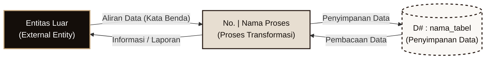
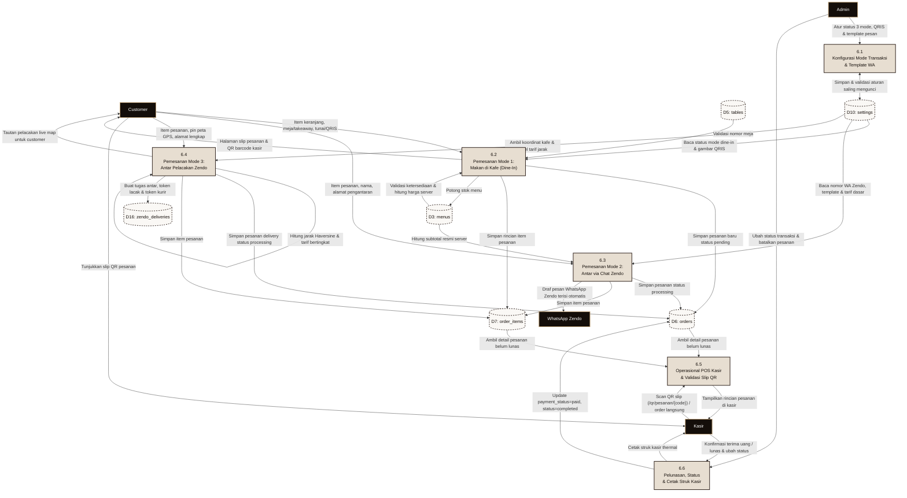
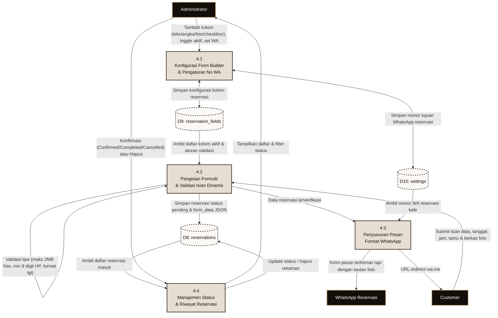
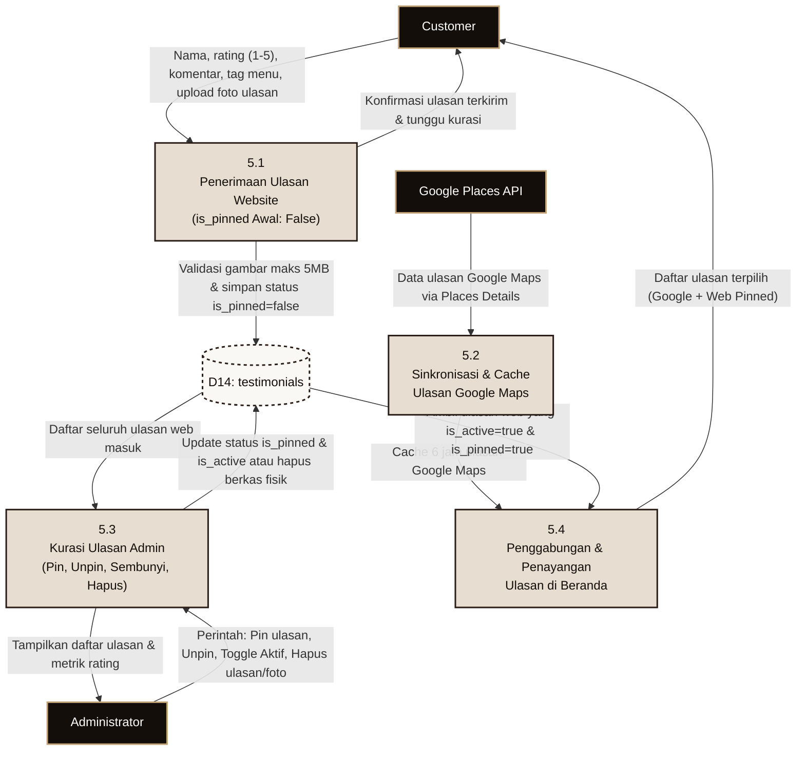
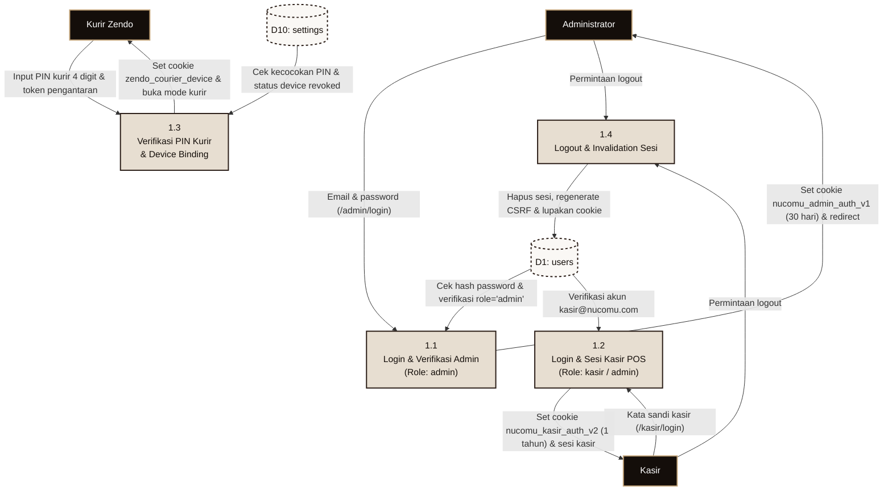
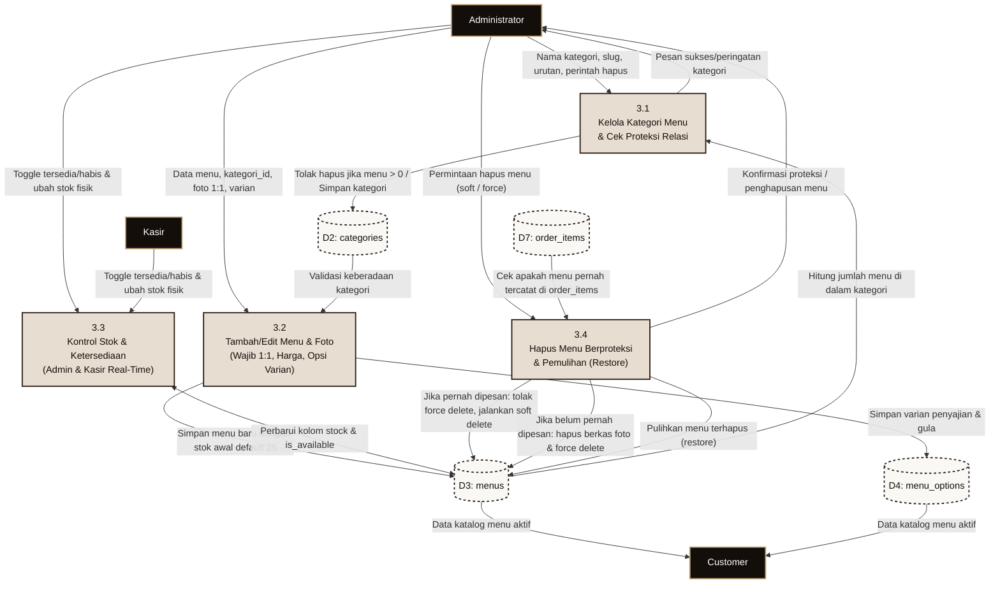
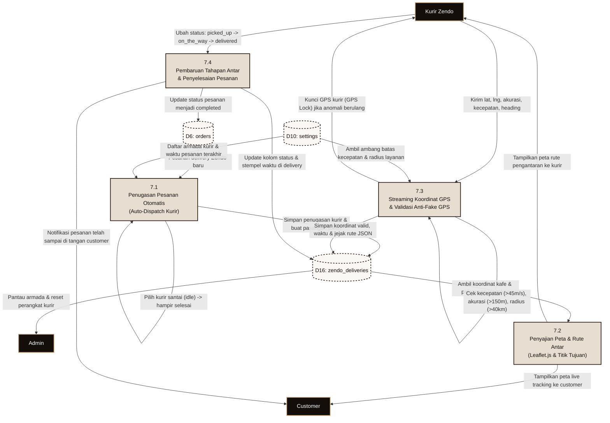

# DIAGRAM ALIR DATA (DATA FLOW DIAGRAM - DFD)
**Sistem:** Sistem Informasi & Transaksi Pemesanan Nucomu Cafe & Roastery  
**Notasi Standar:** Gane dan Sarson (*Gane-Sarson Diagramming Standard*)  
**Konsistensi:** Tingkat Konteks, DFD Level 0, dan DFD Level 1 Seimbang (*Balanced DFD*)

---

## 1. Notasi Gane-Sarson dan Legenda Simbol

Dokumen ini menggunakan notasi **Gane dan Sarson** secara konsisten di seluruh diagram alir data.

### Legenda Komponen:
1. **Entitas Luar (*External Entity*):** Persegi panjang dengan batas tegas warna gelap. Menggambarkan asal sumber data masukan atau tujuan akhir informasi (Admin, Kasir, Customer, Kurir Zendo, WhatsApp API/Web, Google Places API, Layanan QRIS, Perangkat Scanner).
2. **Proses (*Process*):** Persegi panjang dengan sudut tumpul (*rounded rectangle*) yang memuat nomor hierarki proses dan kata kerja aktif. Mengubah data masukan menjadi keluaran.
3. **Penyimpanan Data (*Data Store*):** Simbol penyimpanan data bernomor urut `D1` s/d `D17` yang **menggunakan nama tabel fisik sebenarnya** di basis data MySQL/MariaDB Nucomu Cafe.
4. **Aliran Data (*Data Flow*):** Garis panah berarah yang wajib dinamai dengan frasa kata benda (misalnya: *kredensial login, data pesanan, draf pesan WhatsApp, koordinat GPS*).

### Aturan Ketat DFD yang Dipenuhi:
- **Keseimbangan Aliran (*Balancing*):** Setiap aliran data yang masuk dan keluar dari proses pada tingkat yang lebih tinggi (Diagram Konteks & Level 0) konsisten dipecah secara rinci pada proses turunan Level 1.
- **Tidak Ada Jalur Langsung Ilegal:** Tidak ada aliran data langsung dari Entitas Luar ke Entitas Luar lain, maupun dari Data Store ke Data Store lain tanpa melalui proses pengolahan.
- **Tanpa Lubang Hitam (*Black Hole*) atau Keajaiban (*Miracle*):** Setiap proses memiliki minimal satu aliran masukan (*input*) dan satu aliran keluaran (*output*).
- **Integritas Penulisan Data Store:** Seluruh tabel database memiliki proses yang menulis (*write/create/update*) dan membaca (*read*).

---

## 2. Diagram Konteks (DFD Level 0 Tingkat Sistem)

Diagram Konteks memposisikan sistem secara utuh sebagai satu proses tunggal bernomor `0` dan memperlihatkan seluruh interaksi data dengan entitas luar di sekelilingnya.

#### Gambar 2.1 Diagram Konteks Sistem Informasi Nucomu Cafe

```mermaid
flowchart TB
    classDef ent fill:#140E0A,stroke:#C2A378,stroke-width:2px,color:#FFFFFF;
    classDef sys fill:#E7DED1,stroke:#2A1D17,stroke-width:3px,color:#140E0A;

    SYS["0<br>SISTEM INFORMASI WEBSITE NUCOMU CAFE"]:::sys

    E_ADM["Administrator (Admin)"]:::ent
    E_KSR["Kasir (Cashier)"]:::ent
    E_CST["Customer / Pengunjung"]:::ent
    E_KRR["Kurir Zendo"]:::ent
    E_WA["WhatsApp Web / Gateway API"]:::ent
    E_GMP["Google Maps & Places API"]:::ent
    E_QRIS["Layanan QRIS Kafe"]:::ent
    E_SCN["Perangkat Scanner / Kamera HP"]:::ent

    %% Admin flows
    E_ADM -->|"Kredensial login, kelola konten, menu, harga, banner, kurasi ulasan, form builder, konfigurasi transaksi"| SYS
    SYS -->|"Dashboard analitik, grafik omzet, status notifikasi, data pesanan, rekapitulasi laporan PDF"| E_ADM

    %% Kasir flows
    E_KSR -->|"Kredensial kasir, entri pesanan langsung, update stok, kode slip pesanan, konfirmasi pembayaran lunas"| SYS
    SYS -->|"Tampilan katalog POS, rincian pesanan hasil scan QR, struk thermal kasir, data sinkronisasi"| E_KSR

    %% Customer flows
    E_CST -->|"Permintaan halaman, input ulasan & foto, isian formulir reservasi, data keranjang & checkout 3 mode"| SYS
    SYS -->|"Tampilan katalog & varian, ulasan terkurasi, slip QR pesanan kasir, tautan peta live tracking"| E_CST

    %% Kurir flows
    E_KRR -->|"Token akses kurir, PIN verifikasi, streaming koordinat GPS kurir, pembaruan tahapan pengantaran"| SYS
    SYS -->|"Rute alamat antar pelanggan, panduan koordinat, status verifikasi perangkat, peringatan GPS Lock"| E_KRR

    %% WhatsApp flows
    SYS -->|"Draf pesan pesanan Zendo terformat, draf reservasi meja terstruktur, payload kirim Fonnte API"| E_WA

    %% Google Places flows
    E_GMP -->|"Payload JSON ulasan bintang 5 & komentar pengunjung Google Maps"| SYS
    SYS -->|"Permintaan HTTP Place Details dengan Place ID & API Key"| E_GMP

    %% QRIS flows
    SYS -->|"Citra QRIS resmi kafe dari tabel settings"| E_QRIS

    %% Scanner flows
    E_SCN -->|"Hasil pembacaan scan QR kode pesanan NCM-xxx"| SYS
```

---

## 3. DFD Level 0 (Proses-Proses Utama Sistem)

DFD Level 0 memecah proses induk `0` menjadi 9 (sembilan) proses utama bernomor `1.0` hingga `9.0`, terhubung ke 17 tabel data store sebenarnya (`D1` s/d `D17`).

#### Gambar 2.2 DFD Level 0 Sistem Informasi Nucomu Cafe

```mermaid
flowchart TB
    classDef ent fill:#140E0A,stroke:#C2A378,stroke-width:2px,color:#FFFFFF;
    classDef proc fill:#E7DED1,stroke:#2A1D17,stroke-width:2px,color:#140E0A;
    classDef store fill:#FAF8F5,stroke:#2A1D17,stroke-width:2px,stroke-dasharray: 4 4,color:#140E0A;

    %% Entitas
    E_ADM["Administrator"]:::ent
    E_KSR["Kasir"]:::ent
    E_CST["Customer"]:::ent
    E_KRR["Kurir Zendo"]:::ent
    E_WA["WhatsApp API/Web"]:::ent
    E_GMP["Google Places API"]:::ent

    %% Proses Utama
    P1["1.0<br>Autentikasi & Sesi Pengguna"]:::proc
    P2["2.0<br>Kelola Konten & Tampilan Web"]:::proc
    P3["3.0<br>Kelola Menu, Kategori & Stok"]:::proc
    P4["4.0<br>Kelola Reservasi & Form Builder"]:::proc
    P5["5.0<br>Kelola Ulasan & Testimoni"]:::proc
    P6["6.0<br>Transaksi Pemesanan & Kasir"]:::proc
    P7["7.0<br>Logistik & Pelacakan Kurir"]:::proc
    P8["8.0<br>Pusat Notifikasi & Pesan"]:::proc
    P9["9.0<br>Laporan & Analitik Penjualan"]:::proc

    %% Data Stores
    D1[("D1: users")]:::store
    D2[("D2: categories")]:::store
    D3[("D3: menus")]:::store
    D4[("D4: menu_options")]:::store
    D5[("D5: tables")]:::store
    D6[("D6: orders")]:::store
    D7[("D7: order_items")]:::store
    D8[("D8: reservations")]:::store
    D9[("D9: reservation_fields")]:::store
    D10[("D10: settings")]:::store
    D11[("D11: operating_hours")]:::store
    D12[("D12: facilities")]:::store
    D13[("D13: gallery_items")]:::store
    D14[("D14: testimonials")]:::store
    D15[("D15: events")]:::store
    D16[("D16: zendo_deliveries")]:::store
    D17[("D17: banners")]:::store

    %% 1.0 Autentikasi
    E_ADM -->|"Email & password"| P1
    E_KSR -->|"Kata sandi kasir"| P1
    E_KRR -->|"PIN kurir & device token"| P1
    P1 <-->|"Cek akun & simpan token cookie"| D1
    P1 <-->|"Verifikasi PIN kurir & token perangkat"| D10
    P1 -->|"Sesi admin aktif"| E_ADM
    P1 -->|"Sesi kasir aktif (1 thn)"| E_KSR
    P1 -->|"Mode kurir aktif"| E_KRR

    %% 2.0 Konten Web
    E_ADM -->|"Input banner, about, fasilitas, galeri, event, jam"| P2
    P2 -->|"Tulis banner promo"| D17
    P2 -->|"Tulis narasi about & kontak"| D10
    P2 -->|"Tulis jadwal buka"| D11
    P2 -->|"Tulis fasilitas & foto slider"| D12
    P2 -->|"Tulis galeri & caption"| D13
    P2 -->|"Tulis event kafe"| D15
    D17 & D10 & D11 & D12 & D13 & D15 -->|"Baca konten aktif"| P2
    P2 -->|"Tampilan profil beranda"| E_CST

    %% 3.0 Menu & Kategori
    E_ADM -->|"Data kategori & menu baru"| P3
    E_KSR -->|"Update stok fisik cepat"| P3
    P3 <-->|"Kelola kategori & cek relasi menu"| D2
    P3 <-->|"Simpan menu, foto, harga, stok, soft delete"| D3
    P3 <-->|"Simpan varian & level gula"| D4
    D7 -->|"Cek apakah menu pernah dipesan"| P3
    P3 -->|"Katalog menu publik"| E_CST
    P3 -->|"Daftar menu POS kasir"| E_KSR

    %% 4.0 Reservasi
    E_ADM -->|"Kelola kolom form builder & no WA"| P4
    P4 <-->|"Simpan/baca struktur form"| D9
    E_CST -->|"Isian formulir reservasi"| P4
    P4 -->|"Simpan reservasi status pending"| D8
    P4 -->|"Format draf pesan WA"| E_WA
    D8 -->|"Daftar reservasi masuk"| P4
    P4 -->|"Konfirmasi status reservasi"| E_ADM

    %% 5.0 Ulasan
    E_CST -->|"Form ulasan baru & foto"| P5
    E_GMP -->|"Ulasan Google Maps"| P5
    P5 -->|"Simpan ulasan website (unpinned)"| D14
    D14 -->|"Daftar kurasi ulasan"| P5
    E_ADM -->|"Aksi pin, unpin, sembunyikan, hapus"| P5
    P5 -->|"Update status is_pinned & is_active"| D14
    P5 -->|"Tampilkan ulasan pinned di beranda"| E_CST

    %% 6.0 Transaksi & Kasir
    E_CST -->|"Checkout keranjang 3 mode"| P6
    E_KSR -->|"Entri pesanan langsung & konfirmasi lunas"| P6
    D3 -->|"Ambil harga resmi & potong stok"| P6
    D5 -->|"Pilih meja kafe"| P6
    D10 -->|"Ambil mode transaksi, QRIS & tarif"| P6
    P6 -->|"Simpan data pesanan"| D6
    P6 -->|"Simpan item pesanan"| D7
    P6 -->|"Kirim data pengiriman"| P7
    P6 -->|"Slip QR kasir"| E_CST
    P6 -->|"Draf WA pesanan Zendo"| E_WA
    P6 -->|"Cetak struk kasir thermal"| E_KSR

    %% 7.0 Kurir Zendo
    P6 -->|"Buat tugas antar baru"| P7
    E_KRR -->|"Kirim koordinat GPS & ubah status antar"| P7
    P7 <-->|"Simpan token, koordinat, jejak rute, status"| D16
    P7 -->|"Data posisi live map"| E_CST
    P7 -->|"Panduan rute & tujuan"| E_KRR

    %% 8.0 Notifikasi
    D17 & D8 & D6 & D14 -->|"Agregasi kejadian kafe"| P8
    P8 <-->|"Simpan kunci notifikasi terbaca"| D10
    P8 -->|"Daftar notifikasi & polling badge"| E_ADM

    %% 9.0 Laporan
    D6 & D7 -->|"Rekap data transaksi harian/mingguan/bulanan"| P9
    D10 -->|"Pengaturan visibilitas grafik"| P9
    P9 -->|"Grafik analitik dashboard & unduh PDF 1.4"| E_ADM
```

---

## 4. DFD Level 1 Sub-Proses Transaksi, Pemesanan & Kasir (Proses 6.0)

Sub-proses 6.0 adalah jantung operasional komersial kafe. Sub-proses ini mengelola 3 mode pemesanan pelanggan, perhitungan harga dan stok di server, penerbitan slip QR, operasional kasir POS, pelunasan, hingga cetak struk thermal.

#### Gambar 2.3 DFD Level 1 Proses 6.0 (Transaksi, Pemesanan, Kasir & Scanner Slip)

---

## 5. DFD Level 1 Sub-Proses Reservasi & Form Builder (Proses 4.0)

Sub-proses 4.0 mengelola pembangun formulir kustom oleh admin, pengisian formulir oleh pelanggan, validasi multi-tipe (termasuk unggah foto), penyimpanan basis data, dan penerusan format ke WhatsApp.

#### Gambar 2.4 DFD Level 1 Proses 4.0 (Reservasi Meja & Form Builder)

---

## 6. DFD Level 1 Sub-Proses Ulasan & Testimoni Pelanggan (Proses 5.0)

Sub-proses 5.0 mengatur penerimaan ulasan dari publik website, integrasi ulasan Google Maps, penyaringan kurasi oleh administrator (*pinning system*), dan penayangan ulasan terpilih ke beranda.

#### Gambar 2.5 DFD Level 1 Proses 5.0 (Ulasan & Testimoni Pelanggan)

---

## 7. DFD Level 1 Sub-Proses Autentikasi, Sesi & Otorisasi (Proses 1.0)

Sub-proses 1.0 mengamankan akses sistem untuk 3 peran yang membutuhkan hak khusus (Admin, Kasir, dan Kurir Zendo).

#### Gambar 2.6 DFD Level 1 Proses 1.0 (Autentikasi & Sesi Pengguna)

---

## 8. DFD Level 1 Sub-Proses Menu, Kategori & Stok (Proses 3.0)

Sub-proses 3.0 mengatur pengelolaan kategori, menu, varian, dan aturan ketat perlindungan data (pencegahan penghapusan jika ada relasi atau riwayat transaksi).

#### Gambar 2.7 DFD Level 1 Proses 3.0 (Katalog Menu, Kategori & Kontrol Stok)

---

## 9. DFD Level 1 Sub-Proses Logistik & Pelacakan Kurir Zendo (Proses 7.0)

Sub-proses 7.0 menangani siklus pengantaran kurir Zendo secara langsung (*live tracking*), verifikasi keamanan GPS (*anti fake-GPS*), dan pemantauan jarak koordinat.

#### Gambar 2.8 DFD Level 1 Proses 7.0 (Logistik & Pelacakan Kurir Zendo)

