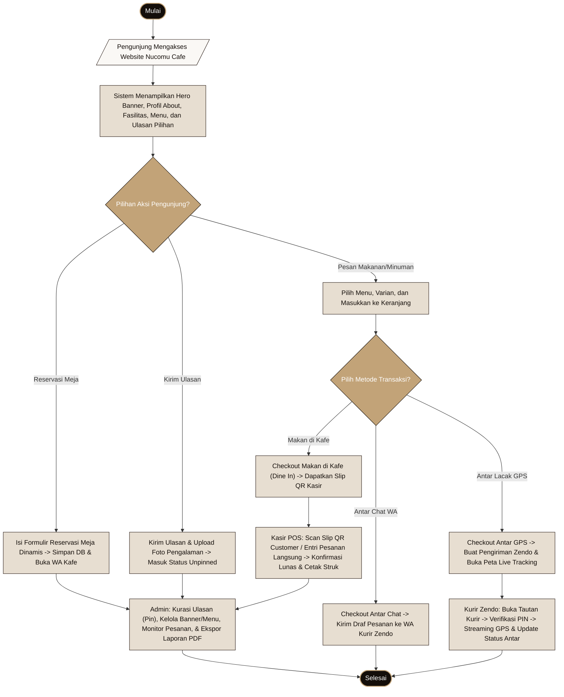
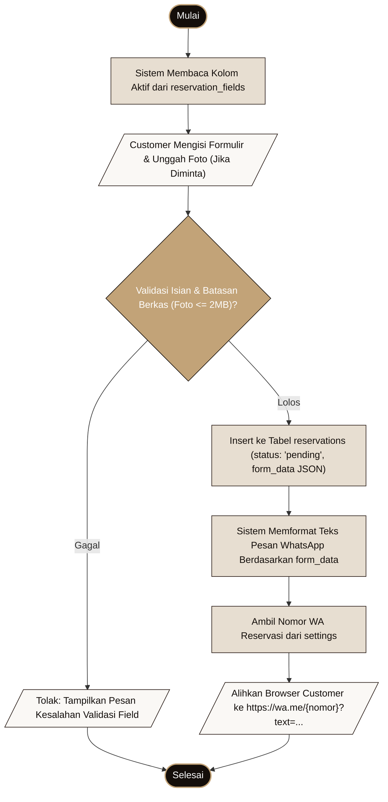
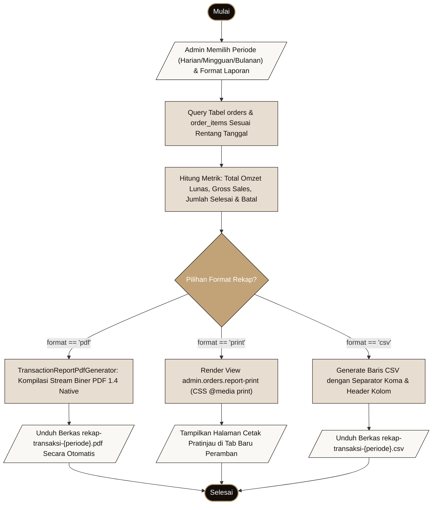

# ALGORITMA ALUR PENGGUNAAN SISTEM INFORMASI NUCOMU CAFE
**Standar Analisis:** Algoritma Prosedural, Pseudocode Terstruktur, Flowchart Standar, dan Matriks Operasi Basis Data  
**Kelengkapan:** Mencakup 4 Komponen Wajib untuk Setiap Alur (Langkah Pengguna, Pseudocode, Flowchart, Tabel Operasi Data)  
**Acuan Implementasi:** Seluruh Berkas Controller, Model, Middleware, dan Helper Proyek

---

## 0. Algoritma Keseluruhan Sistem (Tingkat Tinggi)

Flowchart berikut menyajikan gambaran umum siklus hidup operasional sistem, mulai dari interaksi pelanggan di beranda publik hingga pengelolaan kasir dan administrasi terpusat.

#### Gambar 3.0 Flowchart Algoritma Keseluruhan Sistem Nucomu Cafe


---

## 1. Alur Autentikasi: Login Admin, Login Kasir, Logout, dan Pengecekan Sesi

### 1.1 Langkah Penggunaan dari Sudut Pandang Pengguna
1. **Untuk Admin:** Buka `/admin/login`. Masukkan alamat email dan password admin. Klik "Masuk ke Dashboard". Jika email dan password benar dan peran adalah `admin`, sistem mengarahkan ke `/admin/dashboard`. Jika akun memiliki peran `kasir`, sistem otomatis mengalihkannya ke workspace kasir `/kasir`. Jika peran bukan admin/kasir, akses ditolak.
2. **Untuk Kasir:** Buka `/kasir/login`. Kasir cukup memasukkan kata sandi kasir (default `password123` untuk akun bawaan `kasir@nucomu.com`). Klik tombol masuk. Jika benar, sistem membuat *cookie* sesi 1 tahun dan masuk ke `/kasir`.
3. **Untuk Logout:** Klik tombol "Keluar" di sidebar admin atau header kasir. Sesi dimusnahkan dan pengguna dikembalikan ke halaman login masing-masing.

### 1.2 Pseudocode Logika Autentikasi
```text
ALGORITMA LoginAdmin(email, password):
    VALIDASI email (wajib, format email) DAN password (wajib)
    JIKA validasi gagal MAKA:
        KEMBALIKAN pesan error validasi formulir
    AKHIR JIKA

    JIKA Auth::attempt(email, password) BERHASIL MAKA:
        user = Auth::user()
        JIKA user.role == 'kasir' MAKA:
            RegenerateSession()
            SetSession('kasir_authenticated', true)
            KasirController::queueAuthCookie(user)
            REDIRECT ke route('kasir.index')
        LAIN JIKA user.role != 'admin' MAKA:
            Auth::logout()
            KEMBALIKAN error 'Akun Anda tidak memiliki akses admin.'
        LAIN:
            RegenerateSession()
            token = GenerateHMAC('nucomu_admin|' + user.id + '|' + user.email, APP_KEY)
            SetCookie('nucomu_admin_auth_v1', user.id + '|' + token, masa_berlaku=30_hari)
            REDIRECT ke route('admin.dashboard')
        AKHIR JIKA
    LAIN:
        KEMBALIKAN error 'Email atau password salah.'
    AKHIR JIKA
AKHIR ALGORITMA

ALGORITMA LoginKasir(password):
    VALIDASI password (wajib)
    user = User::where('email', 'kasir@nucomu.com')->first()
    JIKA user DAN Hash::check(password, user.password) MAKA:
        RegenerateSession()
        SetSession('kasir_authenticated', true)
        token = GenerateHMAC(user.id + '|' + user.email + '|' + user.password, APP_KEY)
        SetCookie('nucomu_kasir_auth_v2', user.id + '|' + token, masa_berlaku=365_hari)
        REDIRECT ke route('kasir.index')
    LAIN:
        KEMBALIKAN error 'Kata sandi kasir yang Anda masukkan salah.'
    AKHIR JIKA
AKHIR ALGORITMA
```

### 1.3 Flowchart Autentikasi & Pengecekan Sesi
#### Gambar 3.1 Flowchart Autentikasi Pengguna
```mermaid
flowchart TD
    classDef startEnd fill:#140E0A,stroke:#C2A378,stroke-width:2px,color:#FFFFFF;
    classDef process fill:#E7DED1,stroke:#2A1D17,stroke-width:1px,color:#140E0A;
    classDef decision fill:#C2A378,stroke:#140E0A,stroke-width:1px,color:#FFFFFF;
    classDef io fill:#FAF8F5,stroke:#2A1D17,stroke-width:1px,color:#140E0A;

    S1([Mulai: Pengguna Akses Halaman Login]):::startEnd
    IN1[/"Input Email & Password"/]:::io
    C1{"Periksa Kredensial via Auth::attempt?"}:::decision
    C2{"Periksa Nilai Kolom user.role?"}:::decision
    P_ERR1[/"Tolak: 'Email atau password salah.'/"]:::io
    P_ERR2[/"Tolak: 'Akun Anda tidak memiliki akses admin.'/"]:::io
    P_KASIR["Set Sesi Kasir & Pasang Cookie nucomu_kasir_auth_v2 (1 Tahun)"]:::process
    P_ADM["Set Sesi Admin & Pasang Cookie nucomu_admin_auth_v1 (30 Hari)"]:::process
    R_KASIR[/"Redirect ke /kasir (Workspace Kasir POS)"/]:::io
    R_ADM[/"Redirect ke /admin/dashboard"/]:::io
    E1([Selesai]):::startEnd

    S1 --> IN1 --> C1
    C1 -- Tidak --> P_ERR1 --> E1
    C1 -- Ya --> C2
    C2 -- "role == 'kasir'" --> P_KASIR --> R_KASIR --> E1
    C2 -- "role == 'user' (bukan admin)" --> P_ERR2 --> E1
    C2 -- "role == 'admin'" --> P_ADM --> R_ADM --> E1
```

### 1.4 Tabel Operasi Data Autentikasi
- **Berkas Kode:** `app/Http/Controllers/Admin/AuthController.php`, `app/Http/Controllers/KasirController.php`, `app/Http/Middleware/AdminMiddleware.php`, `app/Http/Middleware/KasirMiddleware.php`.
- **Rute HTTP:** `POST /admin/login` (`admin.login.post`), `POST /kasir/login` (`kasir.login.post`), `POST /admin/logout` (`admin.logout`), `POST /kasir/logout` (`kasir.logout`).

| Langkah | Tabel Terlibat | Kolom yang Dibaca | Kolom yang Ditulis (Cabang IYA) | Kolom yang Ditulis (Cabang TIDAK / Error) | Pesan Error yang Ditampilkan |
| :--- | :--- | :--- | :--- | :--- | :--- |
| **Login Admin** | `users` | `id`, `email`, `password`, `role` | Tidak menulis baris DB baru (hanya *session state* & cookie `nucomu_admin_auth_v1`) | Tidak ada penulisan data | *"Email atau password salah."* atau *"Akun Anda tidak memiliki akses admin."* |
| **Login Kasir** | `users` | `id`, `email`, `password`, `role` | Tidak menulis baris DB (set session `kasir_authenticated` & cookie `nucomu_kasir_auth_v2`) | Tidak ada penulisan data | *"Kata sandi kasir yang Anda masukkan salah."* |
| **Logout** | `sessions` | `id`, `payload` | Session di-invalidate, CSRF token di-regenerate, cookie dihapus | Tidak ada | Tidak ada |

---

## 2. Alur Hero Section & Banner Promo

### 2.1 Langkah Penggunaan dari Sudut Pandang Pengguna
1. **Tambah Banner:** Admin membuka `/admin/banner/tambah`. Mengisi Judul Banner, Subtitle (opsional), Deskripsi, memilih Tipe Media (*Image* atau *Video*), mengunggah berkas foto (wajib landscape minimal 1600px, format JPG/PNG/WebP, maks 5MB) atau video MP4 (maks 20MB), memilih Mode Layout (*Poster*, *Overlay*, atau *Split*), menentukan Tanggal & Jam Mulai (*start_time*) dan Tanggal & Jam Selesai (*end_time*), teks & link tombol CTA, serta urutan. Klik "Simpan Banner".
2. **Perpanjang Masa Tayang:** Pada kartu banner yang masa tayangnya hampir habis atau kedaluwarsa, admin mengklik tombol "Perpanjang", memilih opsi penambahan waktu (1 jam, 6 jam, 1 hari, 3 hari, atau custom), lalu menyimpan.
3. **Pemberitahuan Kadaluwarsa (30 Menit):** Sistem secara berkala menjalankan pengecekan latar belakang (`/admin/banner/expiring-check`). Jika ada banner yang akan kedaluwarsa dalam 30 menit ke depan, badge peringatan kuning berkedip ditampilkan di dashboard dan notifikasi.
4. **Penayangan di Beranda Pelanggan:** Saat pelanggan membuka beranda (`/`), sistem hanya merender banner yang memenuhi kriteria: `is_active = true`, `start_time <= WAKTU_SEKARANG`, dan `end_time >= WAKTU_SEKARANG`. Banner diurutkan berdasarkan `sort_order` lalu `id` terbaru.

### 2.2 Pseudocode Logika Banner
```text
ALGORITMA SimpanBanner(request):
    mediaType = request.input('media_type', 'image')
    JIKA mediaType == 'video' MAKA:
        ATURAN_MEDIA = 'required|file|mimes:mp4,webm,mov|max:20480'
    LAIN:
        ATURAN_MEDIA = 'required|file|mimes:jpeg,png,jpg,webp,gif|max:5120|min_width=1600|rasio=landscape'
    AKHIR JIKA

    VALIDASI request DENGAN:
        title (required|string|max:255),
        media_file (ATURAN_MEDIA),
        start_time (required|date),
        end_time (required|date|after_or_equal:start_time),
        layout_mode (in:poster,overlay,split)

    JIKA validasi gagal MAKA:
        KEMBALIKAN error validasi formulir dan batalkan penyimpanan
    AKHIR JIKA

    file = request.file('media_file')
    namaBerkas = 'banner_' + WAKTU_SEKARANG + '_' + AcakHex(4) + '.' + file.Ekstensi()
    PindahkanFile(file, 'public/uploads/banners/' + namaBerkas)

    Banner::create([
        'title' => request.title,
        'subtitle' => request.subtitle,
        'description' => request.description,
        'media_type' => mediaType,
        'media_path' => namaBerkas,
        'layout_mode' => request.layout_mode ?: 'poster',
        'start_time' => request.start_time,
        'end_time' => request.end_time,
        'button_text' => request.button_text ?: 'Pesan Sekarang',
        'button_link' => request.button_link ?: '#menu',
        'is_active' => request.boolean('is_active', true),
        'sort_order' => request.integer('sort_order', 0)
    ])
    REDIRECT route('admin.banners.index') dengan pesan sukses
AKHIR ALGORITMA
```

### 2.3 Flowchart Banner Promo & Logika Tampil
#### Gambar 3.2 Flowchart Penambahan & Penayangan Banner Promo
```mermaid
flowchart TD
    classDef startEnd fill:#140E0A,stroke:#C2A378,stroke-width:2px,color:#FFFFFF;
    classDef process fill:#E7DED1,stroke:#2A1D17,stroke-width:1px,color:#140E0A;
    classDef decision fill:#C2A378,stroke:#140E0A,stroke-width:1px,color:#FFFFFF;
    classDef io fill:#FAF8F5,stroke:#2A1D17,stroke-width:1px,color:#140E0A;

    S2([Mulai]):::startEnd
    IN2[/"Admin Unggah Berkas & Isi Jadwal Banner"/]:::io
    C_MEDIA{"Validasi Tipe & Dimensi Media?"}:::decision
    C_TIME{"Validasi end_time >= start_time?"}:::decision
    ERR_MED[/"Tolak: 'Ukuran minimal lebar 1600px landscape atau video > 20MB.'/"]:::io
    ERR_TIM[/"Tolak: 'Tanggal selesai harus sama atau setelah tanggal mulai.'/"]:::io
    SAVE_FILE["Simpan Berkas ke public/uploads/banners/"]:::process
    SAVE_DB["Insert Baris Baru ke Tabel banners"]:::process
    WEB_CHECK{"Pelanggan Buka Beranda: is_active && start <= now <= end?"}:::decision
    SHOW_SLIDE[/"Tampilkan Banner pada Slider Beranda"/]:::io
    HIDE_SLIDE["Sembunyikan Banner dari Beranda (Expired/Nonaktif)"]:::process
    E2([Selesai]):::startEnd

    S2 --> IN2 --> C_MEDIA
    C_MEDIA -- Gagal --> ERR_MED --> E2
    C_MEDIA -- Lolos --> C_TIME
    C_TIME -- Gagal --> ERR_TIM --> E2
    C_TIME -- Lolos --> SAVE_FILE --> SAVE_DB --> WEB_CHECK
    WEB_CHECK -- Ya --> SHOW_SLIDE --> E2
    WEB_CHECK -- Tidak --> HIDE_SLIDE --> E2
```

### 2.4 Tabel Operasi Data Banner Promo
- **Berkas Kode:** `app/Http/Controllers/Admin/BannerController.php`, `app/Models/Banner.php`.
- **Rute HTTP:** `GET /admin/banner` (`admin.banners.index`), `POST /admin/banner` (`admin.banners.store`), `POST /admin/banner/{banner}/perpanjang` (`admin.banners.extend`), `POST /admin/banner/{banner}/toggle` (`admin.banners.toggle`), `DELETE /admin/banner/{banner}` (`admin.banners.destroy`).

| Langkah | Tabel Terlibat | Kolom yang Dibaca | Kolom yang Ditulis (Cabang IYA) | Kolom yang Ditulis (Cabang TIDAK / Error) | Pesan Error yang Ditampilkan |
| :--- | :--- | :--- | :--- | :--- | :--- |
| **Simpan Banner** | `banners` | - | `title`, `subtitle`, `description`, `media_type`, `media_path`, `layout_mode`, `start_time`, `end_time`, `button_text`, `button_link`, `is_active`, `sort_order` | Tidak menulis ke DB; file fisik tidak disimpan | *"Ukuran foto minimal lebar 1600 piksel"* atau *"Tanggal selesai harus setelah tanggal mulai."* |
| **Perpanjang** | `banners` | `id`, `end_time` | `end_time` (ditambah X jam / X hari), `is_active = true` | Tidak ada | *"Durasi banner tidak valid."* |
| **Toggle Status** | `banners` | `id`, `is_active` | `is_active = !is_active` | Tidak ada | - |
| **Hapus Banner** | `banners` | `id`, `media_path` | Baris dihapus permanen (`DELETE`), berkas di `public/uploads/banners/` di-unlink | Tidak ada | - |

---

## 3. Alur Konten Profil: Tentang Kafe (About), Fasilitas, dan Galeri Foto

### 3.1 Langkah Penggunaan dari Sudut Pandang Pengguna
1. **Tentang Kafe (About):** Admin membuka `/admin/about`. Mengubah Label Kategori, Headline Cerita, Paragraf 1 (Filosofi), Paragraf 2 (Suasana), Kutipan (*quote*), tautan tombol, dan mengunggah video suasana MP4 atau foto baru. Klik "Simpan Perubahan". Sistem menyimpannya ke tabel `settings`.
2. **Fasilitas Kafe:** Admin membuka `/admin/fasilitas`. Menambah fasilitas baru (Indoor ber-AC, Outdoor, Musala, Toilet) dengan mengisi badge, ikon material, deskripsi, fitur-fitur checklist, serta mengunggah beberapa slide foto carousel (multi-foto). Mengurutkan kartu dengan tombol *reorder*.
3. **Galeri Visual:** Admin membuka `/admin/galeri`. Mengunggah foto suasana kafe, sajian kopi, makanan, atau event, memberi judul dan caption, serta memilih kategori galeri.

### 3.2 Pseudocode Logika Konten Profil
```text
ALGORITMA UpdateAbout(request):
    VALIDASI request:
        about_label (required), cafe_story_headline (required),
        cafe_story_p1 (required), media_type (in:image,video)
    JIKA validasi gagal MAKA KEMBALIKAN error formulir AKHIR JIKA

    JIKA request.hasFile('media_file') MAKA:
        HapusBerkasLamaJikaAda(Setting::get('about_media_path'))
        fileBaru = SimpanKe('public/uploads/about/')
        Setting::set('about_media_path', fileBaru)
    AKHIR JIKA

    Setting::set('about_label', request.about_label)
    Setting::set('cafe_story_headline', request.cafe_story_headline)
    Setting::set('cafe_story_p1', request.cafe_story_p1)
    Setting::set('cafe_story_p2', request.cafe_story_p2)
    Setting::set('about_quote', request.about_quote)
    Setting::set('about_button_text', request.about_button_text)
    Setting::set('about_button_link', request.about_button_link)
    Setting::set('about_media_type', request.media_type)
    REDIRECT route('admin.about.index')
AKHIR ALGORITMA
```

### 3.3 Flowchart Pengelolaan Fasilitas Kafe
#### Gambar 3.3 Flowchart Tambah/Edit Fasilitas Multi-Foto
```mermaid
flowchart TD
    classDef startEnd fill:#140E0A,stroke:#C2A378,stroke-width:2px,color:#FFFFFF;
    classDef process fill:#E7DED1,stroke:#2A1D17,stroke-width:1px,color:#140E0A;
    classDef decision fill:#C2A378,stroke:#140E0A,stroke-width:1px,color:#FFFFFF;
    classDef io fill:#FAF8F5,stroke:#2A1D17,stroke-width:1px,color:#140E0A;

    S3([Mulai]):::startEnd
    IN3[/"Admin Input Nama Fasilitas, Fitur & Unggah Foto-Foto"/]:::io
    C_FAS{"Validasi Format Foto (JPG/PNG/WebP maks 2MB)?"}:::decision
    ERR_FAS[/"Tolak: 'Format foto tidak valid atau melebihi 2MB.'/"]:::io
    PROC_FAS["Simpan Array Foto ke public/uploads/facilities/ & Encode JSON"]:::process
    SAVE_FAS["Insert / Update ke Tabel facilities (photos JSON, features JSON)"]:::process
    PUB_FAS[/"Pengunjung Melihat Slider Fasilitas Interaktif di Beranda"/]:::io
    E3([Selesai]):::startEnd

    S3 --> IN3 --> C_FAS
    C_FAS -- Gagal --> ERR_FAS --> E3
    C_FAS -- Lolos --> PROC_FAS --> SAVE_FAS --> PUB_FAS --> E3
```

### 3.4 Tabel Operasi Data Konten Profil
- **Berkas Kode:** `app/Http/Controllers/Admin/AboutController.php`, `app/Http/Controllers/Admin/FacilityController.php`, `app/Http/Controllers/Admin/GalleryController.php`.
- **Rute HTTP:** `POST /admin/about` (`admin.about.update`), `POST /admin/fasilitas` (`admin.facilities.store`), `PUT /admin/fasilitas/{facility}` (`admin.facilities.update`), `POST /admin/galeri` (`admin.gallery.store`).

| Langkah | Tabel Terlibat | Kolom yang Dibaca | Kolom yang Ditulis (Cabang IYA) | Kolom yang Ditulis (Cabang TIDAK / Error) | Pesan Error yang Ditampilkan |
| :--- | :--- | :--- | :--- | :--- | :--- |
| **Simpan About** | `settings` | `key`, `value` | `key`, `value` untuk 9 kunci setting narasi dan media path | Tidak ada penulisan | *"Label kategori wajib diisi."* atau *"Judul utama cerita wajib diisi."* |
| **Simpan Fasilitas** | `facilities` | - | `name`, `slug`, `tab_name`, `title`, `badge`, `subtitle`, `icon`, `image`, `description`, `features` (JSON), `photos` (JSON), `is_active`, `sort_order` | Tidak ada penulisan | *"Nama fasilitas wajib diisi."* |
| **Simpan Galeri** | `gallery_items` | - | `title`, `category`, `image_path`, `caption`, `sort_order`, `is_active` | Tidak ada penulisan | *"Judul foto wajib diisi."* atau *"Ukuran foto maksimal 2 MB."* |

---

## 4. Alur Menu, Kategori, Proteksi Relasi, dan Kontrol Stok

### 4.1 Langkah Penggunaan dari Sudut Pandang Pengguna
1. **Tambah Kategori:** Admin membuka `/admin/kategori`, mengisi nama kategori (misal: *Coffee, Meals, Dessert*). Slug dibuat otomatis.
2. **Hapus Kategori (Proteksi Relasi):** Admin mengklik tombol hapus kategori. Jika di dalam kategori tersebut masih ada menu makanan/minuman yang terdaftar, sistem **menolak** penghapusan dan menampilkan peringatan agar menunya dipindahkan atau dihapus terlebih dahulu.
3. **Tambah Menu:** Admin membuka `/admin/menu/tambah`. Mengisi nama menu, memilih kategori, mengisi harga (angka bulat positif), mengisi stok awal (default 25), deskripsi, dan wajib mengunggah foto berasio persegi 1:1 (maks 1MB).
4. **Hapus Menu (Proteksi Riwayat Transaksi):** Admin mengklik tombol hapus menu:
   - Jika menu **pernah dipesan** oleh pelanggan (tercatat di tabel `order_items`), sistem **menolak** opsi *force delete* permanen demi keamanan data audit pembukuan. Sistem mengalihkannya ke *soft delete* (menu diarsipkan dan disembunyikan dari katalog website, namun data transaksi historis tetap utuh).
   - Jika menu **belum pernah dipesan**, menu dan berkas fotonya dapat dihapus secara permanen.
5. **Kontrol Stok Cepat:** Kasir atau Admin dapat menekan tombol toggle "Tersedia/Habis" atau memasukkan angka stok fisik secara langsung dari antarmuka POS kasir maupun tabel admin.

### 4.2 Pseudocode Logika Menu & Proteksi Relasi
```text
ALGORITMA HapusKategori(category):
    jumlahMenu = Menu::where('category_id', category.id)->count()
    JIKA jumlahMenu > 0 MAKA:
        KEMBALIKAN error 'Kategori "' + category.name + '" masih berisi ' + jumlahMenu + ' menu. Pindahkan atau hapus menunya dulu.'
    LAIN:
        category.delete()
        KEMBALIKAN sukses 'Kategori berhasil dihapus.'
    AKHIR JIKA
AKHIR ALGORITMA

ALGORITMA HapusMenu(request, menu):
    pernahDipesan = OrderItem::where('menu_id', menu.id)->count()
    nama = menu.name

    JIKA pernahDipesan > 0 MAKA:
        JIKA request.boolean('force') == true MAKA:
            KEMBALIKAN error 'Menu "' + nama + '" sudah pernah dipesan pelanggan (' + pernahDipesan + ' pesanan) sehingga tidak dapat dihapus permanen agar riwayat transaksi tetap aman.'
        LAIN:
            menu.delete() // Soft Delete (kolom deleted_at terisi)
            KEMBALIKAN sukses 'Menu "' + nama + '" berhasil diarsipkan dari katalog website.'
        AKHIR JIKA
    LAIN:
        JIKA request.boolean('force') == true MAKA:
            HapusBerkasFoto(menu.image)
            menu.forceDelete() // Hapus fisik permanen dari DB
            KEMBALIKAN sukses 'Menu "' + nama + '" berhasil dihapus permanen.'
        LAIN:
            menu.delete()
            KEMBALIKAN sukses 'Menu berhasil dihapus dari katalog.'
        AKHIR JIKA
    AKHIR JIKA
AKHIR ALGORITMA
```

### 4.3 Flowchart Proteksi Penghapusan Menu & Kategori
#### Gambar 3.4 Flowchart Logika Proteksi Hapus Kategori & Menu
```mermaid
flowchart TD
    classDef startEnd fill:#140E0A,stroke:#C2A378,stroke-width:2px,color:#FFFFFF;
    classDef process fill:#E7DED1,stroke:#2A1D17,stroke-width:1px,color:#140E0A;
    classDef decision fill:#C2A378,stroke:#140E0A,stroke-width:1px,color:#FFFFFF;
    classDef io fill:#FAF8F5,stroke:#2A1D17,stroke-width:1px,color:#140E0A;

    S4([Mulai]):::startEnd
    DEC_TYPE{"Objek yang Dihapus?"}:::decision

    %% Kategori
    C_CAT{"Kategori Masih Memiliki Menu (menus.count > 0)?"}:::decision
    ERR_CAT[/"Tolak: 'Kategori masih berisi X menu. Pindahkan menunya dulu.'/"]:::io
    DEL_CAT["Hapus Baris dari Tabel categories"]:::process

    %% Menu
    C_MENU{"Menu Pernah Dipesan (order_items.count > 0)?"}:::decision
    C_FORCE{"Apakah Diminta Force Delete (Hapus Permanen)?"}:::decision
    ERR_FORCE[/"Tolak: 'Menu sudah pernah dipesan, tidak dapat dihapus permanen.'/"]:::io
    SOFT_DEL["Jalankan Soft Delete (Isi Kolom menus.deleted_at)"]:::process
    HARD_DEL["Hapus Berkas Foto Fisik & Jalankan forceDelete()"]:::process

    E4([Selesai]):::startEnd

    S4 --> DEC_TYPE
    DEC_TYPE -- "Kategori" --> C_CAT
    C_CAT -- Ya --> ERR_CAT --> E4
    C_CAT -- Tidak --> DEL_CAT --> E4

    DEC_TYPE -- "Menu" --> C_MENU
    C_MENU -- Ya --> C_FORCE
    C_FORCE -- Ya --> ERR_FORCE --> E4
    C_FORCE -- Tidak --> SOFT_DEL --> E4
    C_MENU -- Tidak --> HARD_DEL --> E4
```

### 4.4 Tabel Operasi Data Menu & Kategori
- **Berkas Kode:** `app/Http/Controllers/Admin/CategoryController.php`, `app/Http/Controllers/Admin/MenuController.php`, `app/Models/Category.php`, `app/Models/Menu.php`.
- **Rute HTTP:** `DELETE /admin/kategori/{category}` (`admin.categories.destroy`), `DELETE /admin/menu/{menu}` (`admin.menus.destroy`), `POST /admin/menu/{id}/restore` (`admin.menus.restore`), `POST /admin/menu/{menu}/toggle-available` (`admin.menus.toggleAvailable`), `POST /admin/menu/{menu}/stock` (`admin.menus.updateStock`).

| Langkah | Tabel Terlibat | Kolom yang Dibaca | Kolom yang Ditulis (Cabang IYA) | Kolom yang Ditulis (Cabang TIDAK / Error) | Pesan Error yang Ditampilkan |
| :--- | :--- | :--- | :--- | :--- | :--- |
| **Hapus Kategori** | `categories`, `menus` | `categories.id`, `menus.category_id` | Baris `categories` dihapus | Tidak ada data dihapus | *"Kategori masih berisi X menu. Pindahkan atau hapus menunya dulu."* |
| **Hapus Menu Pernah Dipesan** | `menus`, `order_items` | `menus.id`, `order_items.menu_id` | `menus.deleted_at = NOW()` (Soft delete aman) | Tolak jika force: tidak ada data diubah | *"Menu sudah pernah dipesan sehingga tidak dapat dihapus permanen..."* |
| **Hapus Menu Baru (Nol Pesanan)** | `menus`, `order_items` | `menus.id`, `menus.image` | Baris `menus` terhapus permanen (`forceDelete`) & berkas gambar terhapus | Tidak ada | - |
| **Ubah Stok** | `menus` | `menus.id`, `menus.stock` | `stock = X`, `is_available = (X > 0)` | Tidak ada | *"Nilai stok harus berupa angka minimal 0."* |

---

## 5. Alur Ulasan & Testimoni Pelanggan (Kurasi dan Pinning)

### 5.1 Langkah Penggunaan dari Sudut Pandang Pengguna
1. **Pengunjung Kirim Ulasan:** Pelanggan membuka tab Ulasan di beranda. Mengisi Nama Lengkap, memilih Rating Bintang (1 s/d 5), mengetikkan Ulasan Pengalaman, mengisi tag menu favorit, dan mengunggah foto suasana/menu (opsional, maks 5MB). Klik "Kirim Ulasan".
2. **Status Awal di Basis Data:** Ulasan baru otomatis tersimpan dengan nilai `is_pinned = false` dan `is_active = true`. Ulasan **belum langsung tayang** di beranda website demi mencegah spam dan bahasa tidak senonoh.
3. **Kurasi oleh Admin:** Admin membuka `/admin/testimoni`. Admin membaca isi ulasan, memeriksa bintang dan foto ulasan:
   - Jika ulasan berkualitas dan layak tampil: Admin menekan tombol **"Pin Ulasan"**. Status berubah menjadi `is_pinned = true`. Ulasan langsung tayang di beranda website.
   - Jika ulasan tidak relevan: Admin dapat melepas sematan (**Unpin**) atau menyembunyikan (**Toggle Active**).
   - Jika ulasan berisi spam: Admin menekan tombol **"Hapus Permanen"** untuk memusnahkan baris data beserta berkas foto fisiknya di `public/uploads/reviews/`.
4. **Tampilan di Beranda:** Halaman beranda hanya menampilkan ulasan gabungan dari Google Maps Places API dan ulasan website yang memiliki `is_pinned = true` dan `is_active = true`.

### 5.2 Pseudocode Logika Ulasan
```text
ALGORITMA SubmitReviewCustomer(request):
    VALIDASI request:
        name (required|string|max:100),
        content (required|string|max:1000),
        rating (required|integer|min:1|max:5),
        review_image (nullable|image|mimes:jpeg,png,jpg,webp|max:5120)
    JIKA validasi gagal MAKA KEMBALIKAN error formulir AKHIR JIKA

    pathFoto = null
    JIKA request.hasFile('review_image') MAKA:
        file = request.file('review_image')
        namaBerkas = 'review_' + WAKTU_SEKARANG + '_' + AcakID() + '.' + file.Ekstensi()
        PindahkanFile(file, 'public/uploads/reviews/' + namaBerkas)
        pathFoto = 'uploads/reviews/' + namaBerkas
    AKHIR JIKA

    Testimonial::create([
        'name' => request.name,
        'handle' => request.handle ?: 'Pengunjung Nucomu',
        'order_tag' => request.order_tag,
        'content' => request.content,
        'rating' => request.rating,
        'review_image' => pathFoto,
        'source' => 'website',
        'is_sample' => false,
        'is_active' => true,
        'is_pinned' => false // WAJIB FALSE SECARA DEFAULT
    ])
    KEMBALIKAN sukses 'Ulasan Anda berhasil dikirim dan menunggu kurasi admin.'
AKHIR ALGORITMA
```

### 5.3 Flowchart Kurasi Ulasan Pelanggan
#### Gambar 3.5 Flowchart Pengiriman & Kurasi Ulasan Pelanggan
```mermaid
flowchart TD
    classDef startEnd fill:#140E0A,stroke:#C2A378,stroke-width:2px,color:#FFFFFF;
    classDef process fill:#E7DED1,stroke:#2A1D17,stroke-width:1px,color:#140E0A;
    classDef decision fill:#C2A378,stroke:#140E0A,stroke-width:1px,color:#FFFFFF;
    classDef io fill:#FAF8F5,stroke:#2A1D17,stroke-width:1px,color:#140E0A;

    S5([Mulai]):::startEnd
    IN5[/"Customer Isi Form Ulasan & Upload Foto"/]:::io
    C_VAL5{"Validasi Formulir & Ukuran Foto (<= 5MB)?"}:::decision
    ERR5[/"Tolak: 'Nama, rating bintang, dan ulasan wajib diisi.'/"]:::io
    SAVE_REV["Simpan ke testimonials (is_pinned = false, is_active = true)"]:::process
    ADM_SEE[/"Admin Memeriksa Daftar Ulasan di /admin/testimoni"/]:::io
    DEC_PIN{"Keputusan Kurasi Admin?"}:::decision
    DO_PIN["Admin Klik 'Pin Ulasan' (is_pinned = true, is_active = true)"]:::process
    DO_HIDE["Admin Klik 'Sembunyikan' (is_active = false, is_pinned = false)"]:::process
    DO_DEL["Admin Klik 'Hapus' (Hapus Baris DB & Unlink File Foto)"]:::process
    PUB_REV[/"Ulasan Ditayangkan pada Slider Beranda Website"/]:::io
    E5([Selesai]):::startEnd

    S5 --> IN5 --> C_VAL5
    C_VAL5 -- Gagal --> ERR5 --> E5
    C_VAL5 -- Lolos --> SAVE_REV --> ADM_SEE --> DEC_PIN
    DEC_PIN -- "Sematkan (Pin)" --> DO_PIN --> PUB_REV --> E5
    DEC_PIN -- "Sembunyikan" --> DO_HIDE --> E5
    DEC_PIN -- "Hapus Permanen" --> DO_DEL --> E5
```

### 5.4 Tabel Operasi Data Ulasan & Testimoni
- **Berkas Kode:** `app/Http/Controllers/NucomuController.php` (`storeReview`), `app/Http/Controllers/Admin/TestimonialController.php`, `app/Models/Testimonial.php`.
- **Rute HTTP:** `POST /nucomu/ulasan` (`nucomu.review.store`), `POST /admin/testimoni/{testimonial}/toggle` (`admin.testimonials.toggle`), `DELETE /admin/testimoni/{testimonial}` (`admin.testimonials.destroy`).

| Langkah | Tabel Terlibat | Kolom yang Dibaca | Kolom yang Ditulis (Cabang IYA) | Kolom yang Ditulis (Cabang TIDAK / Error) | Pesan Error yang Ditampilkan |
| :--- | :--- | :--- | :--- | :--- | :--- |
| **Customer Kirim Ulasan** | `testimonials` | - | `name`, `handle`, `order_tag`, `content`, `rating`, `review_image`, `source='website'`, `is_active=true`, `is_pinned=false` | Tidak ada penulisan data | *"Nama lengkap wajib diisi."* atau *"Format foto harus JPG/PNG/WebP maks 5MB."* |
| **Admin Pin Ulasan** | `testimonials` | `id`, `is_pinned` | `is_pinned = true`, `is_active = true` | Tidak ada | - |
| **Admin Unpin Ulasan** | `testimonials` | `id`, `is_pinned` | `is_pinned = false` | Tidak ada | - |
| **Admin Hapus Ulasan** | `testimonials` | `id`, `review_image` | Baris ulasan dihapus permanen (`DELETE`) & file gambar dihapus dari disk | Tidak ada | - |

---

## 6. Alur Reservasi Meja & Form Builder Dinamis

### 6.1 Langkah Penggunaan dari Sudut Pandang Pengguna
1. **Admin Merancang Formulir:** Admin membuka `/admin/reservasi` bagian Form Builder. Admin dapat menambah kolom baru, menentukan label, memilih tipe kolom (teks, nomor telepon, tanggal, jam, angka, area teks, unggah foto bukti, atau pilihan checkbox), mengatur placeholder, dan menentukan apakah kolom wajib diisi (*required*). Admin juga mengatur nomor WhatsApp tujuan reservasi di bagian atas.
2. **Customer Mengisi Reservasi:** Customer membuka modal/halaman reservasi di web (`/reservasi`). Formulir secara dinamis dirender berdasarkan kolom aktif dari basis data. Customer mengisi data, memilih tanggal & jam kedatangan, jumlah tamu, catatan, dan melampirkan foto jika diminta.
3. **Validasi & Penyimpanan Data:** Saat dikirim, server memvalidasi tipe setiap kolom aktif (misal foto maks 2MB format JPG/PNG/WebP, nomor telepon minimal 8 digit). Jika valid, sistem menyimpan data reservasi ke tabel `reservations` berstatus `pending` dan menyimpan struktur isian dinamis ke kolom `form_data` (format JSON).
4. **Penerusan ke WhatsApp:** Sistem menyusun draf pesan WhatsApp yang rapi dengan poin-poin tebal (*bullet points*), menyertakan tautan foto publik yang tersimpan di server jika ada, dan mengalihkan peramban pelanggan langsung ke tautan `https://wa.me/{nomor_wa_kafe}?text=...`.

### 6.2 Pseudocode Logika Reservasi & Form Builder
```text
ALGORITMA SubmitReservation(request):
    kolomAktif = ReservationField::where('is_active', true)->orderBy('sort_order')->get()
    errors = []
    formData = []

    UNTUK SETIAP field DALAM kolomAktif LAKUKAN:
        kunci = field.field_key
        tipe = field.type
        wajib = field.is_required

        JIKA tipe == 'photo' MAKA:
            JIKA wajib DAN TIDAK request.hasFile(kunci) MAKA:
                errors[] = 'Foto ' + field.label + ' wajib diunggah.'
            LAIN JIKA request.hasFile(kunci) MAKA:
                file = request.file(kunci)
                JIKA file.ukuran > 2048 * 1024 ATAU ekstensi BUKAN ['jpg','jpeg','png','webp'] MAKA:
                    errors[] = 'Foto harus JPG/PNG/WebP maksimal 2 MB.'
                LAIN:
                    namaFile = SimpanKe('public/uploads/reservations/')
                    formData[] = {'key': kunci, 'label': field.label, 'type': 'photo', 'url': url(namaFile)}
                AKHIR JIKA
            AKHIR JIKA
        LAIN JIKA tipe == 'checkbox' MAKA:
            pilihan = request.input(kunci, [])
            JIKA wajib DAN Kosong(pilihan) MAKA:
                errors[] = 'Pilihan ' + field.label + ' wajib dipilih minimal satu opsi.'
            AKHIR JIKA
            formData[] = {'key': kunci, 'label': field.label, 'type': 'checkbox', 'value': pilihan}
        LAIN:
            nilai = request.input(kunci)
            JIKA wajib DAN Kosong(nilai) MAKA:
                errors[] = field.label + ' wajib diisi.'
            AKHIR JIKA
            formData[] = {'key': kunci, 'label': field.label, 'type': tipe, 'value': nilai}
        AKHIR JIKA
    AKHIR UNTUK

    JIKA TIDAK Kosong(errors) MAKA:
        KEMBALIKAN response JSON 422 dengan daftar errors
    AKHIR JIKA

    // Simpan ke Basis Data
    reservasi = Reservation::create([
        'name' => EkstrakNama(formData),
        'phone' => EkstrakHP(formData),
        'date' => EkstrakTanggal(formData),
        'time' => EkstrakJam(formData),
        'guests' => EkstrakJumlahTamu(formData),
        'notes' => EkstrakCatatan(formData),
        'form_data' => formData,
        'status' => 'pending'
    ])

    // Susun Pesan WhatsApp
    nomorWA = Setting::get('reservation_whatsapp') ?: Setting::get('cafe_whatsapp', '6285934960910')
    pesanWA = SusunTeksPesanWA(formData)
    urlWA = 'https://wa.me/' + NormalisasiNomor(nomorWA) + '?text=' + UrlEncode(pesanWA)

    KEMBALIKAN response JSON {'success': true, 'whatsapp_url': urlWA}
AKHIR ALGORITMA
```

### 6.3 Flowchart Reservasi Meja Dinamis
#### Gambar 3.6 Flowchart Pengisian & Penyimpanan Reservasi Meja


### 6.4 Tabel Operasi Data Reservasi & Form Builder
- **Berkas Kode:** `app/Http/Controllers/NucomuController.php` (`submitReservation`), `app/Http/Controllers/Admin/ReservationController.php`, `app/Models/Reservation.php`, `app/Models/ReservationField.php`.
- **Rute HTTP:** `POST /reservasi` (`reservation.submit`), `POST /admin/reservasi/fields` (`admin.reservations.fields.store`), `POST /admin/reservasi/{reservation}/status` (`admin.reservations.updateStatus`), `DELETE /admin/reservasi/{reservation}` (`admin.reservations.destroy`).

| Langkah | Tabel Terlibat | Kolom yang Dibaca | Kolom yang Ditulis (Cabang IYA) | Kolom yang Ditulis (Cabang TIDAK / Error) | Pesan Error yang Ditampilkan |
| :--- | :--- | :--- | :--- | :--- | :--- |
| **Simpan Kolom Builder** | `reservation_fields` | `field_key` | `label`, `field_key`, `type`, `placeholder`, `options` (JSON), `is_required`, `sort_order`, `is_active` | Tidak ada | *"Label dan kunci kolom wajib diisi."* |
| **Kirim Reservasi** | `reservations`, `reservation_fields`, `settings` | `reservation_fields.*`, `settings.value` | `name`, `phone`, `date`, `time`, `guests`, `notes`, `form_data` (JSON), `status='pending'` | Tidak menulis ke DB | *"{Label} wajib diisi"* atau *"Foto harus JPG/PNG/WebP maks 2MB."* |
| **Ubah Status Reservasi** | `reservations` | `id`, `status` | `status` diubah menjadi `confirmed`, `cancelled`, atau `completed` | Tidak ada | - |

---

## 7. Alur Transaksi, Tiga Mode Pemesanan, Kasir POS, dan Validasi

### 7.1 Pengaturan Tiga Mode Transaksi & Aturan Saling Mengunci (*Interlocking Server Rules*)
Sistem Nucomu Cafe menyediakan 3 (tiga) mode transaksi pemesanan:
1. **Mode 1: Makan di Kafe (*Dine In & Kasir*)** — Pelanggan memesan di meja atau kasir, memilih bayar Tunai atau QRIS, dan menerima lembar slip pesanan QR untuk divalidasi kasir.
2. **Mode 2: Antar via Chat WhatsApp Zendo** — Pelanggan memesan untuk diantar, sistem menghitung ongkos kirim standar/flat (1,5 km), lalu menyusun draf pesan WhatsApp otomatis ke nomor kurir Zendo tanpa pelacakan GPS.
3. **Mode 3: Antar dengan Pelacakan Langsung Zendo (*Live GPS Tracking*)** — Pelanggan menentukan titik koordinat pada peta, sistem menghitung jarak jalan akurat dan tarif bertingkat, lalu menugaskan kurir Zendo dengan tautan pelacakan rute interaktif.

#### Aturan Saling Mengunci (*Mutual Exclusion / Interlocking*):
Diatur secara ketat pada server (`NucomuController::getTransactionSettings` dan `Admin\OrderController::updateSettings`):
- Mode 2 (Chat Zendo) dan Mode 3 (Pelacakan Zendo) **saling mengunci**. Jika admin mengaktifkan Mode 3 (Pelacakan), maka server secara otomatis mematikan Mode 2 (Chat). Sebaliknya, jika Mode 2 diaktifkan, maka Mode 3 dinonaktifkan.
- Jika kedua mode pengantaran bernilai `true` karena manipulasi request atau data warisan, server menerapkan normalisasi: **Pelacakan Zendo menang (aktif), Chat Zendo dinonaktifkan**.
- **Kondisi Semua Mode OFF:** Jika Mode 1, Mode 2, dan Mode 3 semuanya dinonaktifkan oleh admin:
  * Tombol keranjang belanja (`floating-cart-btn` dan tombol keranjang navbar) disembunyikan dari antarmuka pengguna (`$isAnyOrderModeActive = false`).
  * Katalog menu beralih fungsi menjadi katalog baca murni (*information-only catalog*).
  * Jika ada permintaan POST checkout yang menerobos masuk, server langsung menolak dengan status HTTP 422: *"Layanan pemesanan sedang dinonaktifkan sementara oleh admin."*

### 7.2 Checkout Makan di Kafe (Dine In & Kasir QR Slip)
1. Pelanggan memilih menu di keranjang belanja, memilih metode "Makan di Kafe", memasukkan nama, nomor meja atau opsi bawa pulang (*take away*), dan memilih cara bayar (Tunai atau QRIS).
2. Server mengambil harga satuan asli langsung dari basis data tabel `menus` (mencegah manipulasi harga dari sisi client), menghitung subtotal, memotong stok menu secara otomatis (`KasirController::deductStockForOrderItems`), dan membuat baris pesanan di tabel `orders` berstatus `pending` serta `unpaid`.
3. Server membuat kode pesanan unik format `NCM-Ymd-xxx` (misal `NCM-20261110-001`) dan mengarahkan pelanggan ke halaman slip pesanan digital (`/pesan/slip/{code}`).
4. Halaman slip memuat kode QR yang mengarah ke `/qr/pesanan/{code}`.
5. Kasir memindai kode QR tersebut menggunakan kamera ponsel atau memasukkan kodenya di menu scanner kasir (`/admin/pesanan/scan` atau `/kasir`).
6. Kasir memeriksa kesesuaian pesanan fisik dan uang tunai/transaksi QRIS, lalu menekan tombol "Konfirmasi Lunas & Selesaikan". Status pesanan berubah menjadi `paid` dan `completed`. Kasir dapat mencetak struk thermal.

### 7.3 Checkout Antar via Chat WhatsApp Zendo
1. Pelanggan memilih metode "Antar via Chat Zendo", memasukkan nama, nomor telepon, dan mengetik alamat pengantaran.
2. Server memvalidasi alamat, menetapkan ongkos kirim standar/flat tier dasar (1,5 km = Rp 10.000), menyimpan rekaman pesanan ke tabel `orders` berstatus `processing`, dan menyusun draf pesan WhatsApp dari template dinamis yang diatur admin.
3. Browser pelanggan otomatis diarahkan ke URL `https://wa.me/{nomor_zendo}?text={pesan_terformat}`. Tidak ada tautan pelacakan GPS yang dibuat.

### 7.4 Checkout Antar dengan Pelacakan Langsung Zendo (*Live GPS Tracking*)
1. Pelanggan memilih metode "Antar dengan Pelacakan Zendo", menentukan titik koordinat pada peta interaktif Leaflet.js (`customer_lat`, `customer_lng`), serta mengisi detail patokan alamat.
2. Server menghitung jarak garis lurus dari kafe menggunakan rumus Haversine:
   $$\text{jarak} = 2 R \arcsin\left(\sqrt{\sin^2\left(\frac{\Delta \text{lat}}{2}\right) + \cos(\text{lat}_1)\cos(\text{lat}_2)\sin^2\left(\frac{\Delta \text{lng}}{2}\right)}\right)$$
3. Server menghitung tarif pengantaran bertingkat berdasarkan tabel tarif:
   - 0 s/d 3 km: Rp 10.000
   - 3 s/d 4 km: Rp 12.000
   - 4 s/d 5 km: Rp 15.000
   - 5 s/d 6 km: Rp 17.000
   - 6 s/d 7 km: Rp 18.000
   - Di atas 7 km: Rp 18.000 + (jarak - 7) × Rp 2.500/km
4. Server menjalankan algoritma *Auto-Dispatch* Kurir:
   - Memeriksa kurir yang sedang tidak aktif mengantar (*idle*).
   - Jika semua sibuk, memilih kurir yang status pengantarannya sudah mendekati selesai (*almost_done*).
   - Jika semua masih jauh, memilih kurir yang menerima penugasan paling awal.
5. Server menyimpan pesanan di `orders` dan membuat baris pengantaran di `zendo_deliveries` lengkap dengan `tracking_token` (token publik 64-karakter untuk pelanggan/admin) dan `courier_token` (token rahasia untuk kurir).
6. Pelanggan menerima halaman pemantauan langsung (`/zendo/lacak/{tracking_token}`), sementara kurir menerima tautan kerja kurir (`/zendo/kurir/{courier_token}`).
7. Kurir menyiarkan koordinat GPS perangkatnya secara berkala. Server menjalankan filter anti-*fake* GPS (kecepatan maksimal 45 m/s, akurasi minimal 150m, batas jangkauan layanan maksimal 40 km). Jika anomali berulang 3 kali berturut-turut, sistem mengaktifkan *GPS Lock* selama 5 menit.

### 7.5 Perubahan Status Pesanan oleh Admin & Kasir
Status pesanan dapat diubah melalui antarmuka kasir POS atau tabel pesanan admin melalui tahapan:
- `pending` (Menunggu konfirmasi / belum dibayar)
- `processing` (Sedang dimasak di dapur / barista)
- `ready` (Sajian siap diambil / siap diantar)
- `completed` (Selesai dinikmati pelanggan & lunas)
- `cancelled` (Dibatalkan oleh admin/kasir karena stok habis atau pesanan fiktif)

### 7.6 Penolakan Validasi Pesanan (Tanpa Penulisan Basis Data)
Server menolak permintaan pemesanan dan **tidak menulis data apa pun** ke tabel `orders` maupun `order_items` jika terjadi salah satu kondisi berikut:
1. `is_any_mode_active == false`: Seluruh mode transaksi sedang OFF. Menolak dengan HTTP 422: *"Layanan pemesanan sedang dinonaktifkan sementara oleh admin."*
2. `items` kosong atau bukan array: Menolak dengan HTTP 422: *"Keranjang pesanan masih kosong."*
3. `qty` tidak valid: Nilai bukan bilangan bulat atau kurang dari 1. Menolak dengan HTTP 422: *"Jumlah pesanan (qty) untuk setiap menu harus berupa bilangan bulat minimal 1."*
4. Menu tidak ditemukan: `menu_id` tidak ada di basis data. Menolak dengan HTTP 422: *"Menu 'X' tidak ditemukan dalam daftar menu kami."*
5. Menu habis / tidak tersedia: `is_available == false` atau stok fisik = 0. Menolak dengan HTTP 422: *"Menu 'X' sedang tidak tersedia saat ini."*
6. Alamat pengantaran kosong pada metode Zendo: Menolak dengan HTTP 422: *"Alamat pengiriman wajib dipilih pada peta atau diisi untuk pengiriman Kurir Zendo."*

### 7.7 Flowchart Alur Transaksi & Tiga Mode
#### Gambar 3.7 Flowchart Logika Transaksi & Tiga Mode Pemesanan
```mermaid
flowchart TD
    classDef startEnd fill:#140E0A,stroke:#C2A378,stroke-width:2px,color:#FFFFFF;
    classDef process fill:#E7DED1,stroke:#2A1D17,stroke-width:1px,color:#140E0A;
    classDef decision fill:#C2A378,stroke:#140E0A,stroke-width:1px,color:#FFFFFF;
    classDef io fill:#FAF8F5,stroke:#2A1D17,stroke-width:1px,color:#140E0A;

    S7([Mulai: Checkout Pelanggan]):::startEnd
    C_MODE_ACT{"Apakah Minimal 1 Mode Transaksi Aktif?"}:::decision
    ERR_OFF[/"Tolak 422: 'Layanan pemesanan sedang dinonaktifkan sementara.'/"]:::io

    IN_CART[/"Validasi Item Keranjang, Qty >= 1 & Cek Ketersediaan Menu DB"/]:::process
    C_VALID_CART{"Seluruh Menu Valid & Tersedia?"}:::decision
    ERR_CART[/"Tolak 422: 'Menu tidak ditemukan / sedang habis.'/"]:::io

    DEC_METHOD{"Pilihan Mode Transaksi Pelanggan?"}:::decision

    %% Mode 1 Dine In
    M1_PRICE["Hitung Subtotal dari Harga Database & Potong Stok Menu"]:::process
    M1_SAVE["Insert ke orders (status: 'pending', payment: 'unpaid') & order_items"]:::process
    M1_SLIP[/"Generate Kode NCM & Tampilkan Slip QR Kasir ke Pelanggan"/]:::io
    KSR_SCAN["Kasir Scan QR Slip -> Terima Uang -> Ubah Status Jadi Lunas (Paid/Completed)"]:::process

    %% Mode 2 Chat Zendo
    M2_FEE["Tetapkan Ongkir Flat Tier Dasar (Rp 10.000)"]:::process
    M2_SAVE["Insert ke orders (status: 'processing') & order_items"]:::process
    M2_WA[/"Format Draf WhatsApp & Buka Aplikasi WA Kurir Zendo"/]:::io

    %% Mode 3 Tracking Zendo
    M3_GPS["Validasi Koordinat GPS & Hitung Jarak Haversine dari Kafe"]:::process
    M3_CALC["Hitung Ongkir Bertingkat Berdasarkan Kilometer Jarak"]:::process
    M3_DISPATCH["Jalankan Algoritma Auto-Dispatch Kurir (Idle -> Almost Done)"]:::process
    M3_SAVE["Insert orders & zendo_deliveries (tracking_token, courier_token)"]:::process
    M3_LIVE[/"Buka Halaman Live Tracking GPS untuk Pelanggan & Kurir"/]:::io

    E7([Selesai]):::startEnd

    S7 --> C_MODE_ACT
    C_MODE_ACT -- Tidak --> ERR_OFF --> E7
    C_MODE_ACT -- Ya --> IN_CART --> C_VALID_CART
    C_VALID_CART -- Gagal --> ERR_CART --> E7
    C_VALID_CART -- Lolos --> DEC_METHOD

    DEC_METHOD -- "Mode 1: Makan di Kafe" --> M1_PRICE --> M1_SAVE --> M1_SLIP --> KSR_SCAN --> E7
    DEC_METHOD -- "Mode 2: Antar Chat WA" --> M2_FEE --> M2_SAVE --> M2_WA --> E7
    DEC_METHOD -- "Mode 3: Antar Lacak GPS" --> M3_GPS --> M3_CALC --> M3_DISPATCH --> M3_SAVE --> M3_LIVE --> E7
```

### 7.8 Tabel Operasi Data Transaksi Pemesanan
- **Berkas Kode:** `app/Http/Controllers/NucomuController.php` (`storeOrder`, `orderSlip`), `app/Http/Controllers/KasirController.php`, `app/Http/Controllers/Admin/OrderController.php`, `app/Models/Order.php`, `app/Models/OrderItem.php`, `app/Models/ZendoDelivery.php`.
- **Rute HTTP:** `POST /pesan` (`nucomu.order.store`), `GET /pesan/slip/{code}` (`nucomu.order.slip`), `GET /qr/pesanan/{code}` (`admin.orders.qr`), `POST /admin/pesanan/{order}/status` (`admin.orders.updateStatus`), `POST /admin/pesanan/settings` (`admin.orders.updateSettings`).

| Langkah | Tabel Terlibat | Kolom yang Dibaca | Kolom yang Ditulis (Cabang IYA) | Kolom yang Ditulis (Cabang TIDAK / Error) | Pesan Error yang Ditampilkan |
| :--- | :--- | :--- | :--- | :--- | :--- |
| **Simpan Pesanan Mode 1 (Dine-In)** | `orders`, `order_items`, `menus`, `settings` | `menus.price`, `menus.stock`, `menus.is_available`, `settings.value` | `orders`: `code`, `customer_name`, `order_type`, `table_id`, `subtotal`, `total`, `payment_method`, `payment_status='unpaid'`, `status='pending'`, `form_data`. `order_items`: `order_id`, `menu_id`, `quantity`, `price`, `subtotal`. `menus.stock` berkurang. | Tidak ada penulisan data ke `orders` maupun `order_items` | *"Menu sedang tidak tersedia saat ini."* atau *"Jumlah pesanan minimal 1."* |
| **Simpan Pesanan Mode 2 (Chat WA)** | `orders`, `order_items`, `settings` | `settings.value` (WA kurir, template) | `orders`: `code`, `customer_name`, `delivery_address`, `delivery_fee`, `status='processing'`, `notes` | Tidak ada penulisan | *"Alamat pengiriman wajib diisi."* |
| **Simpan Pesanan Mode 3 (Lacak GPS)** | `orders`, `order_items`, `zendo_deliveries`, `settings` | `settings.value` (tarif, koordinat kafe, kurir) | `orders`: data transaksi lengkap. `zendo_deliveries`: `order_id`, `courier_index`, `tracking_token`, `courier_token`, `destination_lat`, `destination_lng`, `status='assigned'` | Tidak ada penulisan | *"Alamat pengiriman wajib dipilih pada peta."* |
| **Pelunasan Kasir** | `orders` | `id`, `payment_status`, `status` | `payment_status = 'paid'`, `status = 'completed'`, `completed_at = NOW()` | Tidak ada | - |
| **Batal Pesanan** | `orders`, `menus` | `id`, `orders.status` | `status = 'cancelled'`. Stok menu dikembalikan ke jumlah semula. | Tidak ada | - |

---

## 8. Alur Profil Admin, Kontak, Pengaturan Sistem, dan Pusat Notifikasi

### 8.1 Langkah Penggunaan dari Sudut Pandang Pengguna
1. **Profil Admin:** Admin membuka `/admin/profile`. Mengubah nama, alamat email (divalidasi unik kecuali milik sendiri), mengunggah foto profil avatar baru (maks 2MB JPG/PNG/WebP), atau menghapus avatar untuk kembali ke avatar inisial standar.
2. **Ganti Password:** Pada halaman profil bagian tab Keamanan, admin memasukkan Password Saat Ini, Password Baru (minimal 8 karakter), dan Konfirmasi Password Baru. Sistem memverifikasi kecocokan hash password lama via `Hash::check`.
3. **Pusat Notifikasi & Pesan:** Sistem secara berkala mengagregasi kejadian penting:
   - Banner yang masa tayangnya tersisa <= 30 menit atau baru saja berakhir <= 48 jam.
   - Reservasi baru yang masih berstatus `pending`.
   - Pesanan baru yang berstatus `pending` atau `unpaid`.
   - Ulasan baru dari pelanggan website yang belum di-pin (`is_pinned = false`).
   Admin dapat menandai dibaca per notifikasi (*toggle read*) atau menandai seluruh notifikasi telah dibaca (*mark all as read*). Kunci notifikasi yang telah dibaca disimpan dalam bentuk array JSON di tabel `settings` (`admin_read_notification_keys`).

### 8.2 Pseudocode Logika Ganti Password & Notifikasi
```text
ALGORITMA GantiPasswordAdmin(request):
    user = auth()->user()
    VALIDASI request:
        current_password (required),
        password (required|min:8|confirmed)

    JIKA TIDAK Hash::check(request.current_password, user.password) MAKA:
        KEMBALIKAN error 'Password saat ini yang Anda masukkan salah.'
    AKHIR JIKA

    user.password = Hash::make(request.password)
    user.save()
    KEMBALIKAN sukses 'Password akun admin berhasil diubah.'
AKHIR ALGORITMA
```

### 8.3 Flowchart Ganti Password Admin
#### Gambar 3.8 Flowchart Pembaruan Password Administrator
```mermaid
flowchart TD
    classDef startEnd fill:#140E0A,stroke:#C2A378,stroke-width:2px,color:#FFFFFF;
    classDef process fill:#E7DED1,stroke:#2A1D17,stroke-width:1px,color:#140E0A;
    classDef decision fill:#C2A378,stroke:#140E0A,stroke-width:1px,color:#FFFFFF;
    classDef io fill:#FAF8F5,stroke:#2A1D17,stroke-width:1px,color:#140E0A;

    S8([Mulai]):::startEnd
    IN8[/"Admin Input Password Lama, Password Baru & Konfirmasi"/]:::io
    C_CONF{"Konfirmasi Password Cocok & Minimal 8 Karakter?"}:::decision
    ERR_CONF[/"Tolak: 'Konfirmasi password baru tidak cocok atau < 8 karakter.'/"]:::io
    C_OLD{"Verifikasi Hash Password Lama (Hash::check)?"}:::decision
    ERR_OLD[/"Tolak: 'Password saat ini yang Anda masukkan salah.'/"]:::io
    HASH_PW["Hash Password Baru (bcrypt via Hash::make)"]:::process
    SAVE_PW["Update Kolom users.password di Basis Data"]:::process
    SUCC_PW[/"Pesan Sukses: 'Password akun admin berhasil diubah.'/"]:::io
    E8([Selesai]):::startEnd

    S8 --> IN8 --> C_CONF
    C_CONF -- Gagal --> ERR_CONF --> E8
    C_CONF -- Lolos --> C_OLD
    C_OLD -- Gagal --> ERR_OLD --> E8
    C_OLD -- Lolos --> HASH_PW --> SAVE_PW --> SUCC_PW --> E8
```

### 8.4 Tabel Operasi Data Profil, Notifikasi & Pengaturan
- **Berkas Kode:** `app/Http/Controllers/Admin/ProfileController.php`, `app/Http/Controllers/Admin/NotificationController.php`, `app/Http/Controllers/Admin/SettingController.php`.
- **Rute HTTP:** `POST /admin/profile` (`admin.profile.update`), `POST /admin/profile/password` (`admin.profile.password`), `POST /admin/notifications/toggle-read` (`admin.notifications.toggleRead`), `POST /admin/notifications/mark-all-read` (`admin.notifications.markAllRead`).

| Langkah | Tabel Terlibat | Kolom yang Dibaca | Kolom yang Ditulis (Cabang IYA) | Kolom yang Ditulis (Cabang TIDAK / Error) | Pesan Error yang Ditampilkan |
| :--- | :--- | :--- | :--- | :--- | :--- |
| **Update Profil** | `users` | `id`, `email` | `name`, `email`, `avatar` (nama berkas baru) | Tidak ada penulisan | *"Alamat email ini sudah digunakan oleh akun lain."* |
| **Ganti Password** | `users` | `id`, `password` | `password` (hash baru) | Tidak ada penulisan | *"Password saat ini yang Anda masukkan salah."* |
| **Tandai Baca Notif** | `settings` | `key='admin_read_notification_keys'` | `value` diperbarui dengan penambahan/pengurangan kunci notifikasi JSON | Tidak ada | - |

---

## 9. Alur Laporan Transaksi PDF 1.4 Native & Dashboard Penjualan

> [!IMPORTANT]
> **Status Integrasi:** Fitur ini **SUDAH TERGABUNG PENUH** pada cabang kerja aktif saat ini (`fitur-menu-navbar`) melalui basis commit `8b8edba`. Tidak ada dependensi yang tertinggal.

### 9.1 Langkah Penggunaan dari Sudut Pandang Pengguna
1. **Lihat Grafik Analitik:** Admin membuka `/admin/dashboard`. Sistem menyajikan 4 metrik kartu utama (Omzet Hari Ini, Total Pesanan Hari Ini, Pesanan Pending, Total Menu Aktif). Di bawahnya, grafik batang interaktif menampilkan tren pendapatan lunas dan volume transaksi dalam 3 tab: Harian (7 hari terakhir), Mingguan (4 minggu terakhir), dan Bulanan (12 bulan terakhir).
2. **Kendali Grafik:** Admin dapat menyembunyikan atau menampilkan grafik ini melalui saklar pengaturan (`/admin/pengaturan/dashboard-chart`). Jika dinonaktifkan, query berat di database dilewati demi kecepatan loading.
3. **Unduh Laporan Rekapitulasi PDF:** Admin membuka menu Pesanan (`/admin/pesanan`), lalu mengklik tombol pintas 1-klik:
   - **"PDF Hari Ini"** (rekap harian)
   - **"PDF Minggu Ini"** (rekap mingguan dengan rincian per tanggal)
   - **"PDF Bulan Ini"** (rekap bulanan dengan rincian per tanggal)
4. Admin juga dapat memilih format lain: Pratinjau Cetak Web (*Print View*) atau berkas CSV/Excel.
5. Saat PDF diunduh, sistem menjalankan generator biner murni format PDF 1.4 (`App\Support\TransactionReportPdfGenerator`), mengompilasi header kafe, kotak metrik ringkasan penjualan, tabel rekapitulasi harian, tabel rincian transaksi, penomoran halaman otomatis, dan garis pembatas secara instan tanpa pustaka eksternal.

### 9.2 Pseudocode Logika Pembuatan Dokumen PDF 1.4
```text
ALGORITMA ExportRecapReport(request):
    format = request.query('format', 'pdf') // Pilihan: pdf, print, csv
    periode = request.query('period', 'daily') // Pilihan: daily, weekly, monthly, custom

    FilterTransaksi(periode, statusTransaksi, metodeBayar)
    summary = HitungRingkasan(omzetLunas, grossSales, totalTrx, selesaiTrx, batalTrx)
    dailyBreakdown = HitungRekapPerTanggal()

    JIKA format == 'pdf' MAKA:
        meta = {
            'cafe_name': Setting::get('cafe_name', 'NUCOMU CAFE'),
            'period_label': DapatkanLabelPeriode(periode),
            'printed_at': WAKTU_SEKARANG.format('d/m/Y H:i'),
            'filter_label': 'Semua Transaksi'
        }
        // Kompilasi dokumen biner PDF 1.4 murni
        pdfBinary = TransactionReportPdfGenerator::generate(meta, summary, orders, dailyBreakdown)
        namaFile = 'rekap-transaksi-' + SlugPeriode() + '.pdf'

        KEMBALIKAN Response(pdfBinary, 200, [
            'Content-Type' => 'application/pdf',
            'Content-Disposition' => 'attachment; filename="' + namaFile + '"'
        ])
    LAIN JIKA format == 'print' MAKA:
        KEMBALIKAN view('admin.orders.report-print', compact('orders', 'summary', 'dailyBreakdown'))
    LAIN JIKA format == 'csv' MAKA:
        KEMBALIKAN StreamDownloadCSV(orders)
    AKHIR JIKA
AKHIR ALGORITMA
```

### 9.3 Flowchart Pembuatan & Ekspor Laporan PDF
#### Gambar 3.9 Flowchart Ekspor Laporan Rekapitulasi Transaksi PDF


### 9.4 Tabel Operasi Data Laporan & Analitik
- **Berkas Kode:** `app/Http/Controllers/Admin/DashboardController.php`, `app/Http/Controllers/Admin/OrderController.php` (`exportRecap`), `app/Support/TransactionReportPdfGenerator.php`.
- **Rute HTTP:** `GET /admin/dashboard` (`admin.dashboard`), `GET /admin/pesanan/rekap` (`admin.orders.export`), `POST /admin/pengaturan/dashboard-chart` (`admin.settings.toggleChart`).

| Langkah | Tabel Terlibat | Kolom yang Dibaca | Kolom yang Ditulis (Cabang IYA) | Kolom yang Ditulis (Cabang TIDAK / Error) | Pesan Error yang Ditampilkan |
| :--- | :--- | :--- | :--- | :--- | :--- |
| **Kompilasi Dashboard** | `orders`, `order_items`, `menus`, `reservations`, `settings` | `orders.total`, `orders.status`, `orders.payment_status`, `orders.created_at`, `order_items.qty`, `menus.is_available`, `reservations.status`, `settings.value` | Tidak ada penulisan data (operasi baca & kalkulasi agregat) | Tidak ada | - |
| **Toggle Grafik** | `settings` | `key='hide_dashboard_chart'` | `key='hide_dashboard_chart'`, `value = ('0' atau '1')` | Tidak ada | *"Pengaturan grafik berhasil diperbarui."* |
| **Unduh PDF Rekap** | `orders`, `order_items`, `settings` | Seluruh baris transaksi dalam rentang periode yang diminta | Tidak menulis ke DB; stream biner PDF dikirim via HTTP header | Tidak ada | *"Tidak ada data transaksi pada periode yang dipilih."* |
