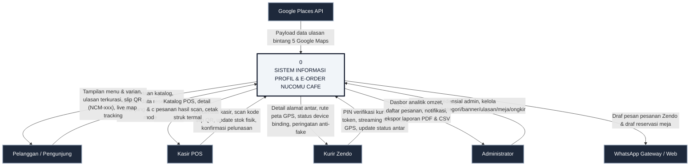
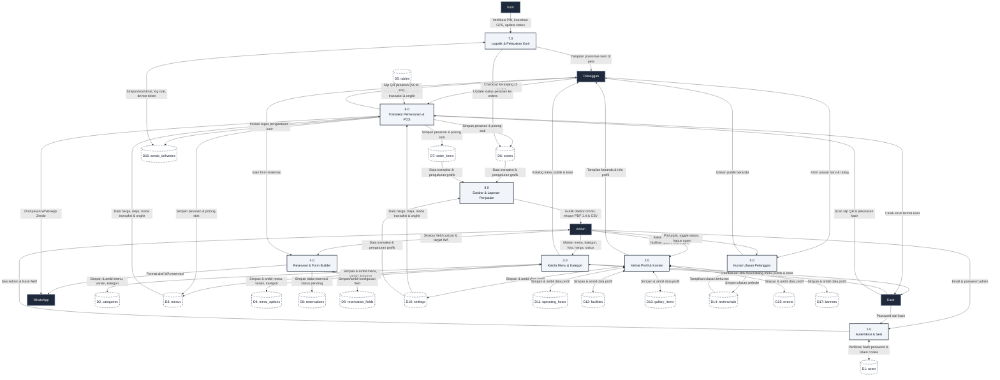
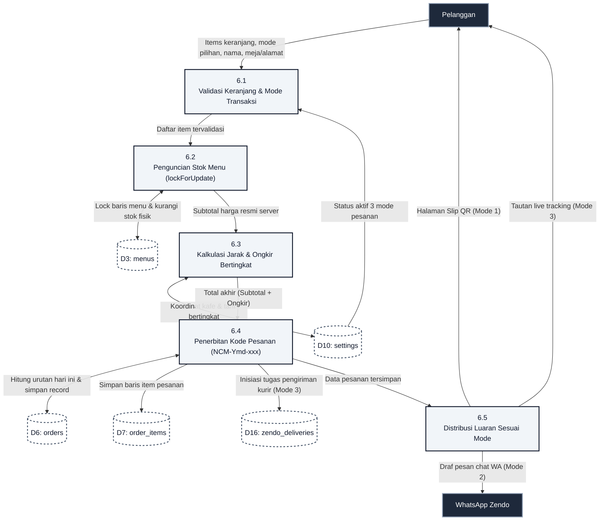
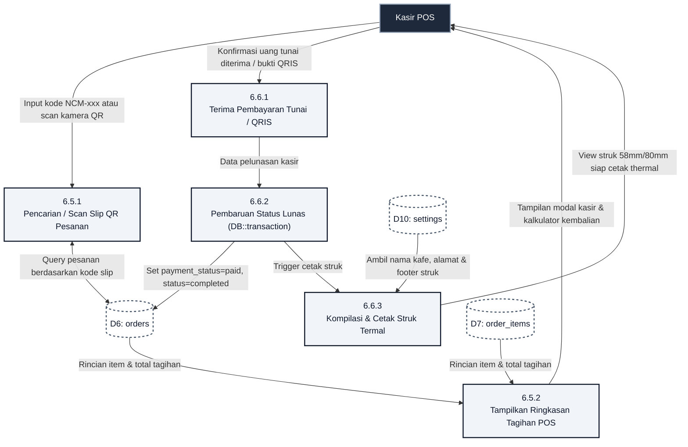
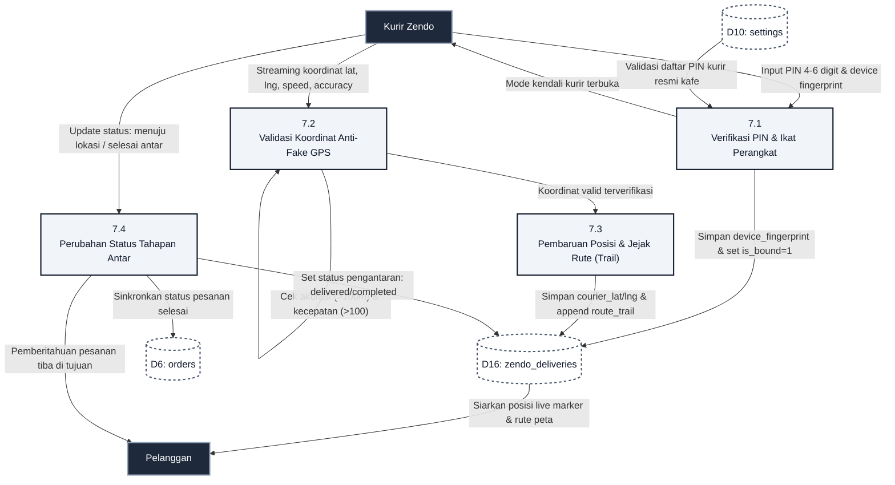

# TAHAP 2: ALIRAN INFORMASI (DATA FLOW DIAGRAM & USE CASE)
**Proyek:** Sistem Informasi Profil dan E-Order Nucomu Cafe (Laravel)
**Standar Notasi:** Gane-Sarson Diagramming Standard & UML Use Case

---

## 1. DFD Level 0 (Diagram Konteks)
Diagram Konteks memposisikan keseluruhan sistem informasi sebagai satu proses tunggal (`0`) dan memetakan batas sistem (*system boundary*) terhadap semua entitas eksternal.

### Tabel 2.1 Keterangan Entitas dan Aliran Data Diagram Konteks
| Kode | Nama Komponen | Tipe | Keterangan Aliran Data |
|---|---|---|---|
| `SYS-0` | Sistem Informasi Profil & E-Order Nucomu Cafe | Proses Inti | Proses sentral pengolah seluruh data transaksi, profil, dan pelacakan |
| `E_CST` | Pelanggan / Pengunjung | Entitas Luar | Mengakses profil, memesan 3 mode checkout, mengirim ulasan dan reservasi |
| `E_KSR` | Kasir POS | Entitas Luar | Memindai slip QR, melunasi transaksi, mengelola stok cepat, dan mencetak struk |
| `E_KRR` | Kurir Zendo | Entitas Luar | Mengautentikasi perangkat via PIN, memperbarui koordinat GPS, dan mengubah status antar |
| `E_ADM` | Administrator | Entitas Luar | Mengelola konten, konfigurasi harga/ongkir/menu, analitik penjualan, dan ekspor laporan |
| `E_WA` | WhatsApp Gateway / Web | Entitas Luar | Media pengiriman draf pesanan chat Zendo dan notifikasi konfirmasi reservasi meja |
| `E_GMP` | Google Places API | Entitas Luar | Penyedia data ulasan publik Google Maps kafe (jika API Key aktif) |

---

## 2. DFD Level 1 (Dekomposisi Sistem Utama)
DFD Level 1 memecah sistem utama menjadi 8 sub-proses utama yang terhubung ke 17 data store fisik aplikasi:

### Tabel 2.2 Deskripsi 8 Sub-Proses DFD Level 1
| No | ID Proses | Nama Proses | Masukan (*Input*) | Ringkasan Proses | Keluaran (*Output*) | Tabel Basis Data Terlibat |
|---|---|---|---|---|---|---|
| 1 | `1.0` | Autentikasi & Sesi | Email/password admin, password kasir | Memvalidasi kredensial pengguna via Hash bcrypt dan menerbitkan cookie otentikasi HMAC SHA-256 | Status sesi aktif, redirect dashboard admin / POS kasir | `users` |
| 2 | `2.0` | Kelola Profil & Konten | Data banner, jadwal buka, narasi about, fasilitas, galeri, agenda acara | Menyimpan dan mengelola data konten profil kafe untuk disajikan di beranda publik | Tampilan visual profil beranda, slider banner, galeri foto | `banners`, `settings`, `operating_hours`, `facilities`, `gallery_items`, `events` |
| 3 | `3.0` | Kelola Menu & Kategori | Form master menu (nama, kategori, harga, foto, stok), stok cepat kasir | Menyimpan master menu dengan soft delete, relasi kategori berjenjang, dan pembaruan stok cepat | Katalog menu publik, daftar item POS kasir | `categories`, `menus`, `menu_options` |
| 4 | `4.0` | Reservasi & Form Builder | Isian tamu reservasi, konfigurasi field kustom admin | Memvalidasi input dinamis, mengunggah berkas opsional, menyimpan record reservasi status pending, dan merakit URL WhatsApp | Draf pesan WA ke admin, tabel reservasi masuk admin | `reservations`, `reservation_fields`, `settings` |
| 5 | `5.0` | Kurasi Ulasan Pelanggan | Form review & rating bintang pelanggan, aksi pin/unpin admin | Menampung testimoni mandiri, memvalidasi rating (1-5), kurasi admin untuk meminang ulasan unggulan ke beranda | Slider ulasan di beranda, tabel kurasi ulasan admin | `testimonials`, `settings` |
| 6 | `6.0` | Transaksi Pemesanan & POS | Item keranjang belanja, meja/takeaway, pin GPS alamat, scan slip QR kasir | Memproses 3 mode checkout dengan DB::transaction dan lockForUpdate stok, menerbitkan kode NCM, dan melayani kasir POS | Slip QR (NCM-xxx), draf WA Zendo, struk termal, rekaman transaksi | `orders`, `order_items`, `menus`, `tables`, `settings`, `zendo_deliveries` |
| 7 | `7.0` | Logistik & Pelacakan Kurir | PIN kurir, token sesi, koordinat GPS streaming, perubahan status antar | Mengikat perangkat kurir, validasi anti-fake GPS (akurasi/kecepatan), merekam polyline rute, dan menyiarkan koordinat | Peta live Leaflet.js real-time, status tahapan antar | `zendo_deliveries`, `orders`, `settings` |
| 8 | `8.0` | Dasbor & Laporan Penjualan | Rentang tanggal laporan, filter status pembayaran | Menghitung 4 metrik omzet, memetakan tren harian/mingguan/bulanan, dan mengompilasi laporan PDF/CSV | Dasbor analitik, file rekapitulasi PDF 1.4 Native, file CSV UTF-8 | `orders`, `order_items`, `settings` |

---

## 3. DFD Level 2 Sub-Proses Spesifik

### 3.1 DFD Level 2: Modul Pemesanan / Checkout Pelanggan (Proses 6.2 s/d 6.4)

### Tabel 2.3 Keterangan DFD Level 2 Pemesanan / Checkout
| Kode | Nama Proses / Komponen | Keterangan Operasional |
|---|---|---|
| `6.1` | Validasi Keranjang & Mode | Memeriksa ketersediaan item, format nomor HP, dan apakah mode transaksi yang dipilih sedang aktif di tabel `settings` |
| `6.2` | Penguncian Stok Menu | Memanggil `Menu::whereKey(...)->lockForUpdate()` di dalam `DB::transaction` untuk mencegah *race condition* stok |
| `6.3` | Kalkulasi Ongkir Bertingkat | Menghitung jarak lurus Haversine kafe-pelanggan, memvalidasi jarak rute jalan, dan mengonversi ke tarif tier ongkir |
| `6.4` | Penerbitan Kode Pesanan | Membuat kode unik terstandar `NCM-Ymd-xxx` dan menyimpan entitas utama `orders`, `order_items`, serta `zendo_deliveries` |
| `6.5` | Distribusi Luaran Mode | Mengarahkan respon JSON: Mode 1 ke slip QR `/qr/pesanan/{code}`, Mode 2 ke API WhatsApp Zendo, Mode 3 ke `/zendo/lacak/{token}` |

---

### 3.2 DFD Level 2: Modul Kasir & Pelunasan (Proses 6.5 & 6.6)

### Tabel 2.4 Keterangan DFD Level 2 Kasir & Pelunasan
| Kode | Nama Proses / Komponen | Keterangan Operasional |
|---|---|---|
| `6.5.1` | Pencarian / Scan Slip QR | Menerima pemindaian kode QR via kamera atau pencarian teks manual pada endpoint `/kasir/pesanan/cari` |
| `6.5.2` | Tampilkan Ringkasan Tagihan | Menampilkan nama pemesan, nomor meja/take away, daftar item, subtotal, dan sisa tagihan |
| `6.6.1` | Terima Pembayaran | Menginput nominal uang bayar kasir dan otomatis menghitung nominal uang kembalian (*change*) |
| `6.6.2` | Pembaruan Status Lunas | Menjalankan `DB::transaction` untuk mengubah `payment_status` menjadi `'paid'` dan `status` pesanan menjadi `'completed'` |
| `6.6.3` | Kompilasi & Cetak Struk | Mengompilasi template struk termal dengan font monospace dan trigger otomatis dialog `window.print()` |

---

### 3.3 DFD Level 2: Modul Pengantaran Kurir Zendo (Proses 7.1 s/d 7.4)

### Tabel 2.5 Keterangan DFD Level 2 Pengantaran Kurir Zendo
| Kode | Nama Proses / Komponen | Keterangan Operasional |
|---|---|---|
| `7.1` | Verifikasi PIN & Ikat Perangkat | Kurir memasukkan PIN rahasia untuk mengikat perangkat HP fisik (`device_fingerprint`) ke token pengiriman |
| `7.2` | Validasi Anti-Fake GPS | Menganalisis parameter `accuracy` (>100 meter ditolak) dan parameter `speed` dari GPS Geolocation API |
| `7.3` | Pembaruan Posisi & Jejak | Menyimpan koordinat terkini kurir dan menambahkan riwayat lintasan ke kolom JSON `route_trail` |
| `7.4` | Perubahan Status Pengantaran | Mengubah status logistik menjadi `delivering` hingga `delivered` dan menyinkronkan status pesanan ke `orders` |

---

## 4. Use Case Diagram Sistem
Diagram Use Case memetakan interaksi fungsional antara 4 aktor utama (*Pelanggan*, *Kasir*, *Kurir*, dan *Admin*) dengan modul-modul sistem:

```mermaid
flowchart LR
    classDef actor fill:#1E293B,stroke:#94A3B8,stroke-width:2px,color:#FFFFFF;
    classDef uc fill:#FFFFFF,stroke:#0F172A,stroke-width:1.5px,color:#0F172A;

    %% Aktor
    A_CST["Aktor: Pelanggan"]:::actor
    A_KSR["Aktor: Kasir"]:::actor
    A_KRR["Aktor: Kurir"]:::actor
    A_ADM["Aktor: Admin"]:::actor

    %% Use Cases Pelanggan
    UC_P1([Lihat Profil, Fasilitas & Agenda]):::uc
    UC_P2([Pencarian & Detail Menu]):::uc
    UC_P3([Kirim Ulasan & Rating]):::uc
    UC_P4([Pengajuan Reservasi Meja]):::uc
    UC_P5([Pesan Mandiri 3 Mode Checkout]):::uc
    UC_P6([Tampilkan Slip QR Pesanan]):::uc
    UC_P7([Pelacakan Live GPS Kurir]):::uc

    %% Use Cases Kasir
    UC_K1([Login / Logout Sesi Kasir]):::uc
    UC_K2([Katalog POS & Order Langsung]):::uc
    UC_K3([Scan & Pencarian Slip QR]):::uc
    UC_K4([Pelunasan Transaksi]):::uc
    UC_K5([Cetak Struk Termal]):::uc
    UC_K6([Update Stok Cepat]):::uc

    %% Use Cases Kurir
    UC_R1([Autentikasi PIN & Ikat Perangkat]):::uc
    UC_R2([Streaming Koordinat GPS Antar]):::uc
    UC_R3([Perbarui Status Pengantaran]):::uc

    %% Use Cases Admin
    UC_A1([Login / Logout Sesi Admin]):::uc
    UC_A2([Pantau Dasbor Analitik Omzet]):::uc
    UC_A3([Kelola Konten & Banner Promo]):::uc
    UC_A4([CRUD Menu & Kategori]):::uc
    UC_A5([Kurasi Testimoni Pelanggan]):::uc
    UC_A6([Form Builder & Konfirmasi Reservasi]):::uc
    UC_A7([Konfigurasi 3 Mode & QRIS]):::uc
    UC_A8([Tarif Ongkir & Manajemen Kurir]):::uc
    UC_A9([Ekspor Laporan Penjualan PDF/CSV]):::uc
    UC_A10([Kelola Jam Kerja, Meja & Profil]):::uc

    %% Relasi Pelanggan
    A_CST --- UC_P1
    A_CST --- UC_P2
    A_CST --- UC_P3
    A_CST --- UC_P4
    A_CST --- UC_P5
    A_CST --- UC_P6
    A_CST --- UC_P7

    %% Relasi Kasir
    A_KSR --- UC_K1
    A_KSR --- UC_K2
    A_KSR --- UC_K3
    A_KSR --- UC_K4
    A_KSR --- UC_K5
    A_KSR --- UC_K6

    %% Relasi Kurir
    A_KRR --- UC_R1
    A_KRR --- UC_R2
    A_KRR --- UC_R3

    %% Relasi Admin
    A_ADM --- UC_A1
    A_ADM --- UC_A2
    A_ADM --- UC_A3
    A_ADM --- UC_A4
    A_ADM --- UC_A5
    A_ADM --- UC_A6
    A_ADM --- UC_A7
    A_ADM --- UC_A8
    A_ADM --- UC_A9
    A_ADM --- UC_A10
```

### Tabel 2.6 Pemetaan Aktor dan Deskripsi Use Case
| Aktor | Kode Use Case | Nama Use Case | Deskripsi Singkat Tindakan |
|---|---|---|---|
| **Pelanggan** | `UC_P1` | Lihat Profil, Fasilitas & Agenda | Menjelajahi informasi profil, jadwal buka, slider fasilitas, galeri, dan event kafe |
| | `UC_P2` | Pencarian & Detail Menu | Mencari menu via filter kategori, melihat modal varian dan harga pokok menu |
| | `UC_P3` | Kirim Ulasan & Rating | Mengirimkan ulasan pengalaman, rating bintang 1-5, dan unggah foto opsional |
| | `UC_P4` | Pengajuan Reservasi Meja | Mengisi formulir reservasi dinamis beserta tanggal, jam, jumlah orang, dan field kustom |
| | `UC_P5` | Pesan Mandiri 3 Mode Checkout | Memasukkan menu ke keranjang dan checkout via Dine-In/Takeaway, Chat Zendo, atau GPS Antar |
| | `UC_P6` | Tampilkan Slip QR Pesanan | Menampilkan barcode QR kode `NCM-xxx` untuk dipindai oleh kasir di meja kasir |
| | `UC_P7` | Pelacakan Live GPS Kurir | Memantau pergerakan marker kurir secara real-time pada peta interaktif Leaflet.js |
| **Kasir** | `UC_K1` | Login / Logout Sesi Kasir | Masuk ke antarmuka POS kasir menggunakan kata sandi khusus staf kasir |
| | `UC_K2` | Katalog POS & Order Langsung | Menangani transaksi langsung pelanggan yang memesan langsung di meja kasir |
| | `UC_K3` | Scan & Pencarian Slip QR | Memindai slip pesanan menggunakan kamera atau mencari kode slip pesanan pelanggan |
| | `UC_K4` | Pelunasan Transaksi | Menerima pembayaran tunai/QRIS, menginput nominal bayar, dan menghitung kembalian |
| | `UC_K5` | Cetak Struk Termal | Mencetak struk fisik bukti transaksi format kertas termal 58mm / 80mm |
| | `UC_K6` | Update Stok Cepat | Mengubah status ketersediaan menu dan stok fisik langsung dari antarmuka kasir |
| **Kurir** | `UC_R1` | Autentikasi PIN & Ikat Perangkat | Membuka kunci pelacakan menggunakan PIN kurir dan mengikat browser HP kurir |
| | `UC_R2` | Streaming Koordinat GPS Antar | Mengirimkan koordinat lintang/bujur perangkat saat bergerak mengantar pesanan |
| | `UC_R3` | Perbarui Status Pengantaran | Mengubah status logistik menjadi `delivering` hingga pesanan berhasil diserahkan (`delivered`) |
| **Admin** | `UC_A1` | Login / Logout Sesi Admin | Masuk dan keluar panel manajemen admin dengan kredensial terenkripsi |
| | `UC_A2` | Pantau Dasbor Analitik Omzet | Memantau grafik tren omzet, menu terlaris, dan 4 kartu metrik performa bisnis |
| | `UC_A3` | Kelola Konten & Banner Promo | Mengunggah banner berjadwal, memperpanjang durasi, dan mengedit konten profil |
| | `UC_A4` | CRUD Menu & Kategori | Menambah menu baru, mengatur varian, menghapus dengan soft delete, dan memulihkan menu |
| | `UC_A5` | Kurasi Testimoni Pelanggan | Memilih ulasan yang disematkan (*pin*) ke beranda atau menyembunyikan ulasan spam |
| | `UC_A6` | Form Builder & Konfirmasi Reservasi | Menambah kolom formulir reservasi baru dan mengubah status konfirmasi tamu |
| | `UC_A7` | Konfigurasi 3 Mode & QRIS | Mengaktifkan/menonaktifkan mode pemesanan dan mengunggah gambar QRIS statis kafe |
| | `UC_A8` | Tarif Ongkir & Manajemen Kurir | Mengatur daftar nomor kurir Zendo dan menetapkan tarif ongkir jarak bertingkat |
| | `UC_A9` | Ekspor Laporan Penjualan PDF/CSV | Mengunduh berkas laporan rekap transaksi format PDF 1.4 Native dan CSV Excel |
| | `UC_A10` | Kelola Jam Kerja, Meja & Profil | Mengatur hari buka kafe, nomor meja fisik kafe, dan profil pribadi akun admin |
