# BAB III
# PERANCANGAN SISTEM

## 3.1 Arsitektur Sistem
Arsitektur sistem pada website Sistem Informasi Profil dan E-Order Nucomu Cafe & Roastery dirancang berbasis pola *Model-View-Controller* (MVC) menggunakan kerangka kerja Laravel untuk menggambarkan struktur sistem dan pembagian hak akses pengguna. Sistem ini melayani empat entitas pengguna (*actors*) yang memiliki peran dan fungsi operasional berbeda: Administrator, Staf Kasir, Pelanggan (*Customer*), dan Kurir Zendo.

Administrator (Admin) memiliki kewenangan penuh mengelola seluruh konten website (banner promosi berjadwal, narasi profil *Our Story*, fasilitas, galeri visual, agenda acara, jadwal jam operasional, dan kontak kafe), mengelola master kategori dan katalog menu makanan/minuman (meliputi penentuan harga pokok, varian rasa/gula/topping, kontrol stok, penanda produk unggulan, mekanisme *soft delete*, serta pemulihan menu terhapus), mengkurasi ulasan testimoni pelanggan (*pin/unpin* ke beranda), mengonfigurasi formulir dinamis (*Form Builder*) reservasi dan mengubah status konfirmasi kehadiran tamu, mengaktifkan/menonaktifkan 3 mode transaksi dan memperbarui gambar QRIS, mengelola armada nomor WhatsApp kurir dan tarif ongkos kirim bertingkat Zendo, memantau dasbor analitik penjualan (metrik harian, mingguan, bulanan), serta mengunduh berkas laporan rekapitulasi penjualan berformat biner PDF 1.4 Native dan spreadsheet CSV Excel.

Staf Kasir mengoperasikan antarmuka *Point of Sale* (POS) mandiri di meja kasir kafe yang meliputi akses katalog cepat produk, pemrosesan pesanan langsung di tempat, pemindaian kode slip QR pesanan mandiri pelanggan (`NCM-Ymd-xxx`) menggunakan kamera atau pencarian kode manual, konfirmasi pelunasan transaksi (menerima pembayaran tunai dengan kalkulator uang kembalian otomatis maupun verifikasi bukti transfer/QRIS), pencetakan struk transaksi termal format 80 mm, serta pembaruan cepat ketersediaan stok fisik menu dapur (*quick stock update*) tanpa perlu membuka panel admin.

Pelanggan (Customer / Pengunjung) dapat mengakses antarmuka publik tanpa perlu melalui prosedur pendaftaran akun yang rumit untuk menjelajahi profil kafe, fasilitas, galeri, agenda acara, dan jam operasional; mencari dan menyaring katalog menu berdasarkan kategori; melihat rincian modal varian (suhu panas/dingin, level manis, topping); mengelola keranjang belanja mandiri interaktif (*Cart Drawer* berbasis *LocalStorage*); melakukan pemesanan mandiri (*checkout*) melalui 3 mode transaksi (Mode 1: Makan di tempat / Bawa pulang dengan penerbitan slip QR digital `NCM-xxx`; Mode 2: Pesan antar via chat terformat WhatsApp Zendo; Mode 3: Pesan antar Kurir Zendo dengan penentuan titik koordinat GPS); memantau status pesanan dan pergerakan live kurir pada peta interaktif *Leaflet.js*; mengirimkan testimoni ulasan dan rating kepuasan; serta mengajukan reservasi meja dengan kolom formulir dinamis.

Kurir Zendo mengakses sistem melalui tautan token logistik khusus pengiriman (`/zendo/lacak/{token}`), melakukan otentikasi menggunakan PIN rahasia 4–6 digit dan pengikatan perangkat fisik (*device binding*), melakukan *streaming* koordinat GPS secara berkala saat bergerak mengantar pesanan (yang divalidasi oleh algoritma proteksi *Anti-Fake GPS* berdasarkan batas kecepatan dan akurasi sinyal satelit), memantau rute dan alamat pemesan, serta memperbarui tahapan status pengantaran dari *delivering* hingga *delivered* (pesanan tiba).

Dengan pembagian peran dan arsitektur tersebut, sistem diharapkan berjalan lebih terstruktur, transparan, dan mempermudah operasional kafe secara menyeluruh, mulai dari layanan pemesanan mandiri pengunjung, efisiensi kerja kasir, ketepatan pengantaran kurir, hingga pelaporan transaksi pemilik kafe.

```mermaid
flowchart TD
    classDef rootStyle fill:#1E293B,stroke:#94A3B8,stroke-width:3px,color:#FFFFFF;
    classDef actorStyle fill:#334155,stroke:#CBD5E1,stroke-width:2px,color:#FFFFFF;
    classDef modStyle fill:#F8FAFC,stroke:#475569,stroke-width:1.5px,color:#0F172A;
    classDef subStyle fill:#FFFFFF,stroke:#94A3B8,stroke-width:1px,color:#1E293B;

    ROOT["Sistem Informasi Profil dan E-Order Nucomu Cafe (Laravel MVC)"]:::rootStyle

    ACT_ADMIN["1.0 Modul Administrator"]:::actorStyle
    ACT_KASIR["2.0 Modul Kasir POS"]:::actorStyle
    ACT_CUST["3.0 Modul Pelanggan (Web Publik)"]:::actorStyle
    ACT_KURIR["4.0 Modul Kurir Zendo (Tracking)"]:::actorStyle

    ROOT --> ACT_ADMIN
    ROOT --> ACT_KASIR
    ROOT --> ACT_CUST
    ROOT --> ACT_KURIR

    %% Admin Submodules
    M_ADM_AUTH["Autentikasi & Profil Admin"]:::modStyle
    M_ADM_DASH["Dasbor Analitik & Omzet"]:::modStyle
    M_ADM_KONTEN["Kelola Konten & Media"]:::modStyle
    M_ADM_MENU["Master Menu & Kategori"]:::modStyle
    M_ADM_TRANS["Transaksi & Mode Pesanan"]:::modStyle
    M_ADM_RES["Reservasi & Form Builder"]:::modStyle
    M_ADM_LAP["Laporan Rekap (PDF & CSV)"]:::modStyle

    ACT_ADMIN --> M_ADM_AUTH
    ACT_ADMIN --> M_ADM_DASH
    ACT_ADMIN --> M_ADM_KONTEN
    ACT_ADMIN --> M_ADM_MENU
    ACT_ADMIN --> M_ADM_TRANS
    ACT_ADMIN --> M_ADM_RES
    ACT_ADMIN --> M_ADM_LAP

    M_ADM_KONTEN --> SUB_KONTEN["Banner Promo Berjadwal (30 Mnt Expiry)<br>Our Story, Fasilitas, Galeri, Event, Jam Kerja"]:::subStyle
    M_ADM_MENU --> SUB_MENU["Harga, Foto 1:1, Varian, Stok<br>Soft Delete & Restore Menu, Proteksi Relasi"]:::subStyle
    M_ADM_TRANS --> SUB_TRANS["Konfigurasi 3 Mode & QRIS<br>Pengaturan Kurir & Tarif Ongkir Bertingkat"]:::subStyle

    %% Kasir Submodules
    M_KASIR_AUTH["Autentikasi Cepat Sesi Kasir"]:::modStyle
    M_KASIR_POS["Katalog POS & Order Langsung"]:::modStyle
    M_KASIR_SCAN["Scan & Lookup Slip QR (NCM-xxx)"]:::modStyle
    M_KASIR_PAY["Pelunasan Tunai/QRIS & Kembalian"]:::modStyle
    M_KASIR_STRUK["Cetak Struk Termal 80mm"]:::modStyle
    M_KASIR_STOK["Update Stok Cepat Fisik Menu"]:::modStyle

    ACT_KASIR --> M_KASIR_AUTH
    ACT_KASIR --> M_KASIR_POS
    ACT_KASIR --> M_KASIR_SCAN
    ACT_KASIR --> M_KASIR_PAY
    ACT_KASIR --> M_KASIR_STRUK
    ACT_KASIR --> M_KASIR_STOK

    %% Pelanggan Submodules
    M_CUST_HOME["Profil, Fasilitas, Galeri, Agenda"]:::modStyle
    M_CUST_KATALOG["Katalog Menu, Filter & Modal Varian"]:::modStyle
    M_CUST_CART["Keranjang Belanja (Cart Drawer LocalStorage)"]:::modStyle
    M_CUST_CHECKOUT["Checkout Mandiri 3 Mode Transaksi"]:::modStyle
    M_CUST_RES["Formulir Reservasi Meja Dinamis"]:::modStyle
    M_CUST_REV["Kirim Testimoni Ulasan & Rating"]:::modStyle
    M_CUST_TRACK["Live Tracking GPS (Leaflet.js)"]:::modStyle

    ACT_CUST --> M_CUST_HOME
    ACT_CUST --> M_CUST_KATALOG
    ACT_CUST --> M_CUST_CART
    ACT_CUST --> M_CUST_CHECKOUT
    ACT_CUST --> M_CUST_RES
    ACT_CUST --> M_CUST_REV
    ACT_CUST --> M_CUST_TRACK

    M_CUST_CHECKOUT --> SUB_CHECKOUT["Mode 1: Dine In / Take Away (Slip QR)<br>Mode 2: Chat Otomatis WhatsApp Zendo<br>Mode 3: Pesan Antar Kurir Zendo GPS"]:::subStyle

    %% Kurir Submodules
    M_KURIR_AUTH["Verifikasi PIN & Ikat Perangkat"]:::modStyle
    M_KURIR_GPS["Streaming Koordinat GPS Antar"]:::modStyle
    M_KURIR_ANTIFAKE["Proteksi Anti-Fake GPS (Speed & Accuracy)"]:::modStyle
    M_KURIR_STATUS["Pembaruan Status Antar (Delivered)"]:::modStyle

    ACT_KURIR --> M_KURIR_AUTH
    ACT_KURIR --> M_KURIR_GPS
    ACT_KURIR --> M_KURIR_ANTIFAKE
    ACT_KURIR --> M_KURIR_STATUS
```

<b>Gambar 3.1 Struktur Program Sistem Informasi Nucomu Cafe</b>

---

## 3.2 Perancangan Database

Perancangan basis data pada sistem ini menggunakan sistem manajemen basis data relasional (*Relational Database Management System* - RDBMS) MySQL/MariaDB. Sistem memiliki 17 tabel operasional utama yang masing-masing berpasangan secara langsung dengan Model Eloquent pada aplikasi.

### Tabel 3.1 Daftar Tabel Database

| Nama Tabel | Primary Key | Deskripsi |
|---|---|---|
| `banners` | `id` | Tabel `banners` adalah tabel yang berisi data banner promosi berjadwal yang ditampilkan pada carousel beranda kafe beserta waktu mulai, batas akhir penayangan otomatis (*auto-expiry*), tombol tautan, dan urutan tampilan. Tabel ini tidak memiliki foreign key dan tidak direferensikan oleh tabel lain. |
| `categories` | `id` | Tabel `categories` adalah tabel yang berisi data kategori induk pengelompokan menu makanan dan minuman (seperti Signature Coffee, Non-Coffee, Meals, Dessert). Tabel ini tidak memiliki foreign key, namun direferensikan oleh tabel `menus` sebagai foreign key (`category_id`). |
| `events` | `id` | Tabel `events` adalah tabel yang berisi data agenda acara komunitas kafe, workshop roastery, dan konser musik akustik beserta tanggal, waktu pelaksanaan, lokasi, serta poster pamflet kegiatan. Tabel ini tidak memiliki foreign key dan tidak direferensikan oleh tabel lain. |
| `facilities` | `id` | Tabel `facilities` adalah tabel yang berisi data kartu fasilitas penunjang kafe (seperti mushola, akses internet WiFi, stopkontak, area merokok) lengkap dengan badge penegas, ikon SVG, checklist butir fitur (JSON), dan galeri slider foto (JSON). Tabel ini tidak memiliki foreign key dan tidak direferensikan oleh tabel lain. |
| `gallery_items` | `id` | Tabel `gallery_items` adalah tabel yang berisi data koleksi foto visual suasana kafe, tata ruang interior, area *outdoor*, sajian barista, dan kegiatan operasional kafe. Tabel ini tidak memiliki foreign key dan tidak direferensikan oleh tabel lain. |
| `menu_options` | `id` | Tabel `menu_options` adalah tabel yang berisi data pilihan varian dari menu makanan atau minuman, seperti varian suhu (panas/dingin), tingkatan gula (*sugar level*), maupun *topping* tambahan beserta harga tambahannya. Tabel ini memiliki foreign key `menu_id` yang mereferensikan tabel `menus`. Tabel ini tidak direferensikan oleh tabel lain. |
| `menus` | `id` | Tabel `menus` adalah tabel yang berisi data master produk makanan dan minuman yang dijual di kafe, mencakup nama sajian, slug URL, harga pokok, stok fisik tersedia, foto produk rasio 1:1, status ketersediaan, status rekomendasi unggulan (*featured/best-seller*), serta penanda waktu penghapusan sementara (*soft delete* pada kolom `deleted_at`). Tabel ini memiliki foreign key `category_id` yang mereferensikan tabel `categories`. Tabel ini juga direferensikan oleh tabel `menu_options` dan `order_items` sebagai foreign key. |
| `operating_hours` | `id` | Tabel `operating_hours` adalah tabel yang berisi data jadwal jam kerja operasional kafe selama 7 hari dalam sepekan (hari Minggu hingga Sabtu), memuat jam buka, jam tutup, dan penanda status libur kafe. Tabel ini tidak memiliki foreign key dan tidak direferensikan oleh tabel lain. |
| `order_items` | `id` | Tabel `order_items` adalah tabel yang berisi data rincian baris menu yang dibeli dalam suatu transaksi pesanan, mencakup snapshot nama menu, harga satuan saat transaksi, kuantitas pembelian, subtotal baris (*line total*), dan pilihan opsi varian dalam format JSON. Tabel ini memiliki foreign key `order_id` yang mereferensikan tabel `orders`, dan foreign key `menu_id` yang mereferensikan tabel `menus`. Tabel ini tidak direferensikan oleh tabel lain. |
| `orders` | `id` | Tabel `orders` adalah tabel yang berisi data induk transaksi pemesanan kafe, mencakup kode unik pesanan berformat `NCM-Ymd-xxx`, nama pemesan, nomor kontak, jenis pesanan (*dine in* atau *take away*), alamat pengantaran, ongkos kirim, payload koordinat GPS dan meja (`form_data`), catatan, subtotal tagihan, total akhir, metode pembayaran (tunai/QRIS), status pembayaran (*pending/paid*), serta status alur pesanan (*pending, processing, ready, completed, cancelled*). Tabel ini tidak memiliki foreign key, namun direferensikan oleh tabel `order_items` dan `zendo_deliveries` sebagai foreign key. |
| `reservation_fields` | `id` | Tabel `reservation_fields` adalah tabel yang berisi data konfigurasi kolom dinamis pembangun formulir reservasi (*Form Builder*) yang ditentukan oleh admin, memuat nama field pengenal, label tampilan, tipe elemen input HTML (text, number, textarea, select, file), opsi pilihan dropdown (JSON), serta status wajib isi (*is_required*). Tabel ini tidak memiliki foreign key dan tidak direferensikan oleh tabel lain. |
| `reservations` | `id` | Tabel `reservations` adalah tabel yang berisi data pengajuan reservasi meja kafe oleh tamu pelanggan, memuat nama tamu, email, nomor WhatsApp, tanggal kunjungan, jam kehadiran, jumlah orang, catatan permintaan khusus, isian kolom dinamis Form Builder dalam format JSON (`custom_fields`), serta status verifikasi reservasi (*pending, confirmed, completed, cancelled*). Tabel ini memiliki foreign key `table_id` yang mereferensikan tabel `tables`. Tabel ini tidak direferensikan oleh tabel lain. |
| `settings` | `id` | Tabel `settings` adalah tabel yang berisi data konfigurasi terpusat sistem berbasis pasangan kunci-nilai (*key-value*), meliputi konfigurasi keaktifan 3 mode transaksi, gambar QRIS statis, narasi profil kafe (*Our Story*), informasi kontak WhatsApp dan media sosial, titik koordinat kafe, daftar nomor WhatsApp kurir, dan skema tarif ongkos kirim bertingkat Zendo. Tabel ini tidak memiliki foreign key dan tidak direferensikan oleh tabel lain. |
| `tables` | `id` | Tabel `tables` adalah tabel yang berisi data daftar nomor meja fisik di kafe beserta kapasitas jumlah kursi tamu, lokasi zona area meja (indoor/outdoor), status keterisian meja (*available, occupied, reserved*), dan berkas gambar kode QR meja. Tabel ini tidak memiliki foreign key, namun direferensikan oleh tabel `reservations` sebagai foreign key (`table_id`). |
| `testimonials` | `id` | Tabel `testimonials` adalah tabel yang berisi data ulasan dan rating kepuasan bintang (skala 1–5) dari pelanggan beserta komentar pengalaman, foto bukti kunjungan, status kurasi sematan di beranda (`is_pinned`), dan sumber data ulasan (website lokal atau Google Maps). Tabel ini tidak memiliki foreign key dan tidak direferensikan oleh tabel lain. |
| `users` | `id` | Tabel `users` adalah tabel yang berisi data akun kredensial staf pengelola sistem kafe dengan peran (*role*) `'admin'` dan `'kasir'`, memuat nama lengkap, alamat email unik, nomor telepon, foto avatar profil, dan kata sandi yang dienkripsi satu arah menggunakan algoritma bcrypt. Tabel ini tidak memiliki foreign key dan tidak direferensikan oleh tabel lain secara relasional formal di basis data. |
| `zendo_deliveries` | `id` | Tabel `zendo_deliveries` adalah tabel yang berisi data tugas logistik pengantaran pesanan oleh Kurir Zendo dan rekaman pelacakan live GPS, memuat token akses pelacakan publik pelanggan (`tracking_token`), token rahasia kontrol kurir (`courier_token`), identitas kurir bertugas, hash PIN kurir, sidik jari peramban (*device fingerprint*), status pengikatan perangkat (`is_device_bound`), koordinat lintang/bujur kurir terkini, riwayat jejak rute GPS (JSON `route_trail`), status tahapan pengantaran (*delivering, delivered*), serta pencatat anomali proteksi *Anti-Fake GPS*. Tabel ini memiliki foreign key `order_id` yang mereferensikan tabel `orders`. Tabel ini tidak direferensikan oleh tabel lain. |
