# TAHAP 3: BASIS DATA (ERD & KAMUS DATA)
**Proyek:** Sistem Informasi Profil dan E-Order Nucomu Cafe (Laravel)
**RDBMS:** MySQL 8.0 / MariaDB (Dukungan SQLite)

---

## 1. Entity Relationship Diagram (ERD) Mermaid
Diagram relasi entitas berikut memetakan 17 tabel fisik operasional aplikasi beserta kunci primer (*Primary Key*), kunci asing (*Foreign Key*), atribut utama, dan kardinalitas relasinya:

```mermaid
erDiagram
    USERS ||--o{ ORDERS : "memproses (kasir/admin)"
    CATEGORIES ||--o{ MENUS : "mengelompokkan (1:N)"
    MENUS ||--o{ MENU_OPTIONS : "memiliki varian (1:N)"
    ORDERS ||--|{ ORDER_ITEMS : "memiliki rincian (1:N)"
    MENUS ||--o{ ORDER_ITEMS : "dipesan dalam (1:N)"
    TABLES ||--o{ RESERVATIONS : "dipesan pada (1:N)"
    ORDERS ||--o| ZENDO_DELIVERIES : "memiliki pengantaran (1:0..1)"

    USERS {
        bigint id PK
        string name
        string email UK
        string password
        enum role "admin, kasir, user"
        string phone
        string avatar
        timestamp email_verified_at
        string remember_token
        timestamp created_at
        timestamp updated_at
    }

    CATEGORIES {
        bigint id PK
        string name
        string slug UK
        text description
        string icon
        int sort_order
        boolean is_active
        timestamp created_at
        timestamp updated_at
    }

    MENUS {
        bigint id PK
        bigint category_id FK
        string name
        string slug UK
        text description
        decimal price
        string image
        boolean is_available
        boolean is_featured
        boolean is_best_seller
        int stock
        string badge
        timestamp deleted_at "soft delete"
        timestamp created_at
        timestamp updated_at
    }

    MENU_OPTIONS {
        bigint id PK
        bigint menu_id FK
        string name
        string type "variant, addon, sugar_level"
        decimal price
        boolean is_available
        timestamp created_at
        timestamp updated_at
    }

    TABLES {
        bigint id PK
        string table_number UK
        int capacity
        string location "indoor, outdoor, lantai_2"
        enum status "available, occupied, reserved"
        string qr_code
        timestamp created_at
        timestamp updated_at
    }

    ORDERS {
        bigint id PK
        string code UK "NCM-Ymd-xxx"
        string customer_name
        string customer_phone
        enum order_type "dine_in, take_away"
        text delivery_address
        decimal delivery_fee
        json form_data "koordinat, meja, jarak"
        text notes
        decimal subtotal
        decimal discount
        decimal total
        enum payment_method "cash, qris, transfer"
        enum payment_status "pending, paid, refunded"
        enum status "pending, processing, ready, completed, cancelled"
        timestamp paid_at
        timestamp created_at
        timestamp updated_at
    }

    ORDER_ITEMS {
        bigint id PK
        bigint order_id FK
        bigint menu_id FK
        string menu_name
        decimal unit_price
        int qty
        decimal line_total
        json options "varian & level gula"
        timestamp created_at
        timestamp updated_at
    }

    ZENDO_DELIVERIES {
        bigint id PK
        bigint order_id FK,UK
        string tracking_token UK
        string courier_token UK
        string courier_name
        string courier_phone
        string courier_pin_hash
        string device_fingerprint
        boolean is_device_bound
        decimal courier_lat
        decimal courier_lng
        decimal destination_lat
        decimal destination_lng
        text destination_address
        decimal distance_km
        json route_trail "riwayat koordinat GPS"
        enum status "assigned, picked_up, delivering, delivered, cancelled"
        int gps_suspicious_count
        timestamp last_location_at
        timestamp delivered_at
        timestamp created_at
        timestamp updated_at
    }

    RESERVATIONS {
        bigint id PK
        bigint table_id FK
        string name
        string email
        string phone
        date reservation_date
        time reservation_time
        int guest_count
        text notes
        json custom_fields "isian Form Builder"
        enum status "pending, confirmed, completed, cancelled"
        timestamp created_at
        timestamp updated_at
    }

    RESERVATION_FIELDS {
        bigint id PK
        string field_name
        string field_label
        enum field_type "text, number, textarea, select, file"
        json options "opsi pilihan select"
        boolean is_required
        int sort_order
        boolean is_active
        timestamp created_at
        timestamp updated_at
    }

    SETTINGS {
        bigint id PK
        string key UK
        longtext value
        string group
        string type "text, json, boolean, image"
        text description
        timestamp created_at
        timestamp updated_at
    }

    OPERATING_HOURS {
        bigint id PK
        int day_of_week "0=Minggu, 6=Sabtu"
        string day_name
        time open_time
        time close_time
        boolean is_closed
        timestamp created_at
        timestamp updated_at
    }

    FACILITIES {
        bigint id PK
        string name
        string badge
        string icon
        text description
        string image
        json features "checklist fasilitas"
        json photos "slider galeri foto"
        int sort_order
        boolean is_active
        timestamp created_at
        timestamp updated_at
    }

    GALLERY_ITEMS {
        bigint id PK
        string title
        string image
        string category "interior, exterior, coffee, event"
        text caption
        int sort_order
        boolean is_active
        timestamp created_at
        timestamp updated_at
    }

    TESTIMONIALS {
        bigint id PK
        string name
        string role
        int rating "1 s.d. 5"
        text comment
        string avatar
        string photo
        boolean is_pinned
        boolean is_active
        string source "web, google"
        timestamp created_at
        timestamp updated_at
    }

    EVENTS {
        bigint id PK
        string title
        string slug UK
        text description
        string image
        date event_date
        time start_time
        time end_time
        string location
        boolean is_active
        timestamp created_at
        timestamp updated_at
    }

    BANNERS {
        bigint id PK
        string title
        string image
        string link
        timestamp start_time
        timestamp end_time
        boolean is_active
        int sort_order
        timestamp created_at
        timestamp updated_at
    }
```

---

## 2. Daftar Tabel Basis Data dan Fungsinya

### 2.1 Tabel Entitas Aplikasi (17 Tabel Model)
| No | Nama Tabel | Model Terkait | Fungsi Utama Tabel |
|---|---|---|---|
| 1 | `users` | `User` | Menyimpan akun pengguna, hak akses peran (admin, kasir, user), dan kredensial terenkripsi bcrypt |
| 2 | `categories` | `Category` | Mengelompokkan menu sajian kafe (Coffee, Non-Coffee, Meals, Dessert) |
| 3 | `menus` | `Menu` | Menyimpan katalog sajian makanan/minuman, harga pokok, foto, stok fisik, dan soft delete |
| 4 | `menu_options` | `MenuOption` | Menyimpan pilihan varian penyajian (Hot/Ice), level manis, dan topping per menu |
| 5 | `tables` | `Table` | Menyimpan daftar meja fisik kafe, kapasitas kursi, lokasi area, dan status meja |
| 6 | `orders` | `Order` | Menyimpan data induk transaksi pesanan pelanggan (kode unik NCM-xxx, nominal, tipe, metode bayar) |
| 7 | `order_items` | `OrderItem` | Menyimpan rincian menu yang dibeli, harga satuan transaksi, kuantitas, dan opsi JSON |
| 8 | `reservations` | `Reservation` | Menyimpan data pengajuan reservasi meja pelanggan dan payload JSON field kustom |
| 9 | `reservation_fields` | `ReservationField` | Menyimpan definisi kolom dinamis formulir reservasi (Form Builder) yang dikonfigurasi admin |
| 10 | `settings` | `Setting` | Menyimpan konfigurasi kafe berbasis pasangan key-value (mode order, narasi profil, QRIS, tarif ongkir) |
| 11 | `operating_hours` | `OperatingHour` | Menyimpan jadwal jam buka-tutup kafe untuk 7 hari dalam sepekan |
| 12 | `facilities` | `Facility` | Menyimpan informasi fasilitas kafe, ikon, checklist fitur (JSON), dan galeri slider foto (JSON) |
| 13 | `gallery_items` | `GalleryItem` | Menyimpan arsip foto suasana kafe, kegiatan roastery, dan kategori tampilan |
| 14 | `testimonials` | `Testimonial` | Menyimpan ulasan ulasan pelanggan, rating bintang (1-5), kurasi sematan (pinned), dan sumber |
| 15 | `events` | `Event` | Menyimpan agenda acara komunitas, workshop roastery, dan live music kafe |
| 16 | `zendo_deliveries` | `ZendoDelivery` | Menyimpan sesi kurir Zendo, koordinat GPS real-time, jejak rute JSON, PIN, dan device fingerprint |
| 17 | `banners` | `Banner` | Menyimpan banner promosi geser (carousel) di beranda beserta jadwal mulai dan kedaluwarsa otomatis |

### 2.2 Tabel Penunjang Framework Laravel (7 Tabel)
| No | Nama Tabel | Fungsi Framework |
|---|---|---|
| 18 | `password_reset_tokens` | Menyimpan token keamanan sekali pakai untuk prosedur reset kata sandi |
| 19 | `sessions` | Menyimpan status sesi pengguna web jika session driver disetel ke database |
| 20 | `cache` | Menyimpan cache aplikasi berbasis tabel relasional |
| 21 | `cache_locks` | Mengelola kunci atomik (*atomic lock*) untuk mencegah race condition background task |
| 22 | `jobs` | Antrean tugas latar belakang (*queue worker*) untuk proses asinkron |
| 23 | `job_batches` | Mengelompokkan eksekusi antrean tugas batch |
| 24 | `failed_jobs` | Mencatat log kegagalan eksekusi queue worker beserta jejak kesalahan (*stack trace*) |

---

## 3. Kamus Data Lengkap (Data Dictionary)

### 3.1 Tabel `users`
**Fungsi:** Menyimpan data akun kredensial pengguna sistem (Admin, Kasir POS, dan User).

| Nama Kolom | Tipe Data | Panjang | Null | Default | Key | Keterangan & Aturan |
|---|---|---|---|---|---|---|
| `id` | `BIGINT` | 20 | NO | None | PK | ID unik akun pengguna (auto increment) |
| `name` | `VARCHAR` | 255 | NO | None | - | Nama lengkap staf / pengguna |
| `email` | `VARCHAR` | 255 | NO | None | Unique | Alamat email unik akun |
| `email_verified_at` | `TIMESTAMP` | - | YES | NULL | - | Waktu verifikasi email |
| `password` | `VARCHAR` | 255 | NO | None | - | Hash kata sandi via bcrypt |
| `role` | `ENUM` | 'admin','kasir','user' | NO | 'user' | - | Peran hak akses sistem |
| `phone` | `VARCHAR` | 50 | YES | NULL | - | Nomor telepon / WhatsApp |
| `avatar` | `VARCHAR` | 255 | YES | NULL | - | Nama berkas avatar foto profil |
| `remember_token` | `VARCHAR` | 100 | YES | NULL | - | Token sesi persistent 'remember me' |
| `created_at` | `TIMESTAMP` | - | YES | NULL | - | Waktu pembuatan record |
| `updated_at` | `TIMESTAMP` | - | YES | NULL | - | Waktu pembaruan terakhir record |

> **Catatan Khusus:** Tidak menggunakan soft delete. Constraint: `email` unik.

### 3.2 Tabel `categories`
**Fungsi:** Kategori induk pengelompokan menu kafe.

| Nama Kolom | Tipe Data | Panjang | Null | Default | Key | Keterangan & Aturan |
|---|---|---|---|---|---|---|
| `id` | `BIGINT` | 20 | NO | None | PK | ID unik kategori (auto increment) |
| `name` | `VARCHAR` | 255 | NO | None | - | Nama kategori (misal: Signature Coffee) |
| `slug` | `VARCHAR` | 255 | NO | None | Unique | Slug URL ramah SEO |
| `description` | `TEXT` | - | YES | NULL | - | Deskripsi singkat kategori |
| `icon` | `VARCHAR` | 255 | YES | NULL | - | Ikon kategori / kode visual |
| `sort_order` | `INT` | 11 | NO | 0 | - | Nomor urut penataan tampilan |
| `is_active` | `TINYINT(1)` | 1 | NO | 1 | - | Status visibilitas (1=aktif, 0=nonaktif) |
| `created_at` | `TIMESTAMP` | - | YES | NULL | - | Waktu pembuatan |
| `updated_at` | `TIMESTAMP` | - | YES | NULL | - | Waktu pembaruan |

> **Catatan Khusus:** Relasi: Dilarang dihapus jika masih ada menu yang terhubung (`menus_count > 0`).

### 3.3 Tabel `menus`
**Fungsi:** Katalog utama produk sajian kafe.

| Nama Kolom | Tipe Data | Panjang | Null | Default | Key | Keterangan & Aturan |
|---|---|---|---|---|---|---|
| `id` | `BIGINT` | 20 | NO | None | PK | ID unik menu (auto increment) |
| `category_id` | `BIGINT` | 20 | NO | None | FK | Relasi ke `categories.id` (RESTRICT) |
| `name` | `VARCHAR` | 255 | NO | None | - | Nama item sajian menu |
| `slug` | `VARCHAR` | 255 | NO | None | Unique | Slug URL identifikasi menu |
| `description` | `TEXT` | - | YES | NULL | - | Deskripsi rasa & komposisi |
| `price` | `DECIMAL` | 12,2 | NO | None | - | Harga pokok satuan (Rupiah) |
| `image` | `VARCHAR` | 255 | YES | NULL | - | Path berkas foto menu persegi (1:1) |
| `is_available` | `TINYINT(1)` | 1 | NO | 1 | - | Status ketersediaan (1=ada, 0=habis) |
| `is_featured` | `TINYINT(1)` | 1 | NO | 0 | - | Status rekomendasi unggulan |
| `is_best_seller` | `TINYINT(1)` | 1 | NO | 0 | - | Penanda menu terlaris kafe |
| `stock` | `INT` | 11 | NO | 100 | - | Jumlah kuantitas stok fisik tersedia |
| `badge` | `VARCHAR` | 50 | YES | NULL | - | Label badge khusus (misal: 'New', 'Promo') |
| `deleted_at` | `TIMESTAMP` | - | YES | NULL | Index | Waktu soft delete (NULL jika aktif) |
| `created_at` | `TIMESTAMP` | - | YES | NULL | - | Waktu pembuatan |
| `updated_at` | `TIMESTAMP` | - | YES | NULL | - | Waktu pembaruan |

> **Catatan Khusus:** Menggunakan **Soft Deletes** (`deleted_at`). Menu yang pernah dipesan tidak boleh di-forceDelete.

### 3.4 Tabel `menu_options`
**Fungsi:** Opsi varian, addon, atau tingkat kemanisan menu.

| Nama Kolom | Tipe Data | Panjang | Null | Default | Key | Keterangan & Aturan |
|---|---|---|---|---|---|---|
| `id` | `BIGINT` | 20 | NO | None | PK | ID unik opsi varian |
| `menu_id` | `BIGINT` | 20 | NO | None | FK | Relasi ke `menus.id` (CASCADE on delete) |
| `name` | `VARCHAR` | 255 | NO | None | - | Nama opsi (misal: 'Less Sugar', 'Ice') |
| `type` | `VARCHAR` | 50 | NO | 'variant' | - | Tipe opsi: variant, addon, sugar_level |
| `price` | `DECIMAL` | 10,2 | NO | 0.00 | - | Selisih harga tambahan varian |
| `is_available` | `TINYINT(1)` | 1 | NO | 1 | - | Status keaktifan opsi |
| `created_at` | `TIMESTAMP` | - | YES | NULL | - | Waktu pembuatan |
| `updated_at` | `TIMESTAMP` | - | YES | NULL | - | Waktu pembaruan |

> **Catatan Khusus:** FK `menu_id` merujuk ke `menus.id`. Di sisi server, harga varian tidak dijumlahkan ulang saat order.

### 3.5 Tabel `tables`
**Fungsi:** Daftar nomor meja kafe fisik.

| Nama Kolom | Tipe Data | Panjang | Null | Default | Key | Keterangan & Aturan |
|---|---|---|---|---|---|---|
| `id` | `BIGINT` | 20 | NO | None | PK | ID unik meja |
| `table_number` | `VARCHAR` | 50 | NO | None | Unique | Nomor / kode meja fisik (misal: '01', 'VIP-1') |
| `capacity` | `INT` | 11 | NO | 4 | - | Kapasitas jumlah kursi tamu |
| `location` | `VARCHAR` | 100 | YES | 'indoor' | - | Zona penempatan meja |
| `status` | `ENUM` | 'available','occupied','reserved' | NO | 'available' | - | Status keterisian meja |
| `qr_code` | `VARCHAR` | 255 | YES | NULL | - | Path berkas QR code meja |
| `created_at` | `TIMESTAMP` | - | YES | NULL | - | Waktu pembuatan |
| `updated_at` | `TIMESTAMP` | - | YES | NULL | - | Waktu pembaruan |

> **Catatan Khusus:** Constraint: `table_number` unik.

### 3.6 Tabel `orders`
**Fungsi:** Data utama transaksi pemesanan produk kafe.

| Nama Kolom | Tipe Data | Panjang | Null | Default | Key | Keterangan & Aturan |
|---|---|---|---|---|---|---|
| `id` | `BIGINT` | 20 | NO | None | PK | ID unik transaksi pesanan |
| `code` | `VARCHAR` | 50 | NO | None | Unique | Kode pesanan format: NCM-Ymd-xxx |
| `customer_name` | `VARCHAR` | 100 | NO | None | - | Nama lengkap pemesan |
| `customer_phone` | `VARCHAR` | 50 | YES | '-' | - | Nomor telepon / kontak pemesan |
| `order_type` | `ENUM` | 'dine_in','take_away' | NO | 'dine_in' | - | Tipe operasional pesanan |
| `delivery_address` | `TEXT` | - | YES | NULL | - | Alamat pengantaran khusus mode Zendo |
| `delivery_fee` | `DECIMAL` | 12,2 | NO | 0.00 | - | Nominal ongkos kirim Zendo |
| `form_data` | `JSON` | - | YES | NULL | - | Payload koordinat lat/lng, meja, dan jarak |
| `notes` | `TEXT` | - | YES | NULL | - | Catatan pesanan dan ringkasan teks Zendo |
| `subtotal` | `DECIMAL` | 12,2 | NO | 0.00 | - | Total harga pesanan sebelum diskon/ongkir |
| `discount` | `DECIMAL` | 12,2 | NO | 0.00 | - | Nominal potongan harga promosi |
| `total` | `DECIMAL` | 12,2 | NO | 0.00 | - | Total akhir tagihan (subtotal + fee - discount) |
| `payment_method` | `ENUM` | 'cash','qris','transfer' | NO | 'cash' | - | Metode pembayaran yang dipilih |
| `payment_status` | `ENUM` | 'pending','paid','refunded' | NO | 'pending' | - | Status pembayaran kasir |
| `status` | `ENUM` | 'pending','processing','ready','completed','cancelled' | NO | 'pending' | - | Status alur hidup pesanan |
| `paid_at` | `TIMESTAMP` | - | YES | NULL | - | Waktu pelunasan transaksi oleh kasir |
| `created_at` | `TIMESTAMP` | - | YES | NULL | Index | Waktu order dibuat |
| `updated_at` | `TIMESTAMP` | - | YES | NULL | - | Waktu pembaruan terakhir |

> **Catatan Khusus:** Kolom JSON `form_data` memuat: `customer_lat`, `customer_lng`, `distance_km`, `table_no`, `dine_type`. Menggunakan `DB::transaction` saat create & update.

### 3.7 Tabel `order_items`
**Fungsi:** Rincian baris menu pada transaksi pesanan.

| Nama Kolom | Tipe Data | Panjang | Null | Default | Key | Keterangan & Aturan |
|---|---|---|---|---|---|---|
| `id` | `BIGINT` | 20 | NO | None | PK | ID unik baris item |
| `order_id` | `BIGINT` | 20 | NO | None | FK | Relasi ke `orders.id` (CASCADE on delete) |
| `menu_id` | `BIGINT` | 20 | YES | NULL | FK | Relasi ke `menus.id` (SET NULL on delete) |
| `menu_name` | `VARCHAR` | 255 | NO | None | - | Snapshot nama menu saat dibeli |
| `unit_price` | `DECIMAL` | 12,2 | NO | None | - | Snapshot harga satuan resmi server |
| `qty` | `INT` | 11 | NO | 1 | - | Jumlah kuantitas item dipesan |
| `line_total` | `DECIMAL` | 12,2 | NO | None | - | Subtotal baris (unit_price * qty) |
| `options` | `JSON` | - | YES | NULL | - | Rincian opsi varian & level gula yang dipilih |
| `created_at` | `TIMESTAMP` | - | YES | NULL | - | Waktu pencatatan |
| `updated_at` | `TIMESTAMP` | - | YES | NULL | - | Waktu pembaruan |

> **Catatan Khusus:** Snapshot data `menu_name` dan `unit_price` menjamin konsistensi finansial jika master menu berubah di masa depan.

### 3.8 Tabel `zendo_deliveries`
**Fungsi:** Logistik pengantaran kurir Zendo & pelacakan live GPS.

| Nama Kolom | Tipe Data | Panjang | Null | Default | Key | Keterangan & Aturan |
|---|---|---|---|---|---|---|
| `id` | `BIGINT` | 20 | NO | None | PK | ID unik tugas pengantaran |
| `order_id` | `BIGINT` | 20 | NO | None | FK,Unique | Relasi 1:1 ke `orders.id` (CASCADE) |
| `tracking_token` | `VARCHAR` | 64 | NO | None | Unique | Token URL publik pelacakan pelanggan |
| `courier_token` | `VARCHAR` | 64 | NO | None | Unique | Token rahasia akses kontrol kurir |
| `courier_name` | `VARCHAR` | 100 | NO | 'Kurir Zendo' | - | Nama identitas kurir bertugas |
| `courier_phone` | `VARCHAR` | 50 | NO | None | - | Nomor HP / WhatsApp aktif kurir |
| `courier_pin_hash` | `VARCHAR` | 255 | YES | NULL | - | Hash PIN verifikasi kurir |
| `device_fingerprint` | `VARCHAR` | 255 | YES | NULL | - | Sidik jari browser perangkat kurir |
| `is_device_bound` | `TINYINT(1)` | 1 | NO | 0 | - | Status pengikatan perangkat fisik (1=terikat) |
| `courier_lat` | `DECIMAL` | 10,7 | YES | NULL | - | Koordinat lintang terkini kurir |
| `courier_lng` | `DECIMAL` | 10,7 | YES | NULL | - | Koordinat bujur terkini kurir |
| `destination_lat` | `DECIMAL` | 10,7 | YES | NULL | - | Koordinat lintang tujuan antar pelanggan |
| `destination_lng` | `DECIMAL` | 10,7 | YES | NULL | - | Koordinat bujur tujuan antar pelanggan |
| `destination_address` | `TEXT` | - | YES | NULL | - | Alamat lengkap tujuan pengantaran |
| `distance_km` | `DECIMAL` | 6,2 | NO | 0.00 | - | Jarak pengantaran hasil hitung server |
| `route_trail` | `JSON` | - | YES | NULL | - | Array riwayat jejak koordinat GPS kurir |
| `status` | `ENUM` | 'assigned','picked_up','delivering','delivered','cancelled' | NO | 'delivering' | - | Status tahapan pengantaran logistik |
| `gps_suspicious_count` | `INT` | 11 | NO | 0 | - | Jumlah deteksi anomali anti-fake GPS |
| `last_location_at` | `TIMESTAMP` | - | YES | NULL | - | Waktu pembaruan koordinat terakhir |
| `delivered_at` | `TIMESTAMP` | - | YES | NULL | - | Waktu penyerahan pesanan selesai |
| `created_at` | `TIMESTAMP` | - | YES | NULL | - | Waktu pembuatan |
| `updated_at` | `TIMESTAMP` | - | YES | NULL | - | Waktu pembaruan |

> **Catatan Khusus:** Kolom JSON `route_trail` merekam jejak polyline. Memiliki mekanisme Anti-Fake GPS.

### 3.9 Tabel `reservations`
**Fungsi:** Data pengajuan reservasi meja kafe oleh pelanggan.

| Nama Kolom | Tipe Data | Panjang | Null | Default | Key | Keterangan & Aturan |
|---|---|---|---|---|---|---|
| `id` | `BIGINT` | 20 | NO | None | PK | ID unik reservasi |
| `table_id` | `BIGINT` | 20 | YES | NULL | FK | Relasi ke `tables.id` (SET NULL) |
| `name` | `VARCHAR` | 100 | NO | None | - | Nama lengkap tamu reservasi |
| `email` | `VARCHAR` | 150 | YES | NULL | - | Email kontak tamu |
| `phone` | `VARCHAR` | 50 | NO | None | - | Nomor WhatsApp aktif tamu |
| `reservation_date` | `DATE` | - | NO | None | - | Tanggal kunjungan yang dipesan |
| `reservation_time` | `TIME` | - | NO | None | - | Waktu jam kehadiran |
| `guest_count` | `INT` | 11 | NO | 1 | - | Jumlah kapasitas orang/tamu |
| `notes` | `TEXT` | - | YES | NULL | - | Permintaan khusus / acara |
| `custom_fields` | `JSON` | - | YES | NULL | - | Isian dinamis dari Form Builder |
| `status` | `ENUM` | 'pending','confirmed','completed','cancelled' | NO | 'pending' | - | Status verifikasi reservasi oleh admin |
| `created_at` | `TIMESTAMP` | - | YES | NULL | - | Waktu pengajuan |
| `updated_at` | `TIMESTAMP` | - | YES | NULL | - | Waktu pembaruan |

> **Catatan Khusus:** Kolom JSON `custom_fields` menyimpan data dinamis seperti nama file unggahan foto atau pilihan dropdown.

### 3.10 Tabel `reservation_fields`
**Fungsi:** Definisi kolom dinamis pembangun form reservasi (Form Builder).

| Nama Kolom | Tipe Data | Panjang | Null | Default | Key | Keterangan & Aturan |
|---|---|---|---|---|---|---|
| `id` | `BIGINT` | 20 | NO | None | PK | ID unik kolom form builder |
| `field_name` | `VARCHAR` | 100 | NO | None | Unique | Nama identifier variabel kolom |
| `field_label` | `VARCHAR` | 255 | NO | None | - | Label teks tampilan di formulir |
| `field_type` | `ENUM` | 'text','number','textarea','select','file' | NO | 'text' | - | Tipe elemen input HTML |
| `options` | `JSON` | - | YES | NULL | - | Pilihan opsi jika tipe input adalah 'select' |
| `is_required` | `TINYINT(1)` | 1 | NO | 0 | - | Kewajiban pengisian (1=wajib, 0=opsional) |
| `sort_order` | `INT` | 11 | NO | 0 | - | Urutan posisi kolom pada form |
| `is_active` | `TINYINT(1)` | 1 | NO | 1 | - | Status pengaktifan kolom |
| `created_at` | `TIMESTAMP` | - | YES | NULL | - | Waktu pembuatan |
| `updated_at` | `TIMESTAMP` | - | YES | NULL | - | Waktu pembaruan |

> **Catatan Khusus:** Constraint: `field_name` unik.

### 3.11 Tabel `settings`
**Fungsi:** Tabel pasangan kunci-nilai (key-value) untuk seluruh konfigurasi dinamis sistem.

| Nama Kolom | Tipe Data | Panjang | Null | Default | Key | Keterangan & Aturan |
|---|---|---|---|---|---|---|
| `id` | `BIGINT` | 20 | NO | None | PK | ID unik pengaturan |
| `key` | `VARCHAR` | 100 | NO | None | Unique | Kunci identifikasi konfigurasi |
| `value` | `LONGTEXT` | - | YES | NULL | - | Nilai konfigurasi (string, integer, atau JSON) |
| `group` | `VARCHAR` | 50 | NO | 'general' | Index | Pengelompokan konfigurasi (order, zendo, contact, dll) |
| `type` | `VARCHAR` | 50 | NO | 'text' | - | Tipe data nilai: text, json, boolean, image |
| `description` | `TEXT` | - | YES | NULL | - | Penjelasan fungsi konfigurasi |
| `created_at` | `TIMESTAMP` | - | YES | NULL | - | Waktu pembuatan |
| `updated_at` | `TIMESTAMP` | - | YES | NULL | - | Waktu pembaruan |

> **Catatan Khusus:** Kunci kritis yang disimpan: `order_mode_dine_in`, `order_mode_zendo_chat`, `order_mode_zendo_tracking`, `qris_image`, `zendo_tariff`, `zendo_couriers`, `cafe_lat`, `cafe_lng`.

### 3.12 Tabel `operating_hours`
**Fungsi:** Jadwal jam kerja kafe untuk 7 hari dalam sepekan.

| Nama Kolom | Tipe Data | Panjang | Null | Default | Key | Keterangan & Aturan |
|---|---|---|---|---|---|---|
| `id` | `BIGINT` | 20 | NO | None | PK | ID unik baris jadwal |
| `day_of_week` | `INT` | 11 | NO | None | - | Hari dalam angka: 0 (Minggu) s.d. 6 (Sabtu) |
| `day_name` | `VARCHAR` | 50 | NO | None | - | Nama hari dalam Bahasa Indonesia |
| `open_time` | `TIME` | - | YES | NULL | - | Jam buka operasional kafe |
| `close_time` | `TIME` | - | YES | NULL | - | Jam tutup operasional kafe |
| `is_closed` | `TINYINT(1)` | 1 | NO | 0 | - | Penanda status libur (1=tutup seharian) |
| `created_at` | `TIMESTAMP` | - | YES | NULL | - | Waktu pembuatan |
| `updated_at` | `TIMESTAMP` | - | YES | NULL | - | Waktu pembaruan |

> **Catatan Khusus:** Tepat memiliki 7 record untuk mewakili hari Minggu hingga Sabtu.

### 3.13 Tabel `facilities`
**Fungsi:** Informasi fasilitas penunjang kafe.

| Nama Kolom | Tipe Data | Panjang | Null | Default | Key | Keterangan & Aturan |
|---|---|---|---|---|---|---|
| `id` | `BIGINT` | 20 | NO | None | PK | ID unik fasilitas |
| `name` | `VARCHAR` | 255 | NO | None | - | Nama fasilitas (misal: Mushola, WiFi 100 Mbps) |
| `badge` | `VARCHAR` | 100 | YES | NULL | - | Label badge penegas (misal: 'Free Access') |
| `icon` | `VARCHAR` | 100 | YES | NULL | - | Nama ikon visual / SVG |
| `description` | `TEXT` | - | YES | NULL | - | Uraian fasilitas yang tersedia |
| `image` | `VARCHAR` | 255 | YES | NULL | - | Foto utama fasilitas |
| `features` | `JSON` | - | YES | NULL | - | Daftar checklist butir fitur fasilitas |
| `photos` | `JSON` | - | YES | NULL | - | Array foto-foto slider pendukung |
| `sort_order` | `INT` | 11 | NO | 0 | - | Urutan penataan di beranda |
| `is_active` | `TINYINT(1)` | 1 | NO | 1 | - | Status tayang |
| `created_at` | `TIMESTAMP` | - | YES | NULL | - | Waktu pembuatan |
| `updated_at` | `TIMESTAMP` | - | YES | NULL | - | Waktu pembaruan |

> **Catatan Khusus:** Kolom JSON `features` dan `photos` mendukung galeri slider interaktif.

### 3.14 Tabel `gallery_items`
**Fungsi:** Koleksi foto suasana kafe dan roastery.

| Nama Kolom | Tipe Data | Panjang | Null | Default | Key | Keterangan & Aturan |
|---|---|---|---|---|---|---|
| `id` | `BIGINT` | 20 | NO | None | PK | ID unik galeri |
| `title` | `VARCHAR` | 255 | NO | None | - | Judul foto / karya seni |
| `image` | `VARCHAR` | 255 | NO | None | - | Path berkas foto di server |
| `category` | `VARCHAR` | 100 | NO | 'interior' | - | Kategori: interior, exterior, coffee, event |
| `caption` | `TEXT` | - | YES | NULL | - | Keterangan foto suasana |
| `sort_order` | `INT` | 11 | NO | 0 | - | Urutan tampil di grid galeri |
| `is_active` | `TINYINT(1)` | 1 | NO | 1 | - | Status tayang publik |
| `created_at` | `TIMESTAMP` | - | YES | NULL | - | Waktu pembuatan |
| `updated_at` | `TIMESTAMP` | - | YES | NULL | - | Waktu pembaruan |

> **Catatan Khusus:** Diunggah oleh admin melalui menu Galeri.

### 3.15 Tabel `testimonials`
**Fungsi:** Ulasan kepuasan dan testimoni pelanggan.

| Nama Kolom | Tipe Data | Panjang | Null | Default | Key | Keterangan & Aturan |
|---|---|---|---|---|---|---|
| `id` | `BIGINT` | 20 | NO | None | PK | ID unik testimoni |
| `name` | `VARCHAR` | 100 | NO | None | - | Nama pelanggan pengulas |
| `role` | `VARCHAR` | 100 | YES | 'Pelanggan Setia' | - | Profesi atau gelar pengulas |
| `rating` | `INT` | 11 | NO | 5 | - | Nilai rating bintang (skala 1 s.d. 5) |
| `comment` | `TEXT` | - | NO | None | - | Uraian ulasan pengalaman |
| `avatar` | `VARCHAR` | 255 | YES | NULL | - | Foto avatar pengulas |
| `photo` | `VARCHAR` | 255 | YES | NULL | - | Foto bukti kunjungan / sajian |
| `is_pinned` | `TINYINT(1)` | 1 | NO | 0 | Index | Status disematkan ke beranda oleh admin |
| `is_active` | `TINYINT(1)` | 1 | NO | 1 | - | Status visibilitas publik |
| `source` | `VARCHAR` | 50 | NO | 'web' | - | Sumber ulasan: 'web' atau 'google' |
| `created_at` | `TIMESTAMP` | - | YES | NULL | - | Waktu pengiriman ulasan |
| `updated_at` | `TIMESTAMP` | - | YES | NULL | - | Waktu kurasi pembaruan |

> **Catatan Khusus:** Hanya ulasan dengan `is_pinned = 1` dan `is_active = 1` yang ditampilkan di beranda publik.

### 3.16 Tabel `events`
**Fungsi:** Agenda kegiatan, konser akustik, dan workshop kafe.

| Nama Kolom | Tipe Data | Panjang | Null | Default | Key | Keterangan & Aturan |
|---|---|---|---|---|---|---|
| `id` | `BIGINT` | 20 | NO | None | PK | ID unik event |
| `title` | `VARCHAR` | 255 | NO | None | - | Judul acara / kegiatan |
| `slug` | `VARCHAR` | 255 | NO | None | Unique | Slug identifikasi acara |
| `description` | `TEXT` | - | YES | NULL | - | Rincian dan jadwal kegiatan |
| `image` | `VARCHAR` | 255 | YES | NULL | - | Poster pamflet acara |
| `event_date` | `DATE` | - | NO | None | - | Tanggal pelaksanaan acara |
| `start_time` | `TIME` | - | YES | NULL | - | Waktu mulai |
| `end_time` | `TIME` | - | YES | NULL | - | Waktu selesai |
| `location` | `VARCHAR` | 255 | YES | 'Nucomu Cafe & Roastery' | - | Lokasi ruang kafe |
| `is_active` | `TINYINT(1)` | 1 | NO | 1 | - | Status aktif publikasi |
| `created_at` | `TIMESTAMP` | - | YES | NULL | - | Waktu pembuatan |
| `updated_at` | `TIMESTAMP` | - | YES | NULL | - | Waktu pembaruan |

> **Catatan Khusus:** Disajikan pada seksi Agenda di beranda.

### 3.17 Tabel `banners`
**Fungsi:** Banner promosi berjadwal di beranda.

| Nama Kolom | Tipe Data | Panjang | Null | Default | Key | Keterangan & Aturan |
|---|---|---|---|---|---|---|
| `id` | `BIGINT` | 20 | NO | None | PK | ID unik banner promo |
| `title` | `VARCHAR` | 255 | NO | None | - | Judul promosi banner |
| `image` | `VARCHAR` | 255 | NO | None | - | Path berkas gambar banner |
| `link` | `VARCHAR` | 255 | YES | NULL | - | URL tujuan klik promosi |
| `start_time` | `TIMESTAMP` | - | YES | NULL | - | Waktu mulai penayangan |
| `end_time` | `TIMESTAMP` | - | YES | NULL | - | Waktu berakhir penayangan (auto-expiry) |
| `is_active` | `TINYINT(1)` | 1 | NO | 1 | - | Status keaktifan banner |
| `sort_order` | `INT` | 11 | NO | 0 | - | Urutan urutan slide banner |
| `created_at` | `TIMESTAMP` | - | YES | NULL | - | Waktu pembuatan |
| `updated_at` | `TIMESTAMP` | - | YES | NULL | - | Waktu pembaruan |

> **Catatan Khusus:** Mendukung **Auto-Expiry** dan peringatan 30 menit sebelum berakhir (`Admin\BannerController@checkExpiring`).

---

## 4. Skema Relasi Antar Tabel (Relational Mapping)
Berikut adalah daftar seluruh relasi formal (*Foreign Key*) dan asosiasi logis antar tabel di sistem Nucomu Cafe:

1. `menus (category_id)` -> `categories (id)` [Jenis: Many-to-One / N:1, Aksi: RESTRICT on delete]
2. `menu_options (menu_id)` -> `menus (id)` [Jenis: Many-to-One / N:1, Aksi: CASCADE on delete]
3. `order_items (order_id)` -> `orders (id)` [Jenis: Many-to-One / N:1, Aksi: CASCADE on delete]
4. `order_items (menu_id)` -> `menus (id)` [Jenis: Many-to-One / N:1, Aksi: SET NULL on delete]
5. `reservations (table_id)` -> `tables (id)` [Jenis: Many-to-One / N:1, Aksi: SET NULL on delete]
6. `zendo_deliveries (order_id)` -> `orders (id)` [Jenis: One-to-One / 1:1, Aksi: CASCADE on delete, Unique]
